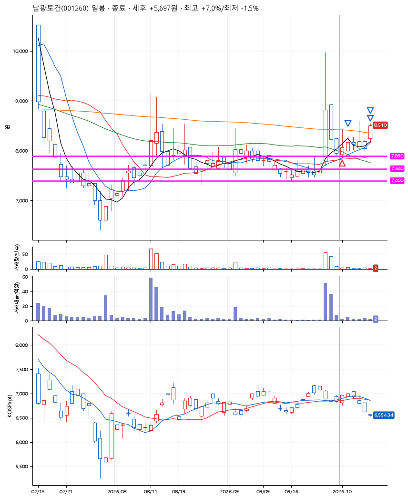
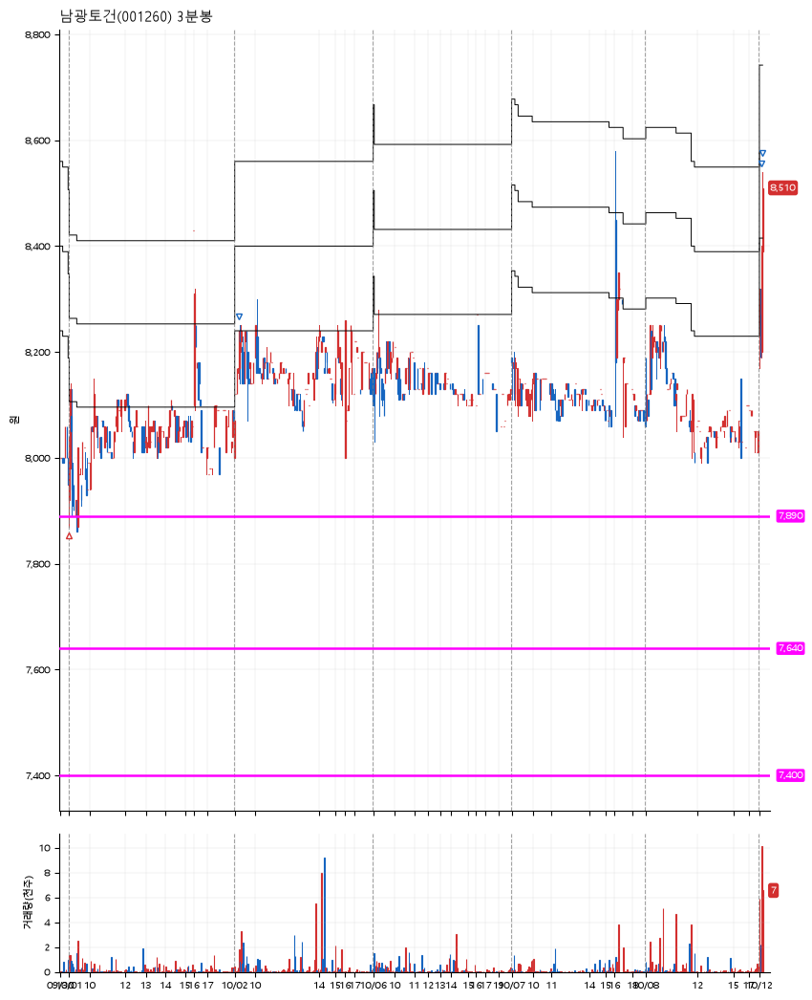

# 남광토건(001260) · 2026-10-12

**1차 매수 → 3% 익절 → 5% 익절 → 7% 익절**

진입 2026-10-01 09:00 (D+3) · 청산 2026-10-12 09:09 (D+8) · 보유 6일차

| | |
|---|---|
| 결과 | 익절 |
| 평단 / 수량 | 7,980원 · 17주 |
| 투입 | 135,660원 |
| 세후 손익 | +5,697원 (+4.20%) |
| 최고 / 최저 | +7.0% / -1.5% |
| 당일 등락 | -1.45% |
| 보유기간 | 12일차 |

## 3선

| | |
|---|---|
| 1선 | 7,890원 |
| 2선 | 7,640원 |
| 3선 | 7,400원 |

기준봉 2026-09-28 (D+8)

`#KOSPI하락횡보장` `#시장을이기는종목`

## 차트

**일봉**

**3분봉**

## 체결

| 시각 | 구분 | 수량 | 판정가 | 체결가 | 오차 |
|---|---|---|---|---|---|
| 09:00 | 매수 | 17주 | 7,880 | 7,980 | +1.27% |
| 09:14 | 매도 | 6주 | 8,220 | 8,220 | +0.00% |
| 09:07 | 매도 | 9주 | 8,380 | 8,370 | -0.12% |
| 09:09 | 매도 | 2주 | 8,540 | 8,515 | -0.29% |

## 잘한 점

명확한 3선 설정. 예상대로의 시나리오.

## 아쉬운 점

1차 매수 이후 익절, 청산까지 꽤 오랜시간이 흘렀다. 조금 더 이른 대응은 할 수 없었는지?
