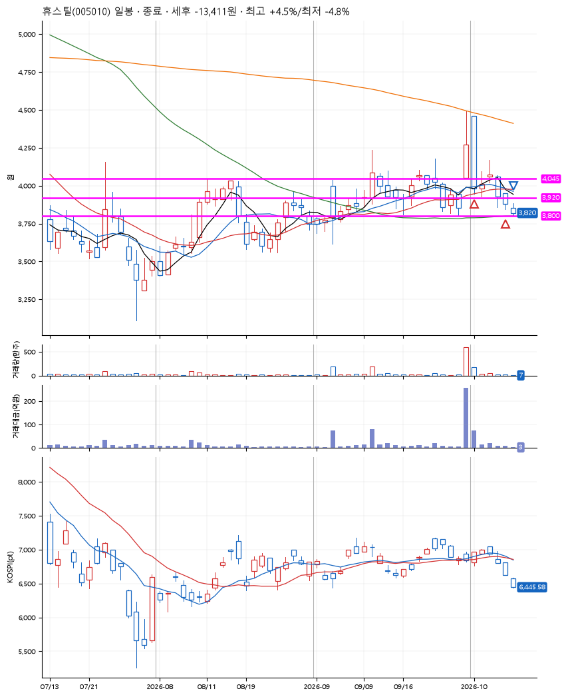
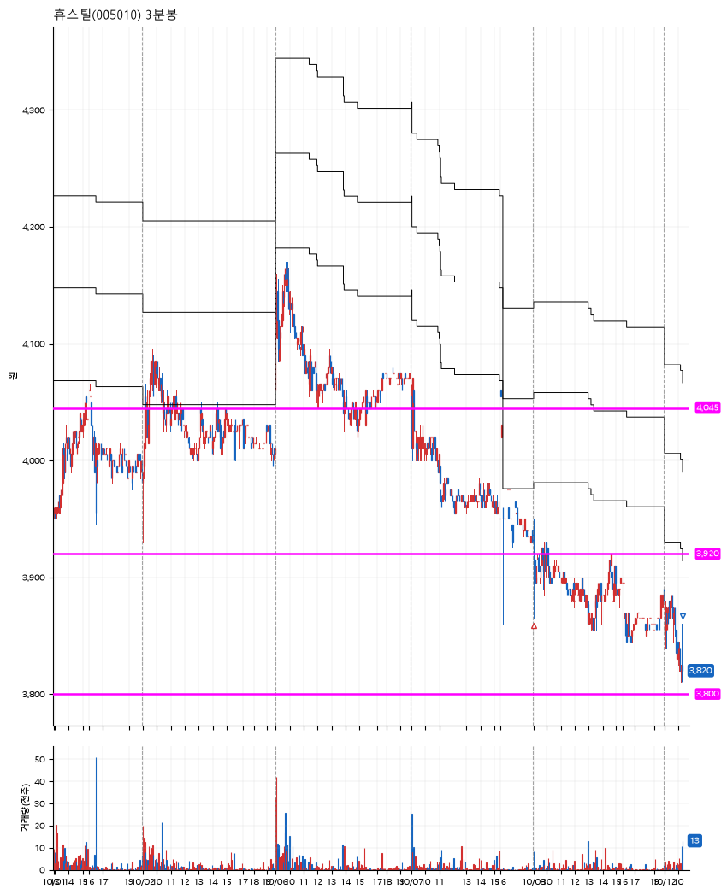

# 휴스틸(005010) · 2026-10-12

**2차 매수 → 손절**

진입 2026-10-01 09:11 (D+1) · 청산 2026-10-12 10:20 (D+6) · 보유 6일차

| | |
|---|---|
| 결과 | 손절 |
| 평단 / 수량 | 3,991원 · 67주 |
| 투입 | 267,425원 |
| 세후 손익 | -13,411원 (-5.01%) |
| 최고 / 최저 | +4.5% / -4.8% |
| 당일 등락 | -2.33% |
| 보유기간 | 12일차 |

## 3선

| | |
|---|---|
| 1선 | 4,045원 |
| 2선 | 3,920원 |
| 3선 | 3,800원 |

기준봉 2026-09-30 (D+6)

`#KOSPI하락횡보장` `#시장을이기는종목` `#테마주`

> 알래스카 LNG

## 차트

**일봉**

**3분봉**

## 체결

| 시각 | 구분 | 수량 | 판정가 | 체결가 | 오차 |
|---|---|---|---|---|---|
| 09:11 | 매수 | 33주 | 4,045 | 4,065 | +0.49% |
| 09:00 | 매수 | 34주 | 3,920 | 3,920 | +0.00% |
| 10:20 | 매도 | 67주 | 3,800 | 3,800 | +0.00% |

## 잘한 점

.

## 아쉬운 점

3선의 근거인 박스를 조금은 짧게 보거나 보수적으로 잡지 않았던 느낌.
