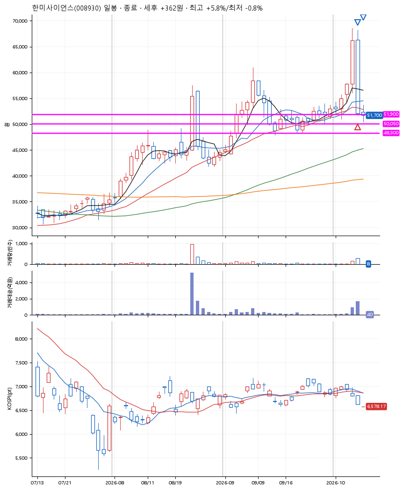
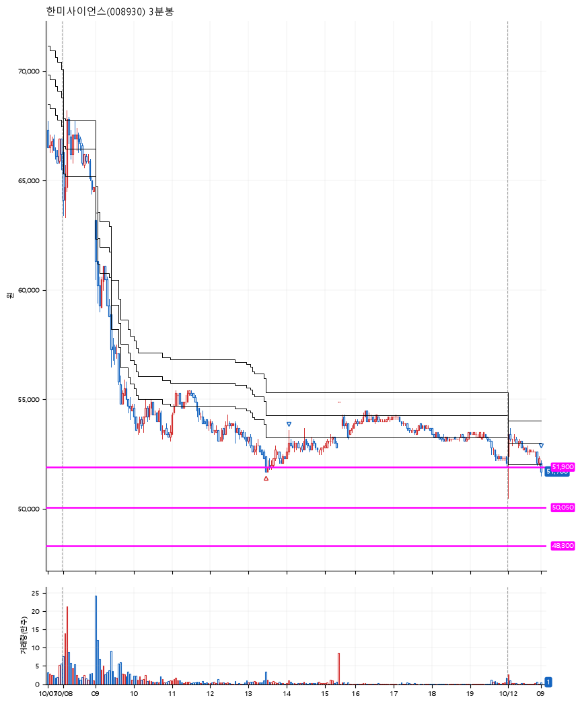

# 한미사이언스(008930) · 2026-10-12

**1차 매수 → 3% 익절 → 본절 이탈**

진입 2026-10-08 13:29 (D+1) · 청산 2026-10-12 09:00 (D+2) · 보유 2일차

| | |
|---|---|
| 결과 | 익절 |
| 평단 / 수량 | 51,900원 · 2주 |
| 투입 | 103,800원 |
| 세후 손익 | +362원 (+0.35%) |
| 최고 / 최저 | +5.8% / -0.8% |
| 당일 등락 | -0.96% |
| 보유기간 | 5일차 |

## 3선

| | |
|---|---|
| 1선 | 51,900원 |
| 2선 | 50,050원 |
| 3선 | 48,300원 |

기준봉 2026-10-07 (D+2)

`#KOSPI하락횡보장` `#시장을이기는종목` `#테마주`

> 비만 신약 기술수출

## 차트

**일봉**

**3분봉**

## 체결

| 시각 | 구분 | 수량 | 판정가 | 체결가 | 오차 |
|---|---|---|---|---|---|
| 13:29 | 매수 | 2주 | 51,900 | 51,900 | +0.00% |
| 14:05 | 매도 | 1주 | 53,500 | 52,800 | -1.31% |
| 09:00 | 매도 | 1주 | 51,900 | 51,600 | -0.58% |

## 잘한 점

_(미작성)_

## 아쉬운 점

_(미작성)_
