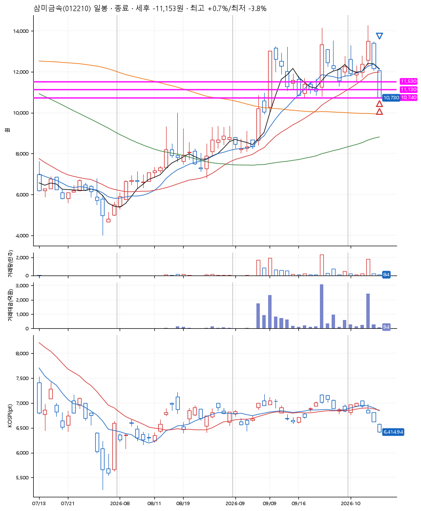
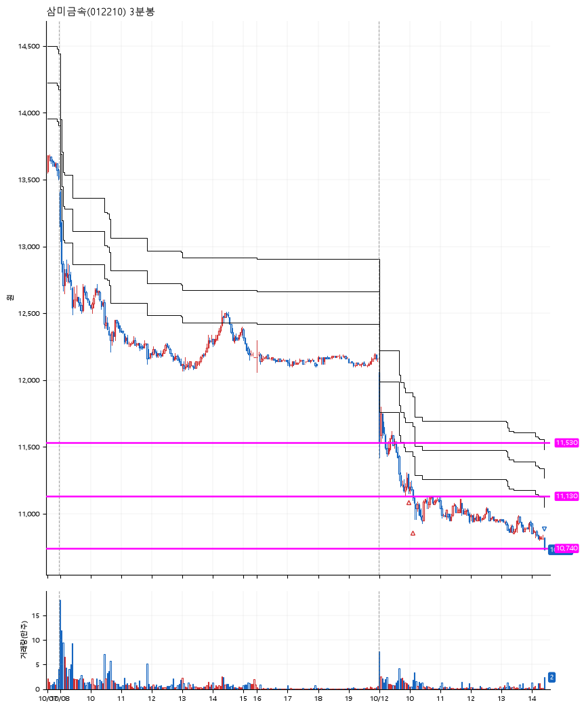

# 삼미금속(012210) · 2026-10-12

**2차 매수 → 손절**

진입 2026-10-12 09:58 (D+2) · 청산 2026-10-12 14:26 (D+2) · 보유 4시간 28분

| | |
|---|---|
| 결과 | 손절 |
| 평단 / 수량 | 11,170원 · 24주 |
| 투입 | 268,080원 |
| 세후 손익 | -11,153원 (-4.16%) |
| 최고 / 최저 | +0.7% / -3.8% |
| 당일 등락 | -14.18% |
| 보유기간 | 4시간 28분 |

## 3선

| | |
|---|---|
| 1선 | 11,530원 |
| 2선 | 11,130원 |
| 3선 | 10,740원 |

기준봉 2026-10-07 (D+2)

`#KOSPI하락횡보장` `#시장을이기는종목` `#테마주`

> 원자력발전 조선기자재

## 차트

**일봉**

**3분봉**

## 체결

| 시각 | 구분 | 수량 | 판정가 | 체결가 | 오차 |
|---|---|---|---|---|---|
| 09:58 | 매수 | 12주 | 11,210 | 11,210 | +0.00% |
| 10:08 | 매수 | 12주 | 11,130 | 11,130 | +0.00% |
| 14:26 | 매도 | 24주 | 10,740 | 10,730 | -0.09% |

## 잘한 점

_(미작성)_

## 아쉬운 점

_(미작성)_
