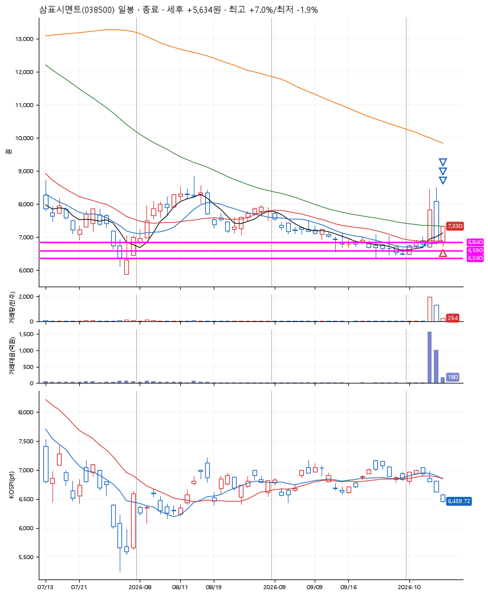
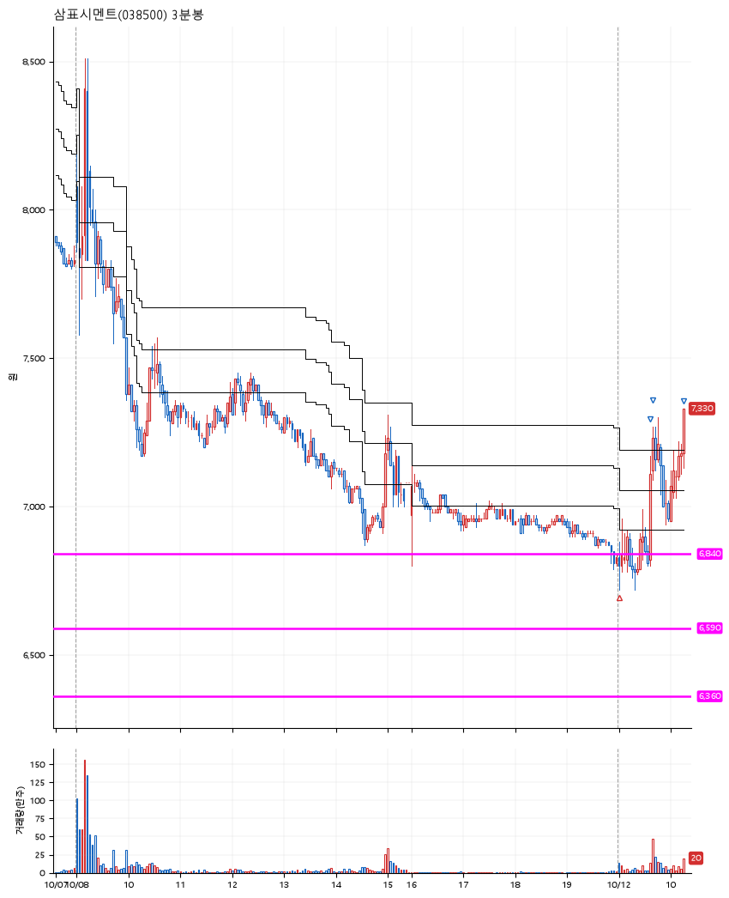

# 삼표시멘트(038500) · 2026-10-12

**1차 매수 → 3% 익절 → 5% 익절 → 7% 익절**

진입 2026-10-12 09:00 (D+2) · 청산 2026-10-12 10:17 (D+2) · 보유 1시간 16분

| | |
|---|---|
| 결과 | 익절 |
| 평단 / 수량 | 6,850원 · 20주 |
| 투입 | 137,000원 |
| 세후 손익 | +5,634원 (+4.11%) |
| 최고 / 최저 | +7.0% / -1.9% |
| 당일 등락 | +8.49% |
| 보유기간 | 1시간 16분 |

## 3선

| | |
|---|---|
| 1선 | 6,840원 |
| 2선 | 6,590원 |
| 3선 | 6,360원 |

기준봉 2026-10-07 (D+2)

`#KOSPI하락횡보장` `#시장을이기는종목` `#테마주`

> 부동산 자산주

## 차트

**일봉**

**3분봉**

## 체결

| 시각 | 구분 | 수량 | 판정가 | 체결가 | 오차 |
|---|---|---|---|---|---|
| 09:00 | 매수 | 20주 | 6,830 | 6,850 | +0.29% |
| 09:38 | 매도 | 8주 | 7,060 | 7,040 | -0.28% |
| 09:40 | 매도 | 10주 | 7,200 | 7,200 | +0.00% |
| 10:17 | 매도 | 2주 | 7,330 | 7,320 | -0.14% |

## 잘한 점

_(미작성)_

## 아쉬운 점

_(미작성)_
