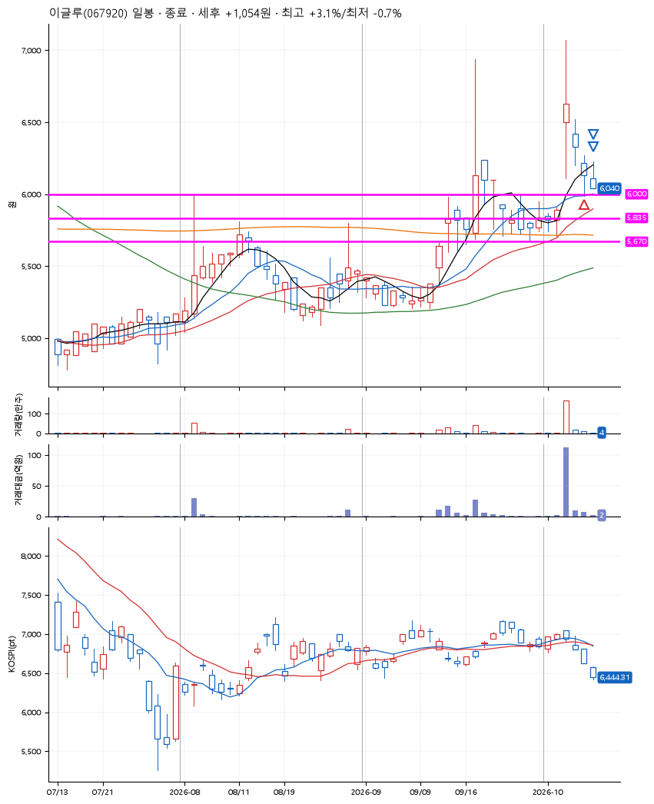
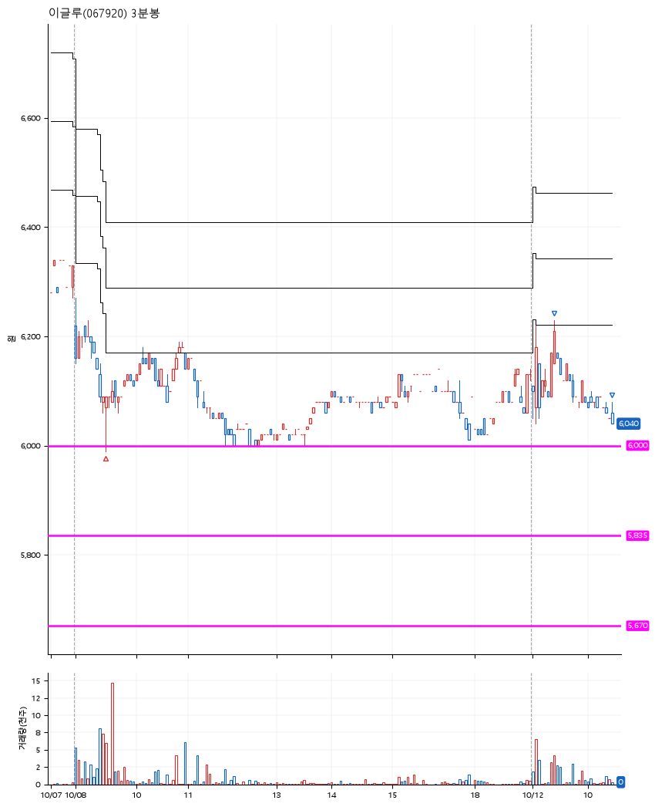

# 이글루(067920) · 2026-10-12

**1차 매수 → 3% 익절 → 본절 이탈**

진입 2026-10-08 09:30 (D+2) · 청산 2026-10-12 10:28 (D+3) · 보유 2일차

| | |
|---|---|
| 결과 | 익절 |
| 평단 / 수량 | 6,040원 · 22주 |
| 투입 | 132,880원 |
| 세후 손익 | +1,054원 (+0.79%) |
| 최고 / 최저 | +3.1% / -0.7% |
| 당일 등락 | -2.29% |
| 보유기간 | 5일차 |

## 3선

| | |
|---|---|
| 1선 | 6,000원 |
| 2선 | 5,835원 |
| 3선 | 5,670원 |

기준봉 2026-10-06 (D+3)

`#KOSPI하락횡보장` `#시장을이기는종목` `#테마주`

> 보안주

## 차트

**일봉**

**3분봉**

## 체결

| 시각 | 구분 | 수량 | 판정가 | 체결가 | 오차 |
|---|---|---|---|---|---|
| 09:30 | 매수 | 22주 | 6,000 | 6,040 | +0.67% |
| 09:23 | 매도 | 8주 | 6,230 | 6,210 | -0.32% |
| 10:28 | 매도 | 14주 | 6,040 | 6,040 | +0.00% |

## 잘한 점

3선의 근거. 앞쪽의 빼족빼족과 기준봉 직전 박스 형성. 기준봉의 갭을 채우는 첫 번째 하락 이후 수익.

## 아쉬운 점

.
