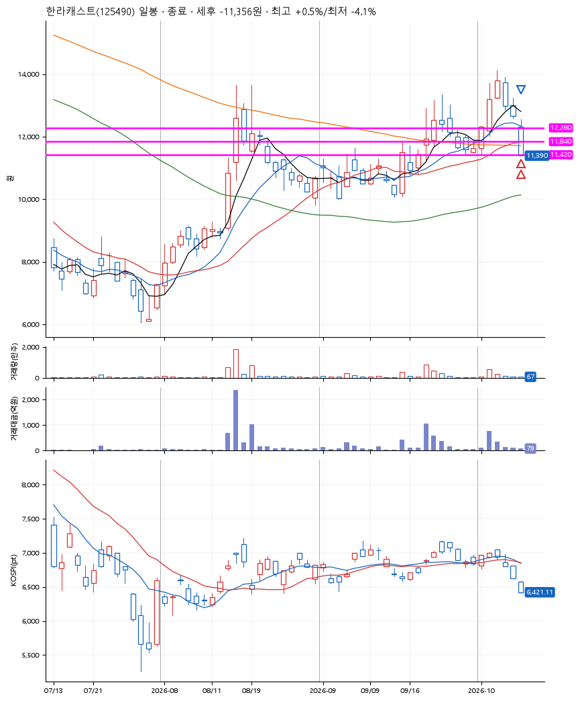
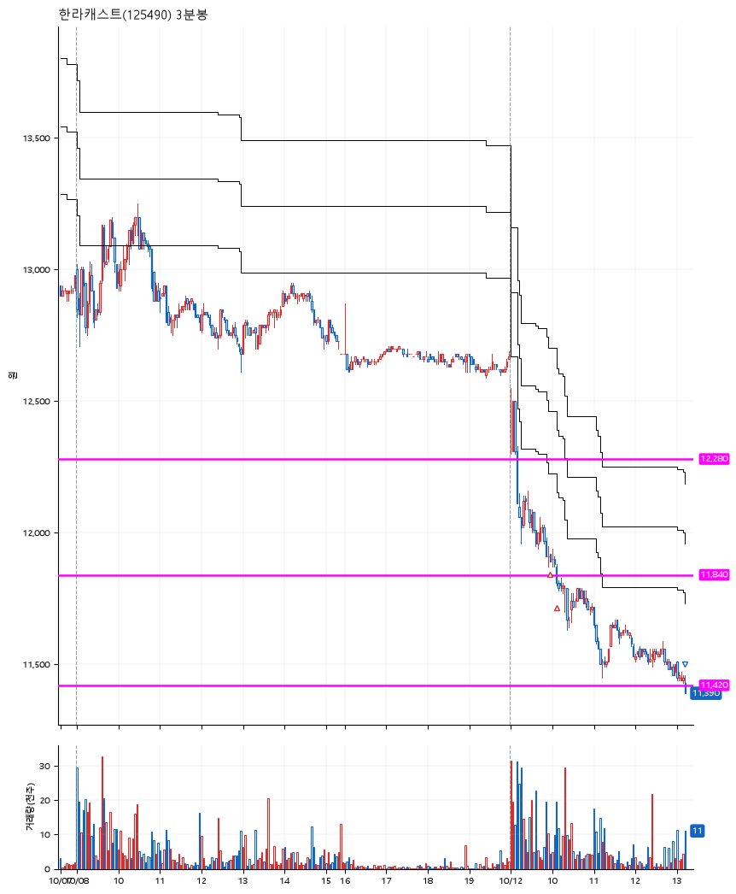

# 한라캐스트(125490) · 2026-10-12

**2차 매수 → 손절**

진입 2026-10-12 09:58 (D+4) · 청산 2026-10-12 13:14 (D+4) · 보유 3시간 16분

| | |
|---|---|
| 결과 | 손절 |
| 평단 / 수량 | 11,880원 · 22주 |
| 투입 | 261,360원 |
| 세후 손익 | -11,356원 (-4.34%) |
| 최고 / 최저 | +0.5% / -4.1% |
| 당일 등락 | -9.74% |
| 보유기간 | 3시간 16분 |

## 3선

| | |
|---|---|
| 1선 | 12,280원 |
| 2선 | 11,840원 |
| 3선 | 11,420원 |

기준봉 2026-10-02 (D+4)

`#KOSPI하락횡보장` `#시장을이기는종목` `#테마주`

> 로봇 피지컬AI 휴머노이드 로봇

## 차트

**일봉**

**3분봉**

## 체결

| 시각 | 구분 | 수량 | 판정가 | 체결가 | 오차 |
|---|---|---|---|---|---|
| 09:58 | 매수 | 11주 | 11,910 | 11,910 | +0.00% |
| 10:07 | 매수 | 11주 | 11,840 | 11,850 | +0.08% |
| 13:14 | 매도 | 22주 | 11,420 | 11,390 | -0.26% |

## 잘한 점

.

## 아쉬운 점

기준봉 직전 애매했던 박스 형성. 조금 더 넓게 보고 3선을 설정하는 것 필요.
