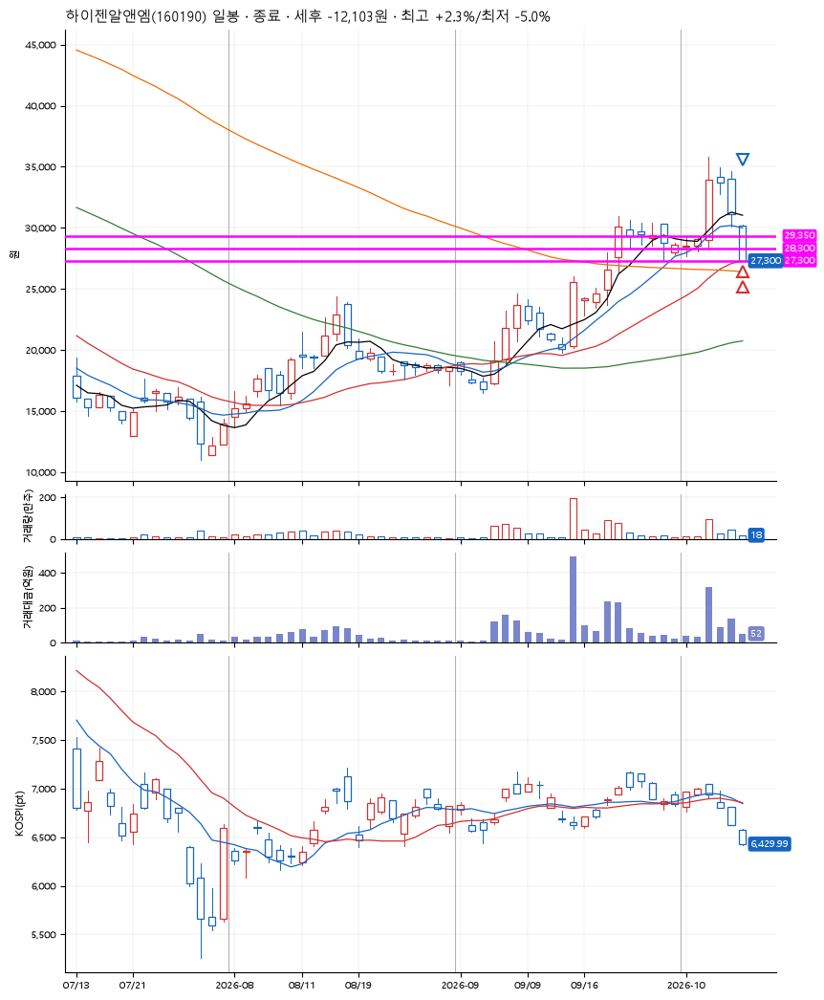
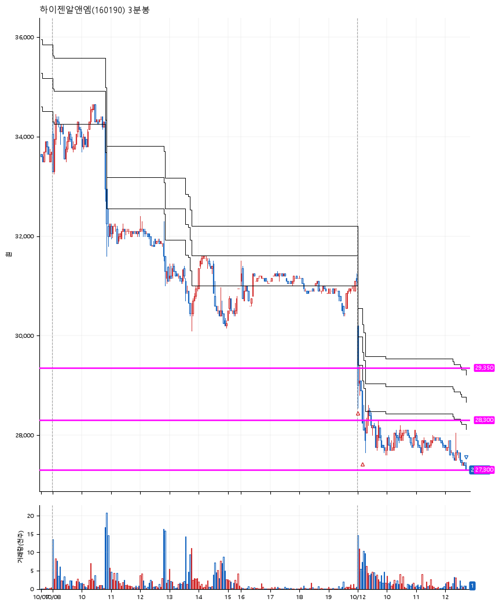

# 하이젠알앤엠(160190) · 2026-10-12

**2차 매수 → 손절**

진입 2026-10-12 09:00 (D+3) · 청산 2026-10-12 12:44 (D+3) · 보유 3시간 43분

| | |
|---|---|
| 결과 | 손절 |
| 평단 / 수량 | 28,750원 · 8주 |
| 투입 | 230,000원 |
| 세후 손익 | -12,103원 (-5.26%) |
| 최고 / 최저 | +2.3% / -5.0% |
| 당일 등락 | -10.60% |
| 보유기간 | 3시간 43분 |

## 3선

| | |
|---|---|
| 1선 | 29,350원 |
| 2선 | 28,300원 |
| 3선 | 27,300원 |

기준봉 2026-10-06 (D+3)

`#KOSPI하락횡보장` `#시장을이기는종목` `#테마주`

> 로봇 전기차

## 차트

**일봉**

**3분봉**

## 체결

| 시각 | 구분 | 수량 | 판정가 | 체결가 | 오차 |
|---|---|---|---|---|---|
| 09:00 | 매수 | 4주 | 29,200 | 29,150 | -0.17% |
| 09:11 | 매수 | 4주 | 28,300 | 28,350 | +0.18% |
| 12:44 | 매도 | 8주 | 27,300 | 27,300 | +0.00% |

## 잘한 점

_(미작성)_

## 아쉬운 점

_(미작성)_
