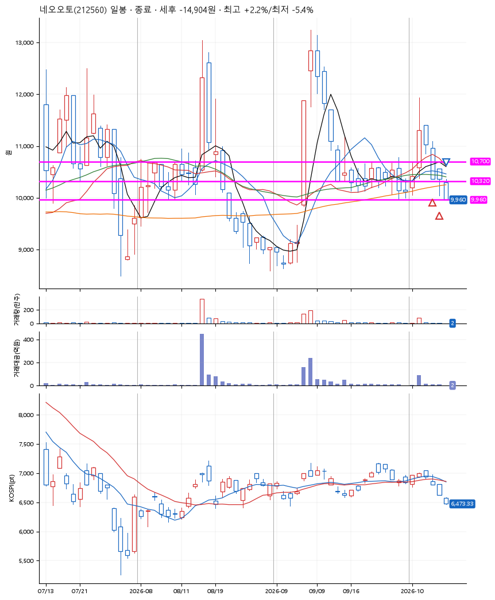
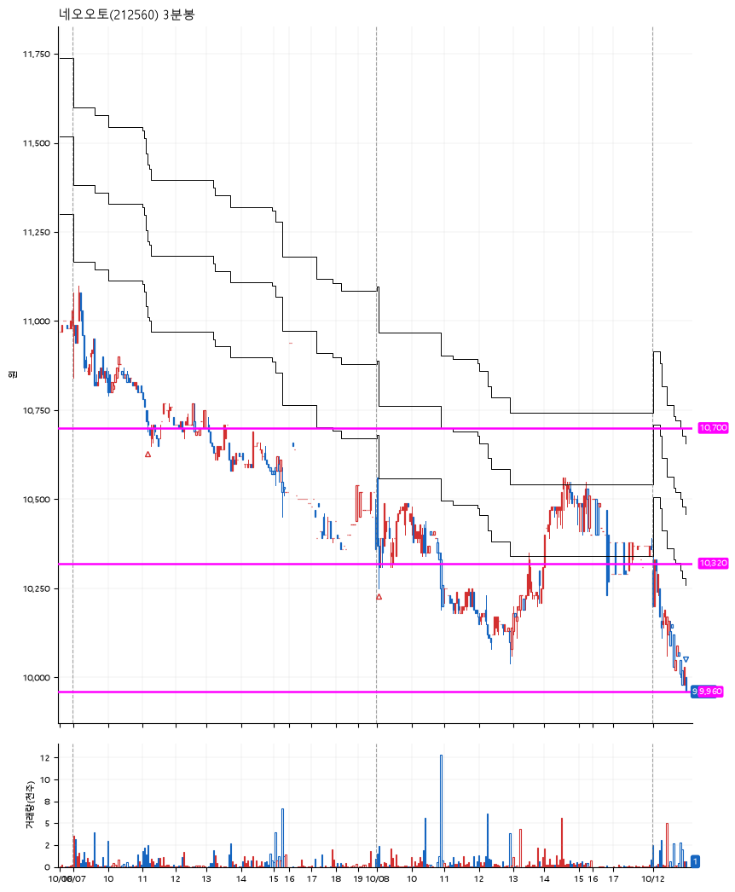

# 네오오토(212560) · 2026-10-12

**2차 매수 → 손절**

진입 2026-10-07 11:10 (D+2) · 청산 2026-10-12 09:58 (D+4) · 보유 3일차

| | |
|---|---|
| 결과 | 손절 |
| 평단 / 수량 | 10,533원 · 25주 |
| 투입 | 263,330원 |
| 세후 손익 | -14,904원 (-5.66%) |
| 최고 / 최저 | +2.2% / -5.4% |
| 당일 등락 | -5.53% |
| 보유기간 | 6일차 |

## 3선

| | |
|---|---|
| 1선 | 10,700원 |
| 2선 | 10,320원 |
| 3선 | 9,960원 |

기준봉 2026-10-02 (D+4)

`#KOSPI하락횡보장` `#시장을이기는종목`

> CART

## 차트

**일봉**

**3분봉**

## 체결

| 시각 | 구분 | 수량 | 판정가 | 체결가 | 오차 |
|---|---|---|---|---|---|
| 11:10 | 매수 | 12주 | 10,700 | 10,710 | +0.09% |
| 09:03 | 매수 | 13주 | 10,300 | 10,370 | +0.68% |
| 09:58 | 매도 | 25주 | 9,960 | 9,960 | +0.00% |

## 잘한 점

.

## 아쉬운 점

3선의 근거가 짧은 박스가 있었다고 생각했지만, 주가의 움직임이 굉장히 큰 종목이라 기준봉 이후에도 큰 움직임이 나올 확률이 있을거라 생각하면 좋을 듯 하다. 그리고 박스가 전체적으로 주가의 아래쪽이 아닌 중간 부분에 있었다는 것도 조금은 불안한 부분.
