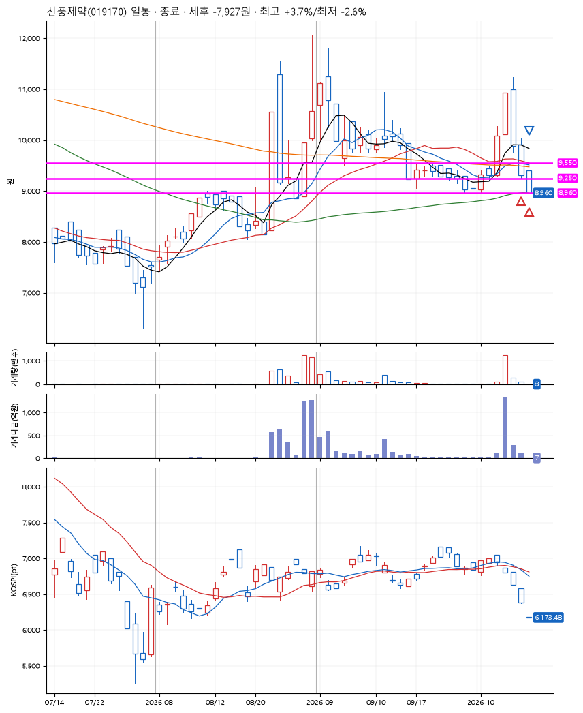
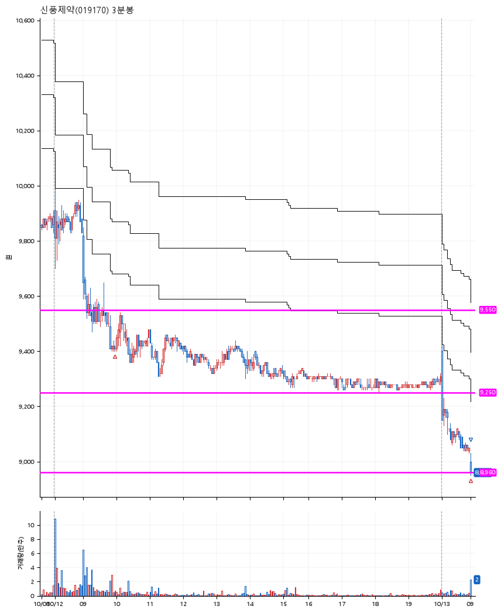

# 신풍제약(019170) · 2026-10-13

**2차 매수 → 손절**

진입 2026-10-12 09:58 (D+2) · 청산 2026-10-13 09:01 (D+3) · 보유 2일차

| | |
|---|---|
| 결과 | 손절 |
| 평단 / 수량 | 9,203원 · 29주 |
| 투입 | 266,880원 |
| 세후 손익 | -7,927원 (-2.97%) |
| 최고 / 최저 | +3.7% / -2.6% |
| 당일 등락 | +6.22% |
| 보유기간 | 2일차 |

## 3선

| | |
|---|---|
| 1선 | 9,550원 |
| 2선 | 9,250원 |
| 3선 | 8,960원 |

기준봉 2026-10-07 (D+3)

`#KOSPI하락횡보장` `#시장을이기는종목` `#테마주`

> 제약 바이오

## 차트

**일봉**

**3분봉**

## 체결

| 시각 | 구분 | 수량 | 판정가 | 체결가 | 오차 |
|---|---|---|---|---|---|
| 09:58 | 매수 | 14주 | 9,410 | 9,420 | +0.11% |
| 09:00 | 매수 | 15주 | 9,000 | 9,000 | +0.00% |
| 09:01 | 매도 | 29주 | 8,960 | 8,950 | -0.11% |

## 잘한 점

.

## 아쉬운 점

장마감 차트를 보면 3선을 딱 찍고 회복하는 모습. 조금은 더 보수적으로 매매하려고 노력이 필요해보임.
