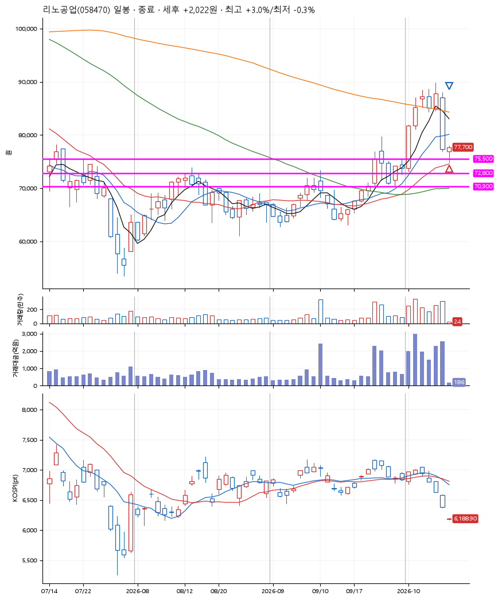
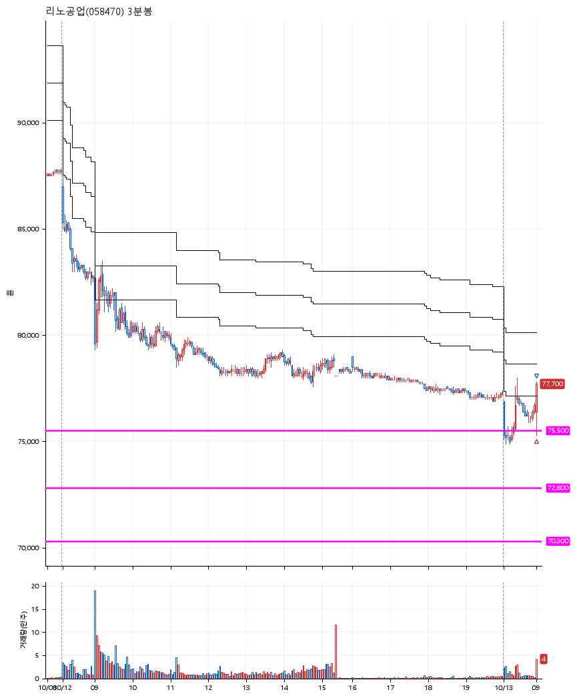

# 리노공업(058470) · 2026-10-13

**1차 매수 → 3% 익절**

진입 2026-10-13 09:01 (D+6) · 청산 2026-10-13 09:02 (D+6) · 보유 1분

| | |
|---|---|
| 결과 | 익절 |
| 평단 / 수량 | 75,500원 · 1주 |
| 투입 | 75,500원 |
| 세후 손익 | +2,022원 (+2.68%) |
| 최고 / 최저 | +3.0% / -0.3% |
| 당일 등락 | +4.19% |
| 보유기간 | 1분 |

## 3선

| | |
|---|---|
| 1선 | 75,500원 |
| 2선 | 72,800원 |
| 3선 | 70,300원 |

기준봉 2026-10-01 (D+6)

`#KOSPI하락횡보장` `#시장을이기는종목` `#테마주` `#섹터주`

> 반도체

## 차트

**일봉**

**3분봉**

## 체결

| 시각 | 구분 | 수량 | 판정가 | 체결가 | 오차 |
|---|---|---|---|---|---|
| 09:01 | 매수 | 1주 | 75,500 | 75,500 | +0.00% |
| 09:02 | 매도 | 1주 | 77,800 | 77,700 | -0.13% |

## 잘한 점

1주 매수하여 3%익절 때 청산. 만약 2주 이상 매수하였다면 조금은 수익을 더 먹었을 듯.

## 아쉬운 점

.
