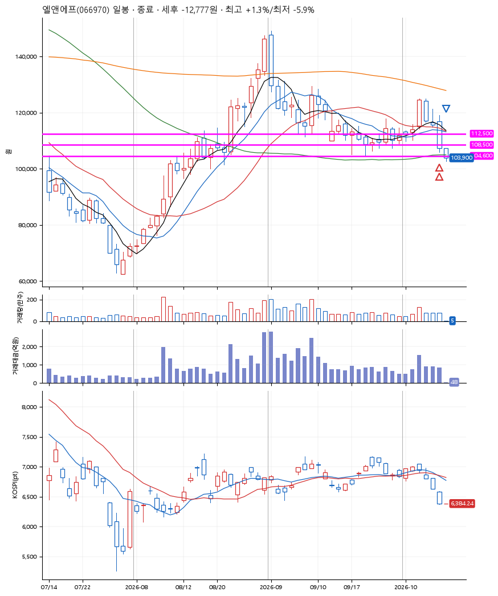
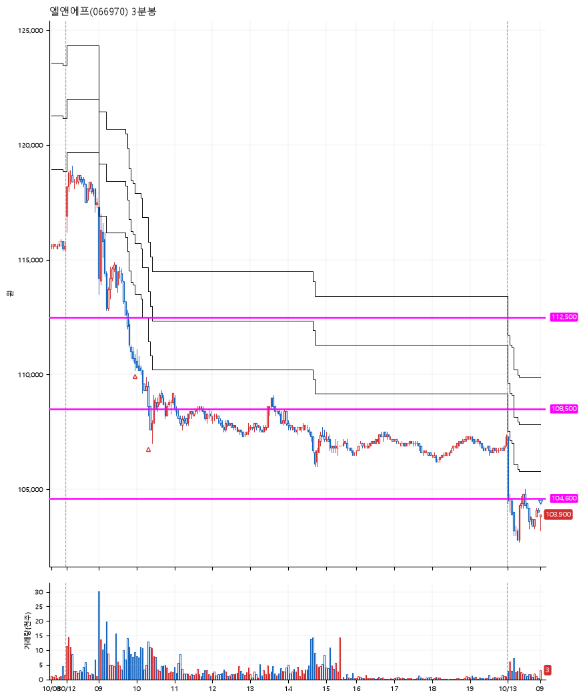

# 엘앤에프(066970) · 2026-10-13

**2차 매수 → 손절**

진입 2026-10-12 09:58 (D+3) · 청산 2026-10-13 09:00 (D+4) · 보유 2일차

| | |
|---|---|
| 결과 | 손절 |
| 평단 / 수량 | 109,650원 · 2주 |
| 투입 | 219,300원 |
| 세후 손익 | -12,777원 (-5.83%) |
| 최고 / 최저 | +1.3% / -5.9% |
| 당일 등락 | +5.30% |
| 보유기간 | 2일차 |

## 3선

| | |
|---|---|
| 1선 | 112,500원 |
| 2선 | 108,500원 |
| 3선 | 104,600원 |

기준봉 2026-10-06 (D+4)

`#KOSPI하락횡보장` `#시장을이기는종목` `#테마주`

> 2차전지

## 차트

**일봉**

**3분봉**

## 체결

| 시각 | 구분 | 수량 | 판정가 | 체결가 | 오차 |
|---|---|---|---|---|---|
| 09:58 | 매수 | 1주 | 110,600 | 110,700 | +0.09% |
| 10:19 | 매수 | 1주 | 108,500 | 108,600 | +0.09% |
| 09:00 | 매도 | 2주 | 103,800 | 103,500 | -0.29% |

## 잘한 점

_(미작성)_

## 아쉬운 점

_(미작성)_
