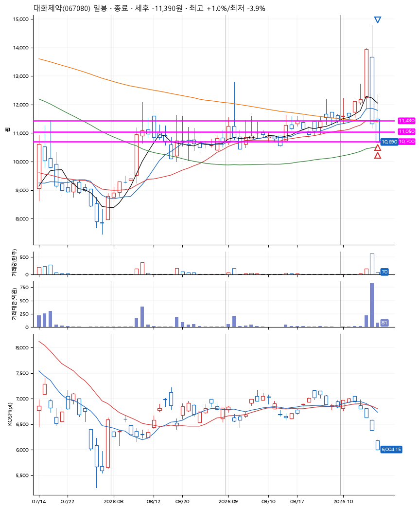
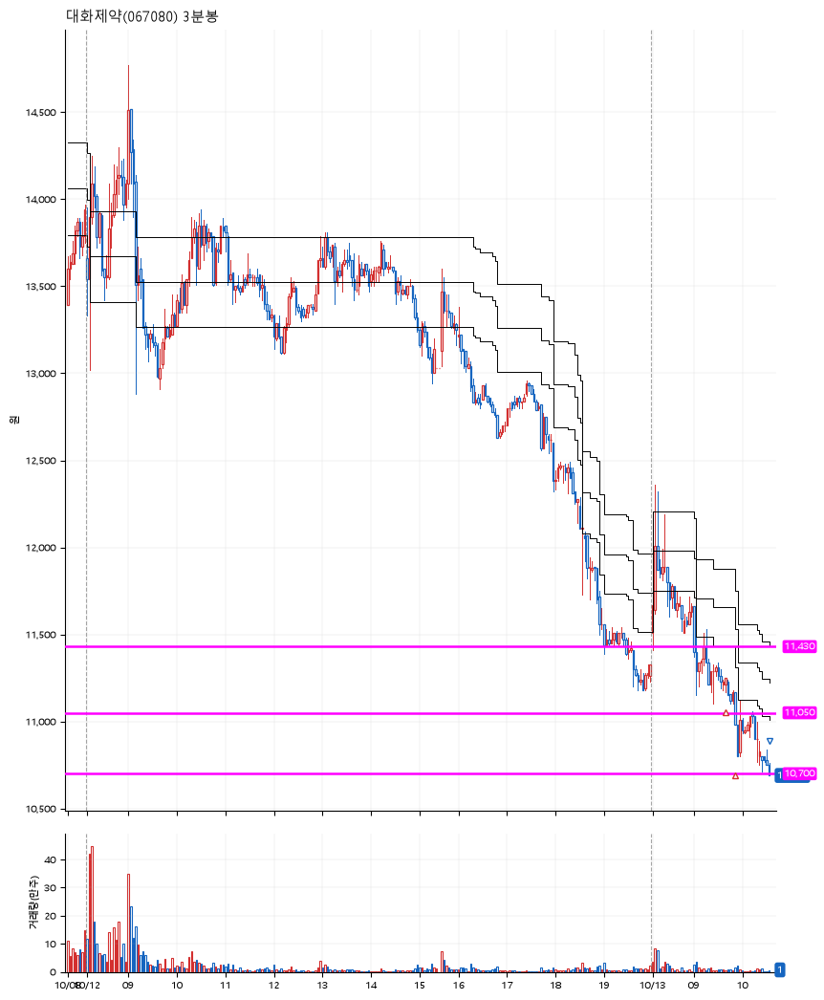

# 대화제약(067080) · 2026-10-13

**2차 매수 → 손절**

진입 2026-10-13 09:41 (D+2) · 청산 2026-10-13 10:34 (D+2) · 보유 53분

| | |
|---|---|
| 결과 | 손절 |
| 평단 / 수량 | 11,140원 · 24주 |
| 투입 | 267,360원 |
| 세후 손익 | -11,390원 (-4.26%) |
| 최고 / 최저 | +1.0% / -3.9% |
| 당일 등락 | -7.38% |
| 보유기간 | 53분 |

## 3선

| | |
|---|---|
| 1선 | 11,430원 |
| 2선 | 11,050원 |
| 3선 | 10,700원 |

기준봉 2026-10-08 (D+2)

`#KOSPI하락횡보장` `#시장을이기는종목`

## 차트

**일봉**

**3분봉**

## 체결

| 시각 | 구분 | 수량 | 판정가 | 체결가 | 오차 |
|---|---|---|---|---|---|
| 09:41 | 매수 | 12주 | 11,200 | 11,210 | +0.09% |
| 09:53 | 매수 | 12주 | 11,050 | 11,070 | +0.18% |
| 10:34 | 매도 | 24주 | 10,700 | 10,690 | -0.09% |

## 잘한 점

_(미작성)_

## 아쉬운 점

_(미작성)_
