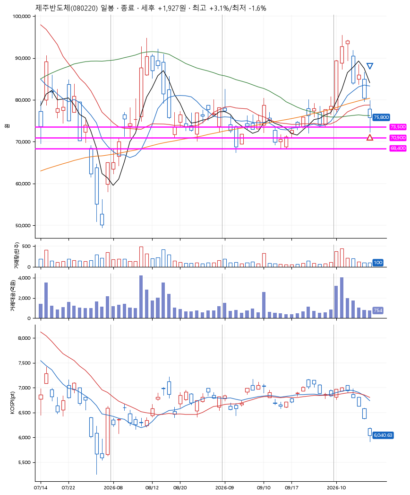
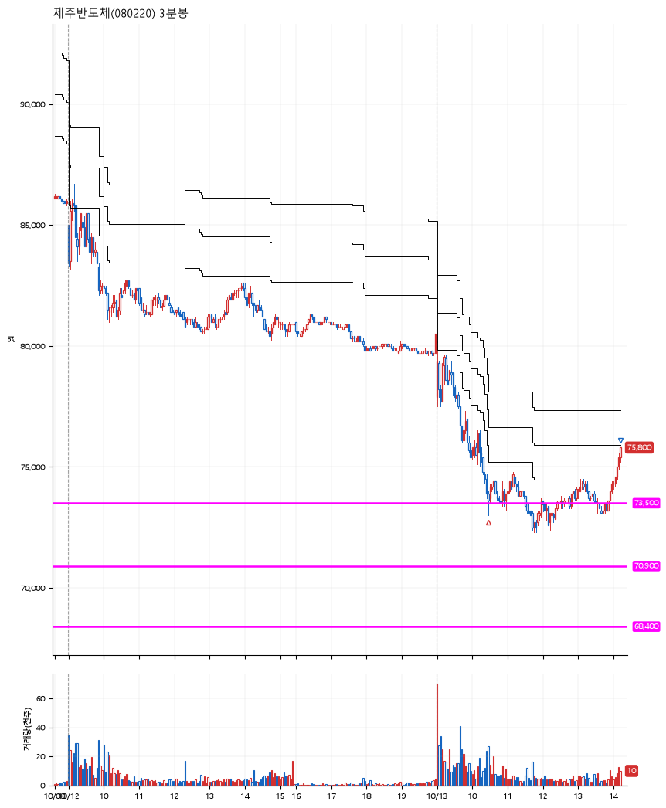

# 제주반도체(080220) · 2026-10-13

**1차 매수 → 3% 익절**

진입 2026-10-13 10:28 (D+6) · 청산 2026-10-13 14:14 (D+6) · 보유 3시간 46분

| | |
|---|---|
| 결과 | 익절 |
| 평단 / 수량 | 73,500원 · 1주 |
| 투입 | 73,500원 |
| 세후 손익 | +1,927원 (+2.62%) |
| 최고 / 최저 | +3.1% / -1.6% |
| 당일 등락 | -3.85% |
| 보유기간 | 3시간 46분 |

## 3선

| | |
|---|---|
| 1선 | 73,500원 |
| 2선 | 70,900원 |
| 3선 | 68,400원 |

기준봉 2026-10-01 (D+6)

`#KOSPI하락횡보장` `#시장을이기는종목` `#테마주` `#섹터주`

> 반도체

## 차트

**일봉**

**3분봉**

## 체결

| 시각 | 구분 | 수량 | 판정가 | 체결가 | 오차 |
|---|---|---|---|---|---|
| 10:28 | 매수 | 1주 | 73,500 | 73,500 | +0.00% |
| 14:14 | 매도 | 1주 | 75,800 | 75,600 | -0.26% |

## 잘한 점

_(미작성)_

## 아쉬운 점

_(미작성)_
