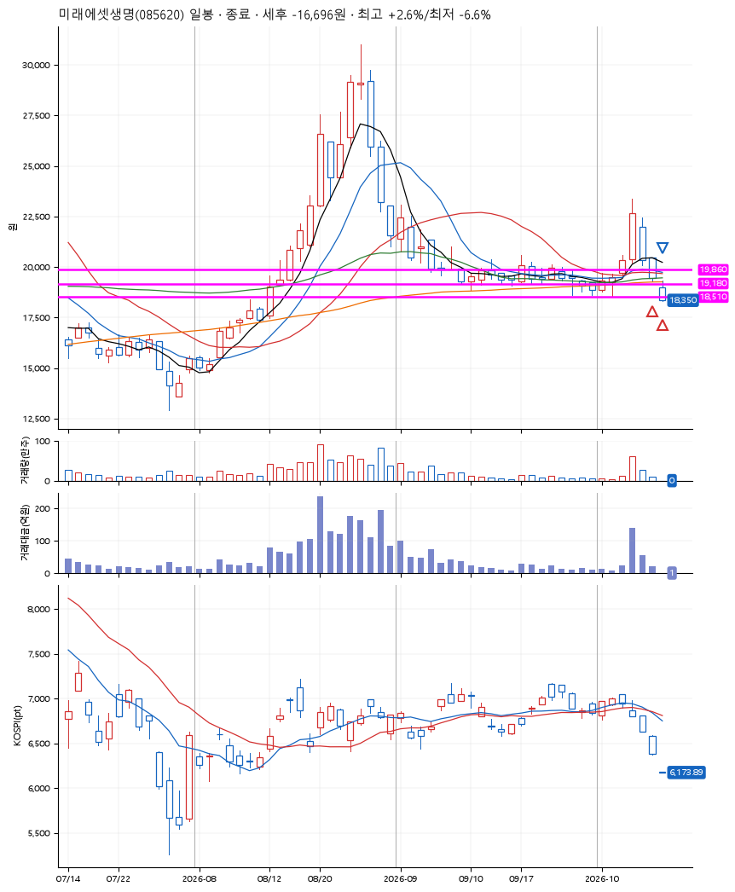
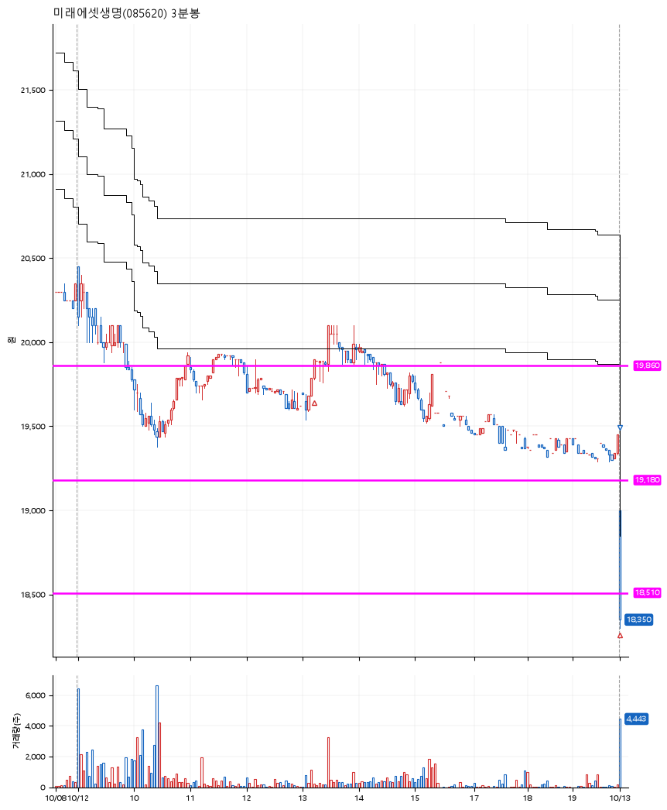

# 미래에셋생명(085620) · 2026-10-13

**2차 매수 → 손절**

진입 2026-10-12 13:14 (D+2) · 청산 2026-10-13 09:00 (D+3) · 보유 2일차

| | |
|---|---|
| 결과 | 손절 |
| 평단 / 수량 | 19,593원 · 13주 |
| 투입 | 254,710원 |
| 세후 손익 | -16,696원 (-6.55%) |
| 최고 / 최저 | +2.6% / -6.6% |
| 당일 등락 | -2.58% |
| 보유기간 | 2일차 |

## 3선

| | |
|---|---|
| 1선 | 19,860원 |
| 2선 | 19,180원 |
| 3선 | 18,510원 |

기준봉 2026-10-07 (D+3)

`#KOSPI하락횡보장` `#시장을이기는종목`

## 차트

**일봉**

**3분봉**

## 체결

| 시각 | 구분 | 수량 | 판정가 | 체결가 | 오차 |
|---|---|---|---|---|---|
| 13:14 | 매수 | 6주 | 19,790 | 19,900 | +0.56% |
| 09:00 | 매수 | 7주 | 19,000 | 19,330 | +1.74% |
| 09:00 | 매도 | 13주 | 18,510 | 18,351 | -0.86% |

## 잘한 점

_(미작성)_

## 아쉬운 점

_(미작성)_
