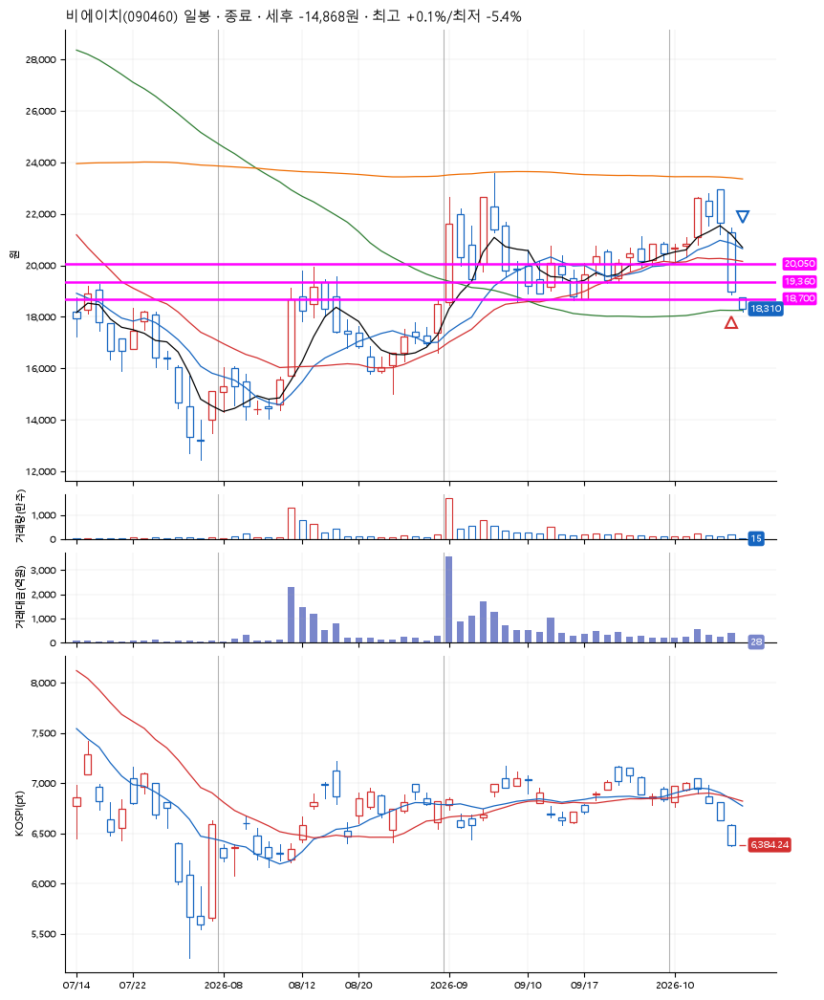
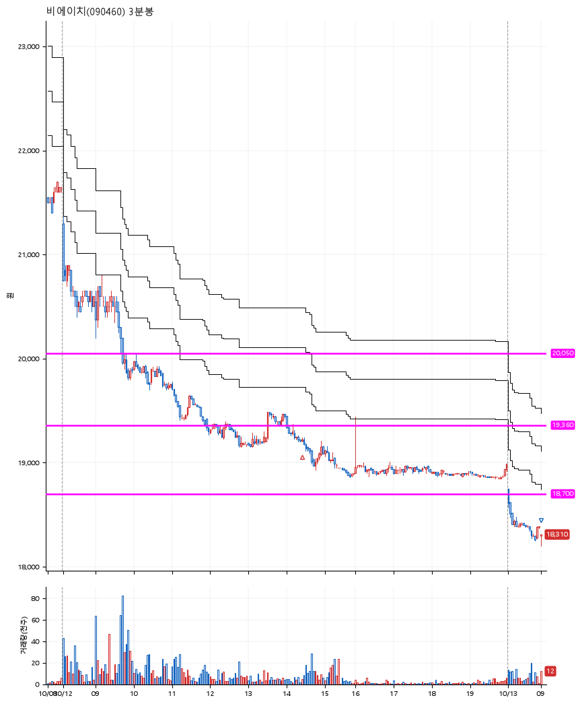

# 비에이치(090460) · 2026-10-13

**2차 매수 → 손절**

진입 2026-10-12 14:26 (D+3) · 청산 2026-10-13 09:00 (D+4) · 보유 2일차

| | |
|---|---|
| 결과 | 손절 |
| 평단 / 수량 | 19,230원 · 14주 |
| 투입 | 269,220원 |
| 세후 손익 | -14,868원 (-5.52%) |
| 최고 / 최저 | +0.1% / -5.4% |
| 당일 등락 | +2.13% |
| 보유기간 | 2일차 |

## 3선

| | |
|---|---|
| 1선 | 20,050원 |
| 2선 | 19,360원 |
| 3선 | 18,700원 |

기준봉 2026-10-06 (D+4)

`#KOSPI하락횡보장` `#시장을이기는종목` `#테마주`

> 로봇 휴머노이드

## 차트

**일봉**

**3분봉**

## 체결

| 시각 | 구분 | 수량 | 판정가 | 체결가 | 오차 |
|---|---|---|---|---|---|
| 14:26 | 매수 | 14주 | 19,210 | 19,230 | +0.10% |
| 09:00 | 매도 | 14주 | 18,300 | 18,210 | -0.49% |

## 잘한 점

_(미작성)_

## 아쉬운 점

_(미작성)_
