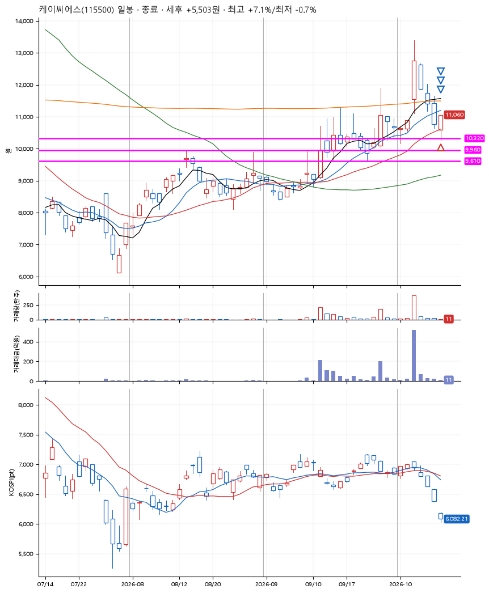
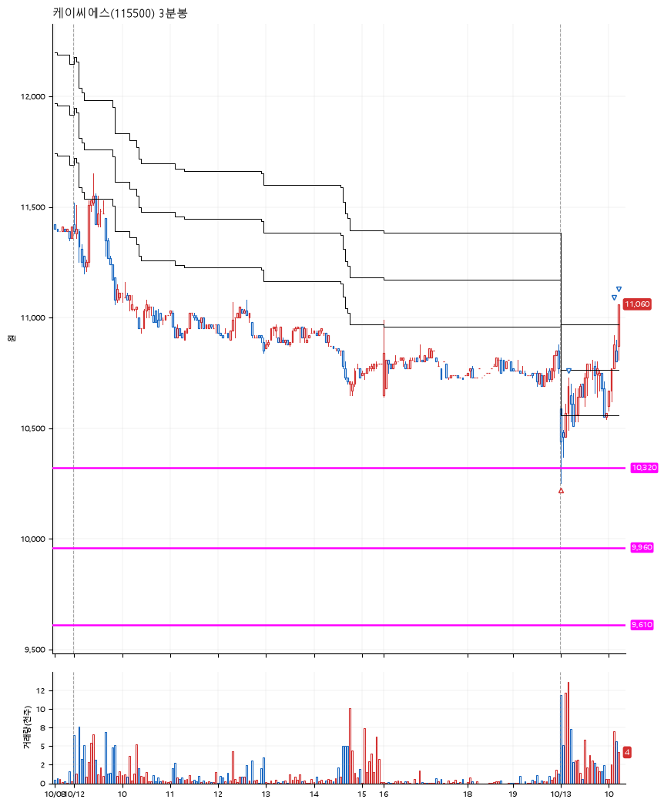

# 케이씨에스(115500) · 2026-10-13

**1차 매수 → 3% 익절 → 5% 익절 → 7% 익절**

진입 2026-10-13 09:00 (D+4) · 청산 2026-10-13 10:14 (D+4) · 보유 1시간 14분

| | |
|---|---|
| 결과 | 익절 |
| 평단 / 수량 | 10,330원 · 13주 |
| 투입 | 134,290원 |
| 세후 손익 | +5,503원 (+4.10%) |
| 최고 / 최저 | +7.1% / -0.7% |
| 당일 등락 | -2.74% |
| 보유기간 | 1시간 14분 |

## 3선

| | |
|---|---|
| 1선 | 10,320원 |
| 2선 | 9,960원 |
| 3선 | 9,610원 |

기준봉 2026-10-06 (D+4)

`#KOSPI하락횡보장` `#시장을이기는종목`

## 차트

**일봉**

**3분봉**

## 체결

| 시각 | 구분 | 수량 | 판정가 | 체결가 | 오차 |
|---|---|---|---|---|---|
| 09:00 | 매수 | 13주 | 10,320 | 10,330 | +0.10% |
| 09:10 | 매도 | 5주 | 10,650 | 10,600 | -0.47% |
| 10:07 | 매도 | 6주 | 10,850 | 10,832 | -0.17% |
| 10:14 | 매도 | 2주 | 11,060 | 11,060 | +0.00% |

## 잘한 점

앞의 빼족빼족에서 지지받는 3선의 설정. 익절 청산 이후 다시 하락하는 모습.

## 아쉬운 점

.
