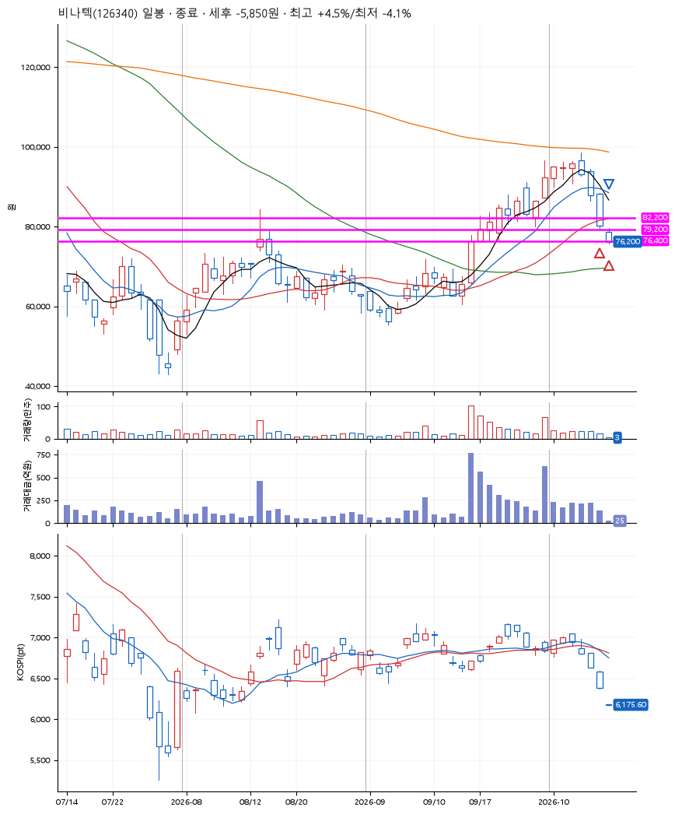
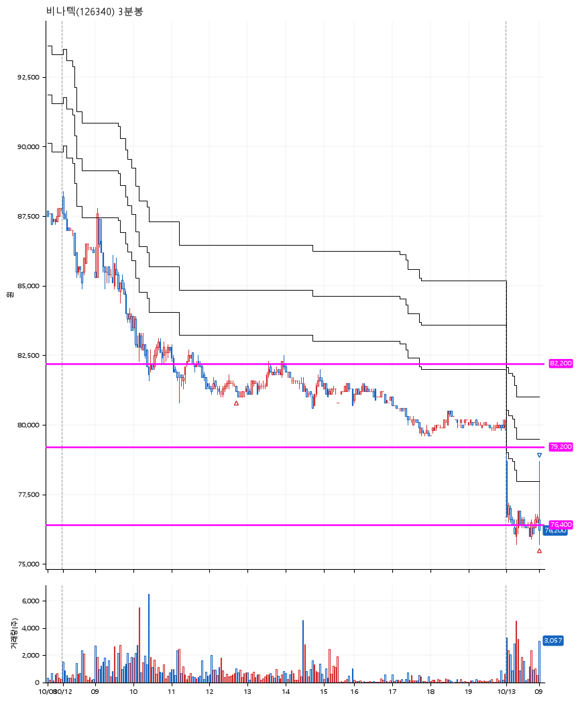

# 비나텍(126340) · 2026-10-13

**2차 매수 → 손절**

진입 2026-10-12 12:44 (D+6) · 청산 2026-10-13 09:01 (D+7) · 보유 2일차

| | |
|---|---|
| 결과 | 손절 |
| 평단 / 수량 | 78,950원 · 2주 |
| 투입 | 157,900원 |
| 세후 손익 | -5,850원 (-3.70%) |
| 최고 / 최저 | +4.5% / -4.1% |
| 당일 등락 | +2.61% |
| 보유기간 | 2일차 |

## 3선

| | |
|---|---|
| 1선 | 82,200원 |
| 2선 | 79,200원 |
| 3선 | 76,400원 |

기준봉 2026-09-30 (D+7)

`#KOSPI하락횡보장` `#시장을이기는종목` `#테마주`

> 고체산화물 연료전지 수소에너지 ESS

## 차트

**일봉**

**3분봉**

## 체결

| 시각 | 구분 | 수량 | 판정가 | 체결가 | 오차 |
|---|---|---|---|---|---|
| 12:44 | 매수 | 1주 | 81,300 | 81,400 | +0.12% |
| 09:00 | 매수 | 1주 | 76,600 | 76,500 | -0.13% |
| 09:01 | 매도 | 2주 | 76,200 | 76,200 | +0.00% |

## 잘한 점

.

## 아쉬운 점

이전의 빼족빼족에서 지지받는 등 이전의 기억으로 설정된 조금은 공격적인 3선. 아니나 다를까 3선을 딱 찍고 지지받는 모습.
