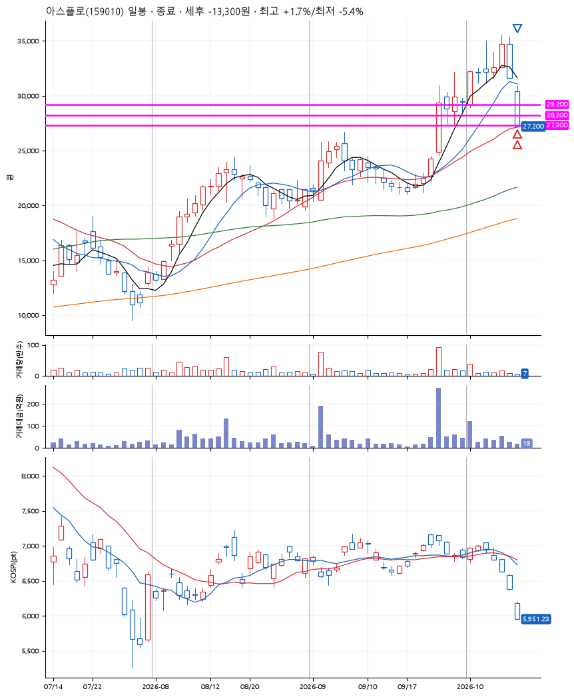
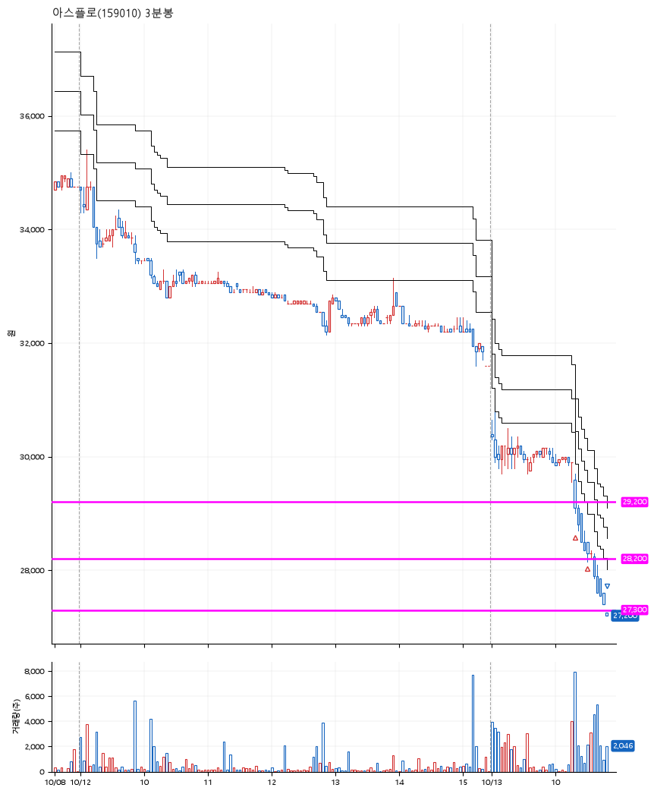

# 아스플로(159010) · 2026-10-13

**2차 매수 → 손절**

진입 2026-10-13 10:19 (D+6) · 청산 2026-10-13 10:48 (D+6) · 보유 29분

| | |
|---|---|
| 결과 | 손절 |
| 평단 / 수량 | 28,800원 · 8주 |
| 투입 | 230,400원 |
| 세후 손익 | -13,300원 (-5.77%) |
| 최고 / 최저 | +1.7% / -5.4% |
| 당일 등락 | +2.14% |
| 보유기간 | 29분 |

## 3선

| | |
|---|---|
| 1선 | 29,200원 |
| 2선 | 28,200원 |
| 3선 | 27,300원 |

기준봉 2026-10-01 (D+6)

`#KOSPI하락횡보장` `#시장을이기는종목` `#테마주` `#섹터주`

> 반도체

## 차트

**일봉**

**3분봉**

## 체결

| 시각 | 구분 | 수량 | 판정가 | 체결가 | 오차 |
|---|---|---|---|---|---|
| 10:19 | 매수 | 4주 | 29,150 | 29,300 | +0.51% |
| 10:30 | 매수 | 4주 | 28,200 | 28,300 | +0.35% |
| 10:48 | 매도 | 8주 | 27,250 | 27,200 | -0.18% |

## 잘한 점

_(미작성)_

## 아쉬운 점

_(미작성)_
