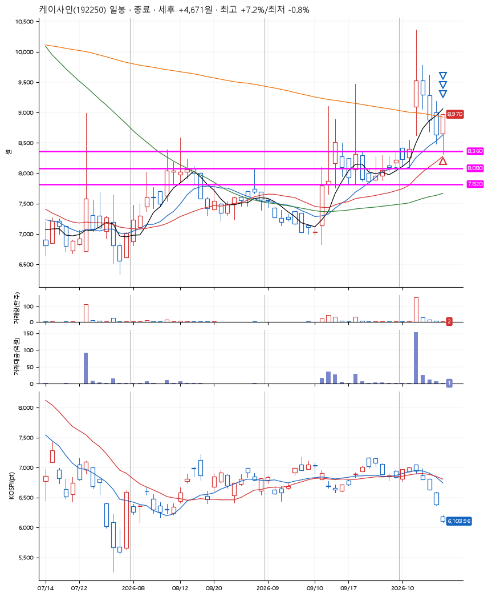
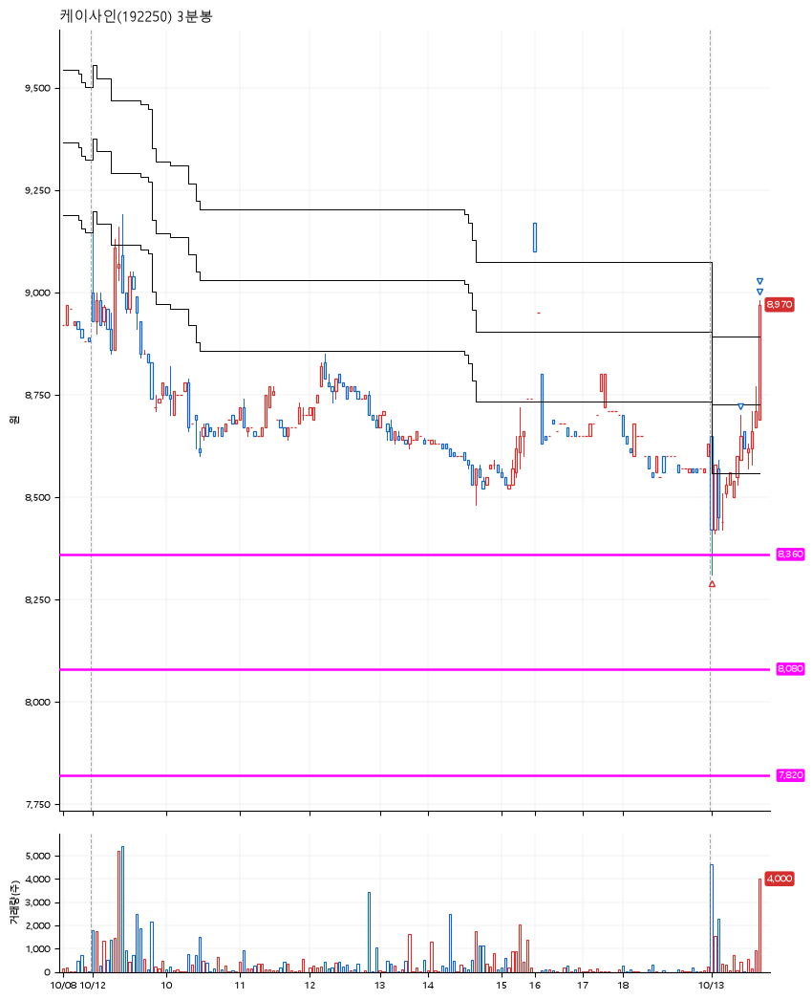

# 케이사인(192250) · 2026-10-13

**1차 매수 → 3% 익절 → 5% 익절 → 7% 익절**

진입 2026-10-13 09:01 (D+4) · 청산 2026-10-13 09:41 (D+4) · 보유 39분

| | |
|---|---|
| 결과 | 익절 |
| 평단 / 수량 | 8,380원 · 16주 |
| 투입 | 134,080원 |
| 세후 손익 | +4,671원 (+3.48%) |
| 최고 / 최저 | +7.2% / -0.8% |
| 당일 등락 | -0.81% |
| 보유기간 | 39분 |

## 3선

| | |
|---|---|
| 1선 | 8,360원 |
| 2선 | 8,080원 |
| 3선 | 7,820원 |

기준봉 2026-10-06 (D+4)

`#KOSPI하락횡보장` `#시장을이기는종목` `#테마주`

> 보안주

## 차트

**일봉**

**3분봉**

## 체결

| 시각 | 구분 | 수량 | 판정가 | 체결가 | 오차 |
|---|---|---|---|---|---|
| 09:01 | 매수 | 16주 | 8,360 | 8,380 | +0.24% |
| 09:24 | 매도 | 6주 | 8,640 | 8,600 | -0.46% |
| 09:40 | 매도 | 8주 | 8,800 | 8,736 | -0.73% |
| 09:41 | 매도 | 2주 | 8,970 | 8,790 | -2.01% |

## 잘한 점

_(미작성)_

## 아쉬운 점

_(미작성)_
