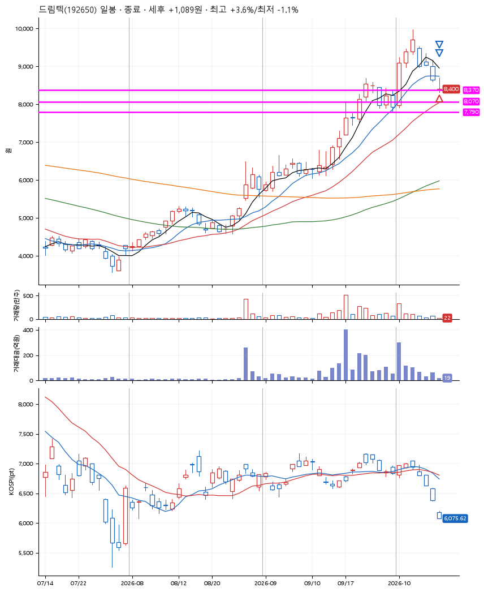
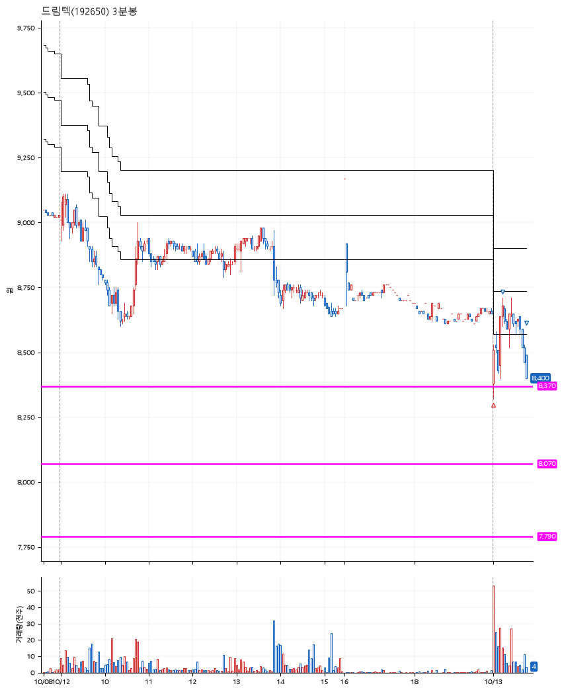

# 드림텍(192650) · 2026-10-13

**1차 매수 → 3% 익절 → 본절 이탈**

진입 2026-10-13 09:00 (D+6) · 청산 2026-10-13 09:47 (D+6) · 보유 46분

| | |
|---|---|
| 결과 | 익절 |
| 평단 / 수량 | 8,410원 · 16주 |
| 투입 | 134,560원 |
| 세후 손익 | +1,089원 (+0.81%) |
| 최고 / 최저 | +3.6% / -1.1% |
| 당일 등락 | +0.60% |
| 보유기간 | 46분 |

## 3선

| | |
|---|---|
| 1선 | 8,370원 |
| 2선 | 8,070원 |
| 3선 | 7,790원 |

기준봉 2026-10-01 (D+6)

`#KOSPI하락횡보장` `#시장을이기는종목` `#테마주` `#섹터주`

> 반도체

## 차트

**일봉**

**3분봉**

## 체결

| 시각 | 구분 | 수량 | 판정가 | 체결가 | 오차 |
|---|---|---|---|---|---|
| 09:00 | 매수 | 16주 | 8,370 | 8,410 | +0.48% |
| 09:13 | 매도 | 6주 | 8,670 | 8,660 | -0.12% |
| 09:47 | 매도 | 10주 | 8,410 | 8,400 | -0.12% |

## 잘한 점

운 좋게 익절했지만 조금은 공격적인 3선이 아니었을까. 짧게 치고빠지기 좋은 지점.

## 아쉬운 점

.
