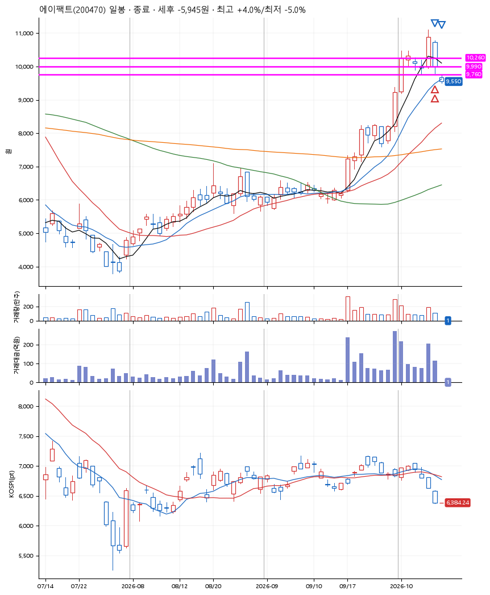
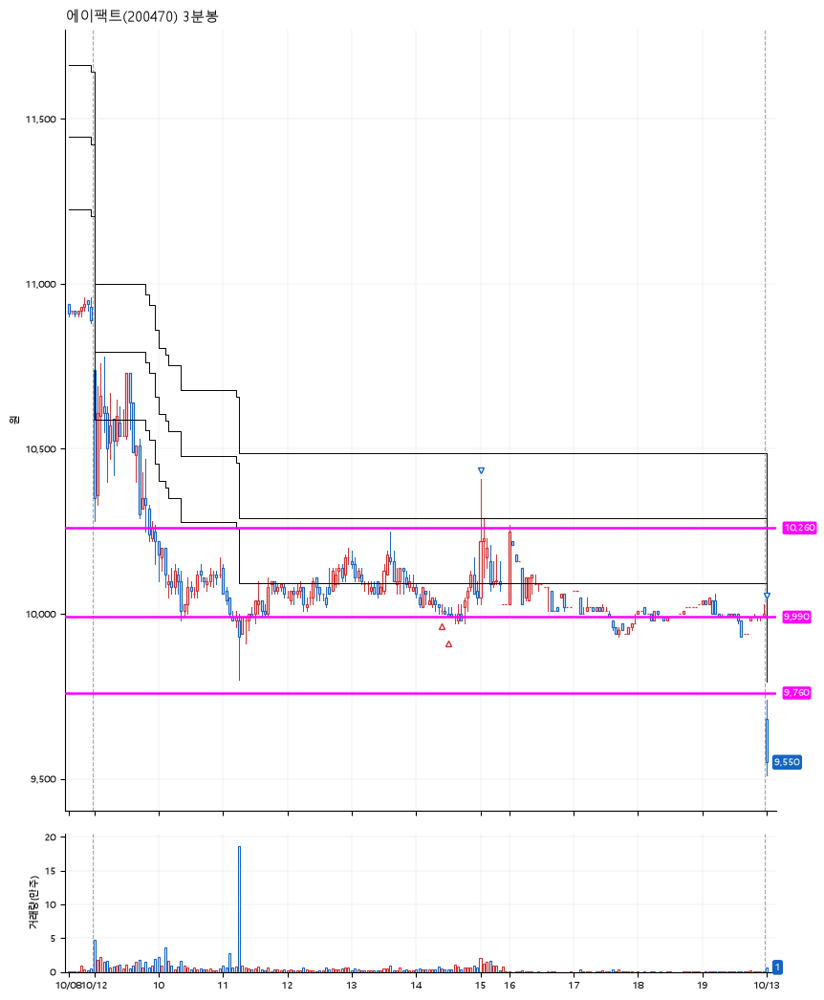

# 에이팩트(200470) · 2026-10-13

**2차 매수 → 3% 익절 → 본절 이탈**

진입 2026-10-12 14:26 (D+1) · 청산 2026-10-13 09:00 (D+2) · 보유 2일차

| | |
|---|---|
| 결과 | 손절 |
| 평단 / 수량 | 10,010원 · 26주 |
| 투입 | 260,260원 |
| 세후 손익 | -5,945원 (-2.28%) |
| 최고 / 최저 | +4.0% / -5.0% |
| 당일 등락 | +8.78% |
| 보유기간 | 2일차 |

## 3선

| | |
|---|---|
| 1선 | 10,260원 |
| 2선 | 9,990원 |
| 3선 | 9,760원 |

기준봉 2026-10-08 (D+2)

`#KOSPI하락횡보장` `#시장을이기는종목` `#테마주`

> 반도체

## 차트

**일봉**

**3분봉**

## 체결

| 시각 | 구분 | 수량 | 판정가 | 체결가 | 오차 |
|---|---|---|---|---|---|
| 14:26 | 매수 | 13주 | 10,020 | 10,020 | +0.00% |
| 14:32 | 매수 | 13주 | 9,990 | 10,000 | +0.10% |
| 15:02 | 매도 | 10주 | 10,320 | 10,210 | -1.07% |
| 09:00 | 매도 | 16주 | 9,680 | 9,550 | -1.34% |

## 잘한 점

.

## 아쉬운 점

장시작 직후 갭하락으로 시작하여 바로 손절. 이후 회복하는 모습. 애초에 3선이 너무나도 공격적인 설정이었다.
