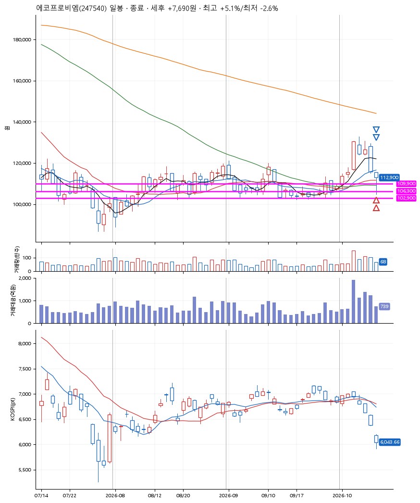
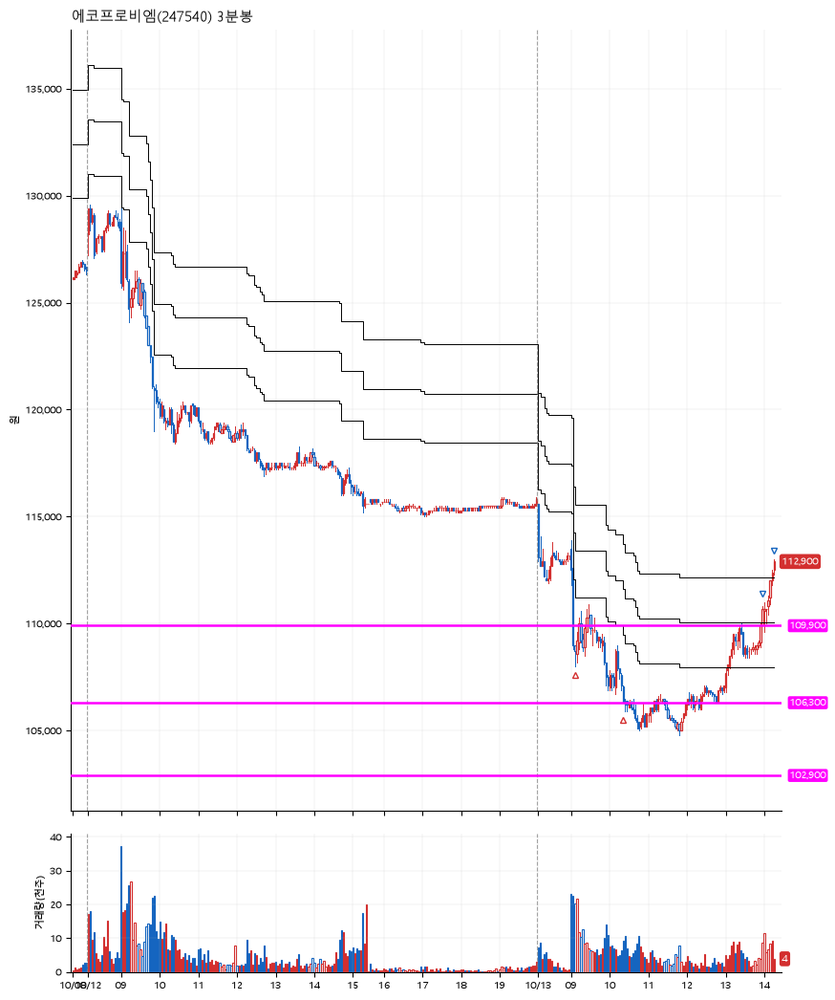

# 에코프로비엠(247540) · 2026-10-13

**2차 매수 → 3% 익절 → 5% 익절**

진입 2026-10-13 09:08 (D+4) · 청산 2026-10-13 14:16 (D+4) · 보유 5시간 7분

| | |
|---|---|
| 결과 | 익절 |
| 평단 / 수량 | 107,550원 · 2주 |
| 투입 | 215,100원 |
| 세후 손익 | +7,690원 (+3.58%) |
| 최고 / 최저 | +5.1% / -2.6% |
| 당일 등락 | -0.26% |
| 보유기간 | 5시간 7분 |

## 3선

| | |
|---|---|
| 1선 | 109,900원 |
| 2선 | 106,300원 |
| 3선 | 102,900원 |

기준봉 2026-10-06 (D+4)

`#KOSPI하락횡보장` `#시장을이기는종목` `#테마주`

> 2차전지

## 차트

**일봉**

**3분봉**

## 체결

| 시각 | 구분 | 수량 | 판정가 | 체결가 | 오차 |
|---|---|---|---|---|---|
| 09:08 | 매수 | 1주 | 108,700 | 108,700 | +0.00% |
| 10:23 | 매수 | 1주 | 106,300 | 106,400 | +0.09% |
| 13:59 | 매도 | 1주 | 110,800 | 110,400 | -0.36% |
| 14:16 | 매도 | 1주 | 113,000 | 112,900 | -0.09% |

## 잘한 점

_(미작성)_

## 아쉬운 점

_(미작성)_
