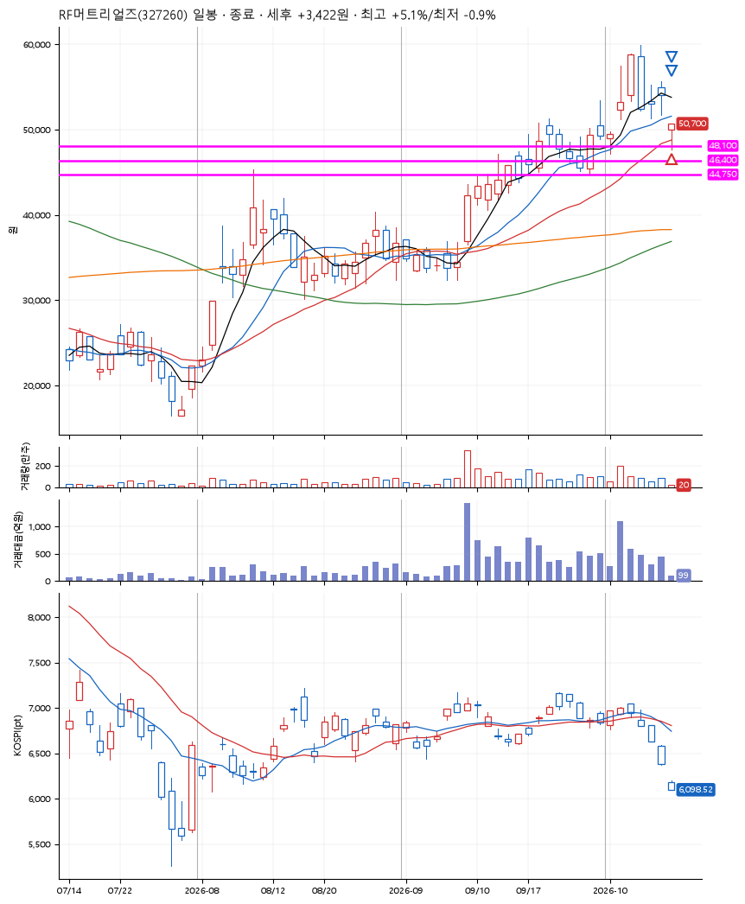
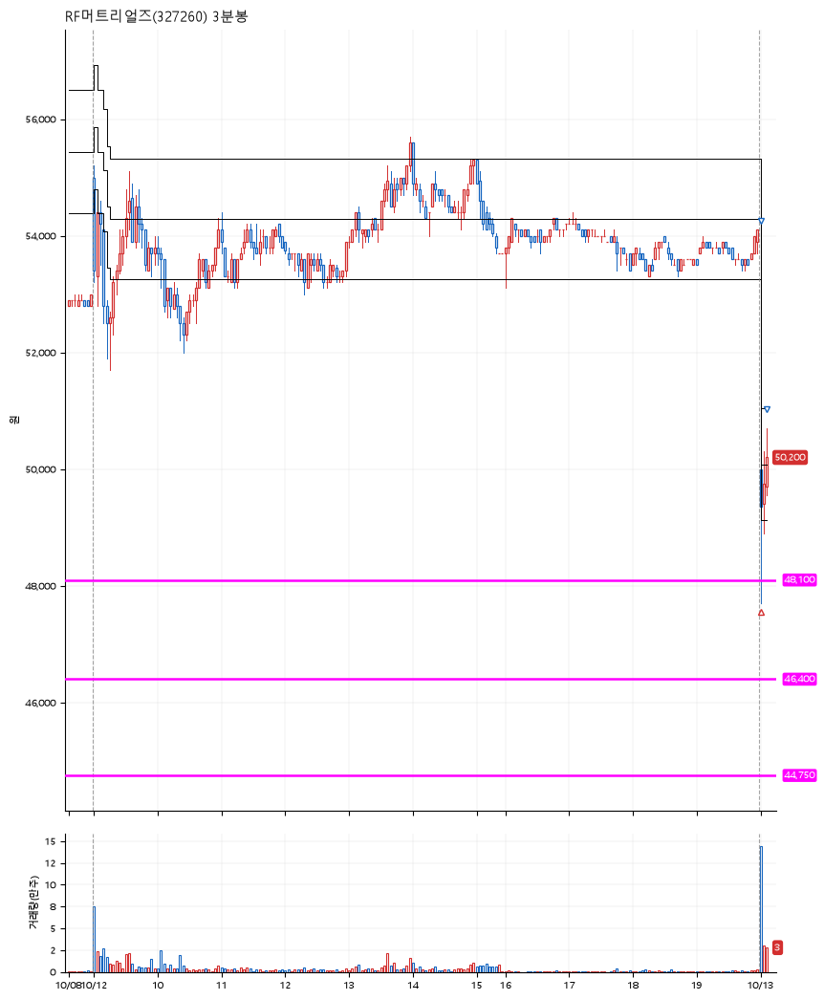

# RF머트리얼즈(327260) · 2026-10-13

**1차 매수 → 3% 익절 → 5% 익절**

진입 2026-10-13 09:01 (D+4) · 청산 2026-10-13 09:08 (D+4) · 보유 7분

| | |
|---|---|
| 결과 | 익절 |
| 평단 / 수량 | 48,150원 · 2주 |
| 투입 | 96,300원 |
| 세후 손익 | +3,422원 (+3.55%) |
| 최고 / 최저 | +5.1% / -0.9% |
| 당일 등락 | -0.10% |
| 보유기간 | 7분 |

## 3선

| | |
|---|---|
| 1선 | 48,100원 |
| 2선 | 46,400원 |
| 3선 | 44,750원 |

기준봉 2026-10-06 (D+4)

`#KOSPI하락횡보장` `#시장을이기는종목` `#테마주`

> 광통신 통신장비

## 차트

**일봉**

**3분봉**

## 체결

| 시각 | 구분 | 수량 | 판정가 | 체결가 | 오차 |
|---|---|---|---|---|---|
| 09:01 | 매수 | 2주 | 48,100 | 48,150 | +0.10% |
| 09:01 | 매도 | 1주 | 49,650 | 49,450 | -0.40% |
| 09:08 | 매도 | 1주 | 50,600 | 50,500 | -0.20% |

## 잘한 점

앞의 빼족빼족에서 지지받고 조금은 불안한 3선이었지만 운좋게 수익.

## 아쉬운 점

다른 종목들로 보아 조금은 더 보수적으로 3선을 설정해도 될 듯.
