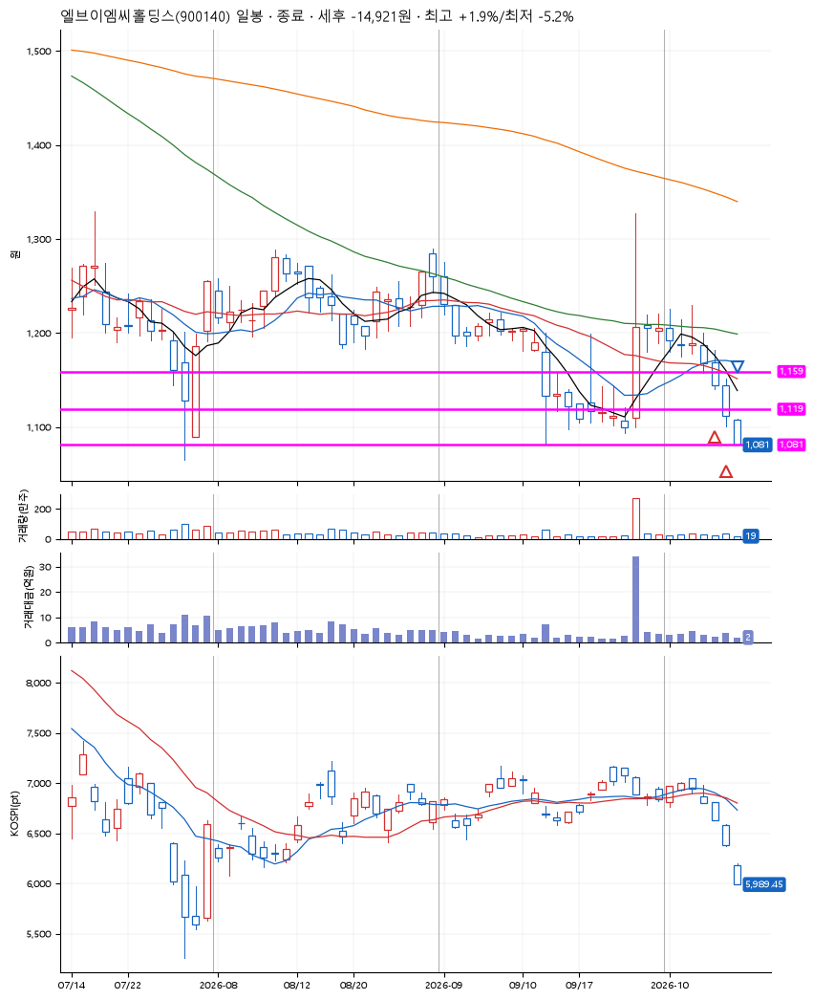
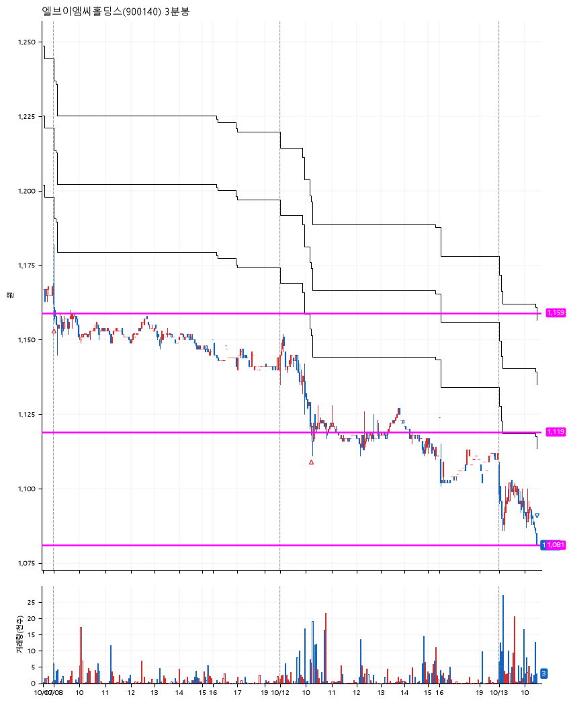

# 엘브이엠씨홀딩스(900140) · 2026-10-13

**2차 매수 → 손절**

진입 2026-10-08 09:01 (D+7) · 청산 2026-10-13 10:28 (D+9) · 보유 3일차

| | |
|---|---|
| 결과 | 손절 |
| 평단 / 수량 | 1,141원 · 240주 |
| 투입 | 273,764원 |
| 세후 손익 | -14,921원 (-5.45%) |
| 최고 / 최저 | +1.9% / -5.2% |
| 당일 등락 | -1.44% |
| 보유기간 | 6일차 |

## 3선

| | |
|---|---|
| 1선 | 1,159원 |
| 2선 | 1,119원 |
| 3선 | 1,081원 |

기준봉 2026-09-28 (D+9)

`#KOSPI하락횡보장` `#시장을이기는종목`

## 차트

**일봉**

**3분봉**

## 체결

| 시각 | 구분 | 수량 | 판정가 | 체결가 | 오차 |
|---|---|---|---|---|---|
| 09:01 | 매수 | 118주 | 1,158 | 1,160 | +0.17% |
| 10:12 | 매수 | 122주 | 1,118 | 1,122 | +0.36% |
| 10:28 | 매도 | 240주 | 1,081 | 1,081 | +0.00% |

## 잘한 점

_(미작성)_

## 아쉬운 점

_(미작성)_
