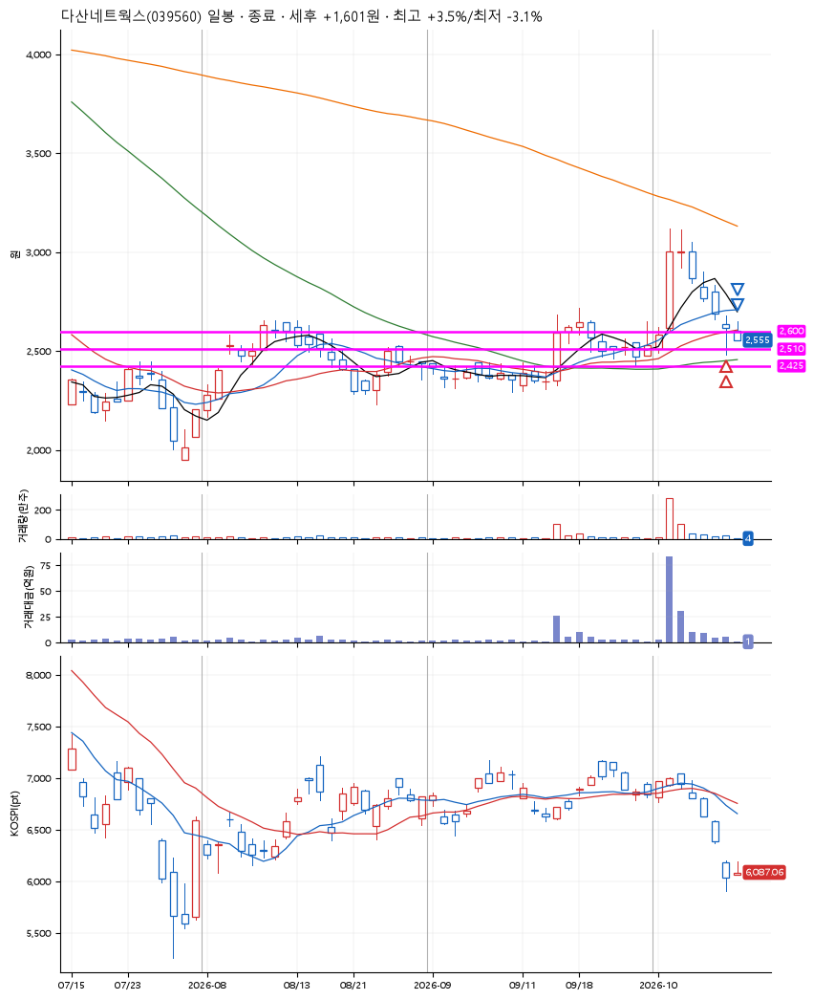
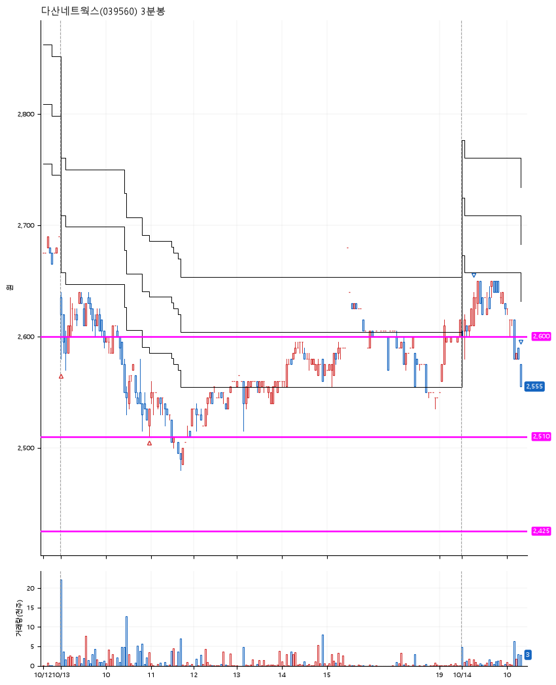

# 다산네트웍스(039560) · 2026-10-14

**2차 매수 → 3% 익절 → 본절 이탈**

진입 2026-10-13 09:01 (D+5) · 청산 2026-10-14 10:18 (D+6) · 보유 2일차

| | |
|---|---|
| 결과 | 익절 |
| 평단 / 수량 | 2,559원 · 106주 |
| 투입 | 271,290원 |
| 세후 손익 | +1,601원 (+0.59%) |
| 최고 / 최저 | +3.5% / -3.1% |
| 당일 등락 | -1.15% |
| 보유기간 | 2일차 |

## 3선

| | |
|---|---|
| 1선 | 2,600원 |
| 2선 | 2,510원 |
| 3선 | 2,425원 |

기준봉 2026-10-02 (D+6)

`#KOSPI하락횡보장` `#시장을이기는종목` `#테마주`

> 통신장비

## 차트

**일봉**

**3분봉**

## 체결

| 시각 | 구분 | 수량 | 판정가 | 체결가 | 오차 |
|---|---|---|---|---|---|
| 09:01 | 매수 | 52주 | 2,590 | 2,595 | +0.19% |
| 10:58 | 매수 | 54주 | 2,510 | 2,525 | +0.60% |
| 09:15 | 매도 | 42주 | 2,640 | 2,619 | -0.80% |
| 10:18 | 매도 | 64주 | 2,555 | 2,555 | +0.00% |

## 잘한 점

_(미작성)_

## 아쉬운 점

_(미작성)_
