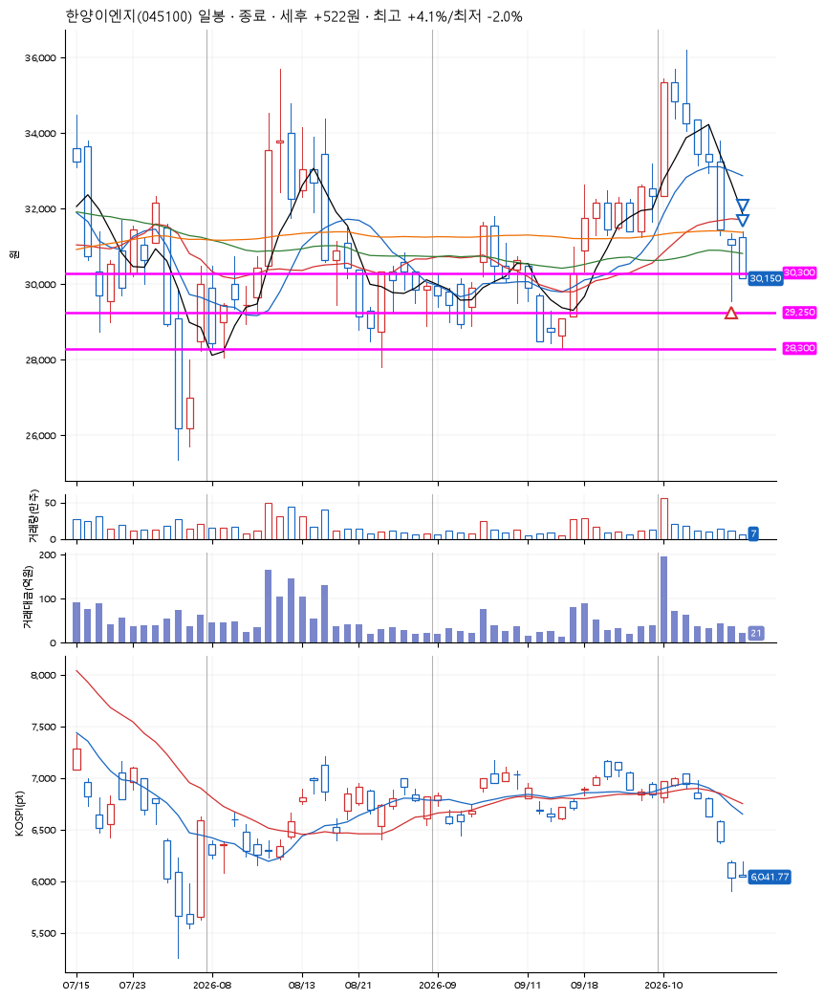
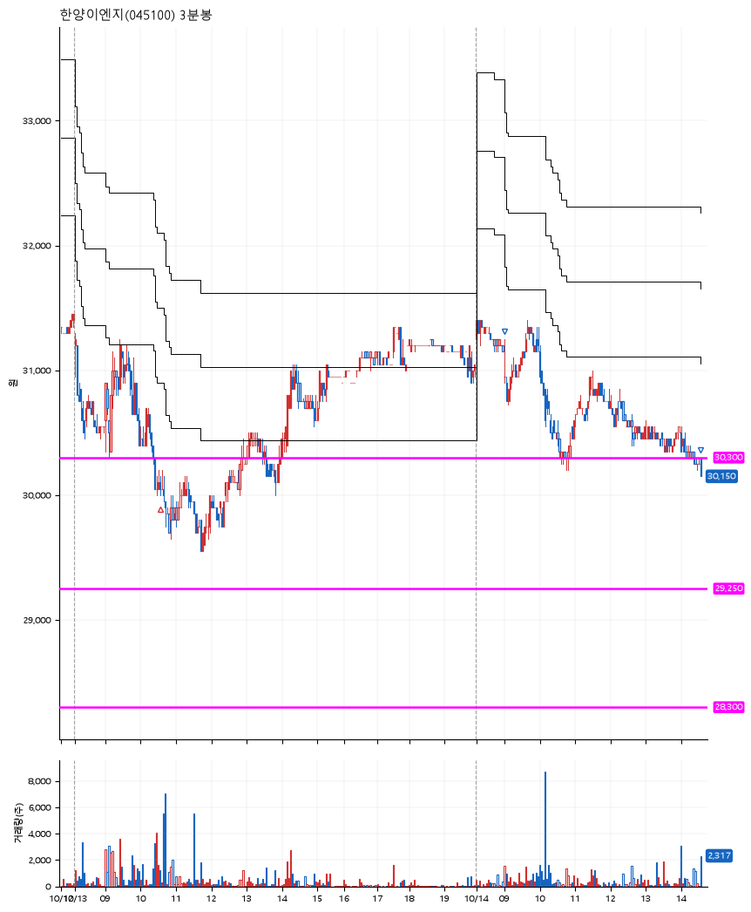

# 한양이엔지(045100) · 2026-10-14

**1차 매수 → 3% 익절 → 본절 이탈**

진입 2026-10-13 10:34 (D+6) · 청산 2026-10-14 14:35 (D+7) · 보유 2일차

| | |
|---|---|
| 결과 | 익절 |
| 평단 / 수량 | 30,150원 · 4주 |
| 투입 | 120,600원 |
| 세후 손익 | +522원 (+0.43%) |
| 최고 / 최저 | +4.1% / -2.0% |
| 당일 등락 | -3.39% |
| 보유기간 | 2일차 |

## 3선

| | |
|---|---|
| 1선 | 30,300원 |
| 2선 | 29,250원 |
| 3선 | 28,300원 |

기준봉 2026-10-01 (D+7)

`#KOSPI하락횡보장` `#시장을이기는종목` `#테마주` `#섹터주`

> 반도체

## 차트

**일봉**

**3분봉**

## 체결

| 시각 | 구분 | 수량 | 판정가 | 체결가 | 오차 |
|---|---|---|---|---|---|
| 10:34 | 매수 | 4주 | 30,100 | 30,150 | +0.17% |
| 09:00 | 매도 | 1주 | 31,200 | 30,950 | -0.80% |
| 14:35 | 매도 | 3주 | 30,150 | 30,150 | +0.00% |

## 잘한 점

_(미작성)_

## 아쉬운 점

_(미작성)_
