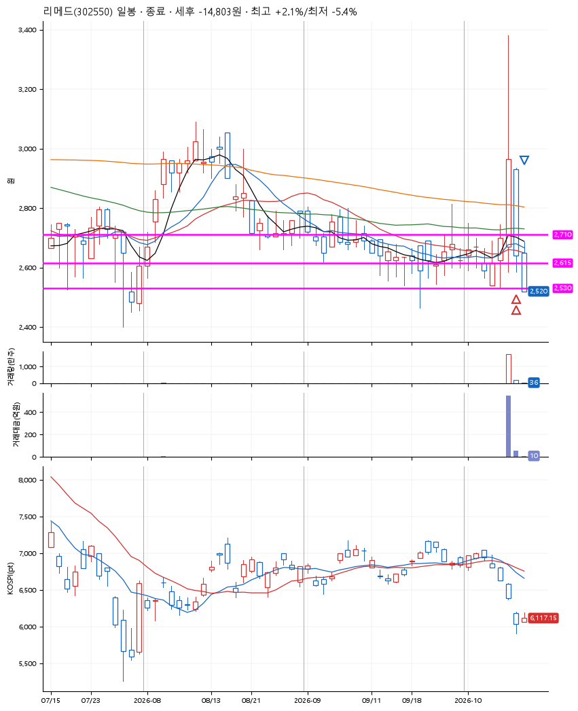
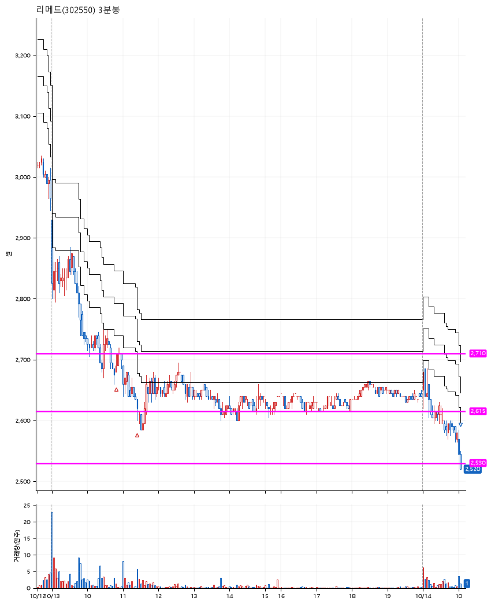

# 리메드(302550) · 2026-10-14

**2차 매수 → 손절**

진입 2026-10-13 10:48 (D+1) · 청산 2026-10-14 10:03 (D+2) · 보유 2일차

| | |
|---|---|
| 결과 | 손절 |
| 평단 / 수량 | 2,664원 · 102주 |
| 투입 | 271,760원 |
| 세후 손익 | -14,803원 (-5.45%) |
| 최고 / 최저 | +2.1% / -5.4% |
| 당일 등락 | -8.87% |
| 보유기간 | 2일차 |

## 3선

| | |
|---|---|
| 1선 | 2,710원 |
| 2선 | 2,615원 |
| 3선 | 2,530원 |

기준봉 2026-10-12 (D+2)

`#KOSPI하락횡보장` `#시장을이기는종목`

> 미국진출

## 차트

**일봉**

**3분봉**

## 체결

| 시각 | 구분 | 수량 | 판정가 | 체결가 | 오차 |
|---|---|---|---|---|---|
| 10:48 | 매수 | 50주 | 2,695 | 2,700 | +0.19% |
| 11:24 | 매수 | 52주 | 2,615 | 2,630 | +0.57% |
| 10:03 | 매도 | 102주 | 2,530 | 2,525 | -0.20% |

## 잘한 점

_(미작성)_

## 아쉬운 점

_(미작성)_
