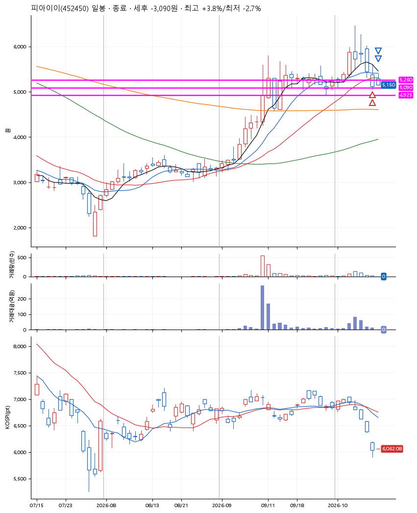
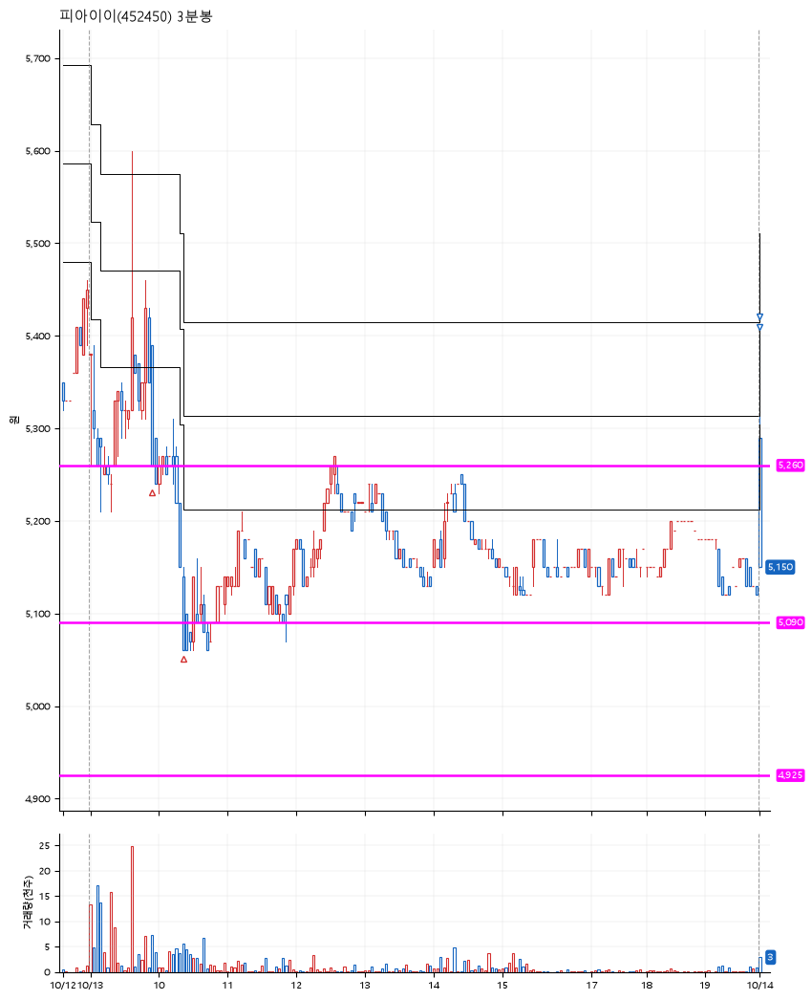

# 피아이이(452450) · 2026-10-14

**2차 매수 → 3% 익절 → 본절 이탈**

진입 2026-10-13 09:56 (D+4) · 청산 2026-10-14 09:00 (D+5) · 보유 2일차

| | |
|---|---|
| 결과 | 손절 |
| 평단 / 수량 | 5,200원 · 52주 |
| 투입 | 270,400원 |
| 세후 손익 | -3,090원 (-1.14%) |
| 최고 / 최저 | +3.8% / -2.7% |
| 당일 등락 | -4.91% |
| 보유기간 | 2일차 |

## 3선

| | |
|---|---|
| 1선 | 5,260원 |
| 2선 | 5,090원 |
| 3선 | 4,925원 |

기준봉 2026-10-06 (D+5)

`#KOSPI하락횡보장` `#시장을이기는종목`

## 차트

**일봉**

**3분봉**

## 체결

| 시각 | 구분 | 수량 | 판정가 | 체결가 | 오차 |
|---|---|---|---|---|---|
| 09:56 | 매수 | 26주 | 5,260 | 5,290 | +0.57% |
| 10:23 | 매수 | 26주 | 5,080 | 5,110 | +0.59% |
| 09:00 | 매도 | 20주 | 5,360 | 5,153 | -3.86% |
| 09:00 | 매도 | 32주 | 5,160 | 5,152 | -0.16% |

## 잘한 점

_(미작성)_

## 아쉬운 점

_(미작성)_
