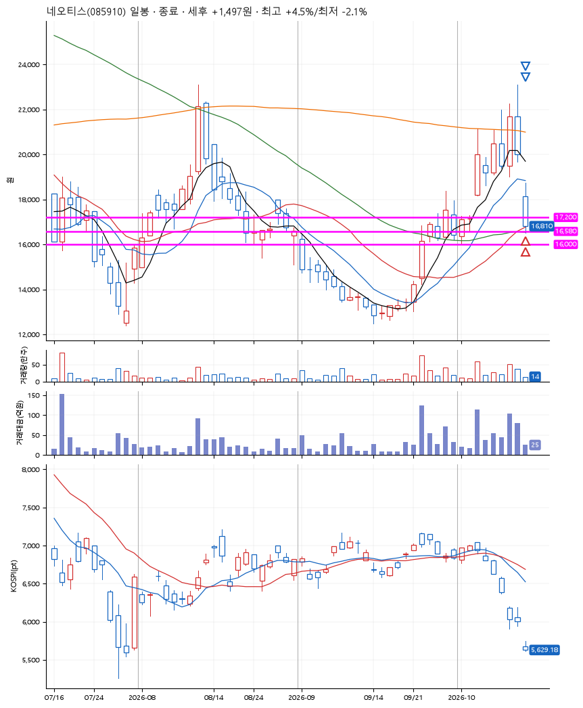
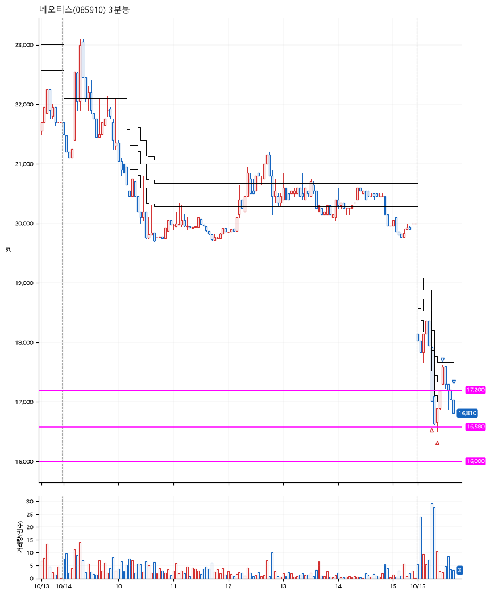

# 네오티스(085910) · 2026-10-15

**2차 매수 → 3% 익절 → 본절 이탈**

진입 2026-10-15 09:17 (D+2) · 청산 2026-10-15 09:39 (D+2) · 보유 22분

| | |
|---|---|
| 결과 | 익절 |
| 평단 / 수량 | 16,865원 · 15주 |
| 투입 | 252,978원 |
| 세후 손익 | +1,497원 (+0.59%) |
| 최고 / 최저 | +4.5% / -2.1% |
| 당일 등락 | -1.05% |
| 보유기간 | 22분 |

## 3선

| | |
|---|---|
| 1선 | 17,200원 |
| 2선 | 16,580원 |
| 3선 | 16,000원 |

기준봉 2026-10-13 (D+2)

`#KOSPI하락횡보장` `#시장을이기는종목` `#테마주`

> 반도체 전기차

## 차트

**일봉**

**3분봉**

## 체결

| 시각 | 구분 | 수량 | 판정가 | 체결가 | 오차 |
|---|---|---|---|---|---|
| 09:17 | 매수 | 7주 | 17,200 | 17,150 | -0.29% |
| 09:21 | 매수 | 8주 | 16,510 | 16,616 | +0.64% |
| 09:27 | 매도 | 6주 | 17,500 | 17,310 | -1.09% |
| 09:39 | 매도 | 9주 | 16,860 | 16,800 | -0.36% |

## 잘한 점

_(미작성)_

## 아쉬운 점

_(미작성)_
