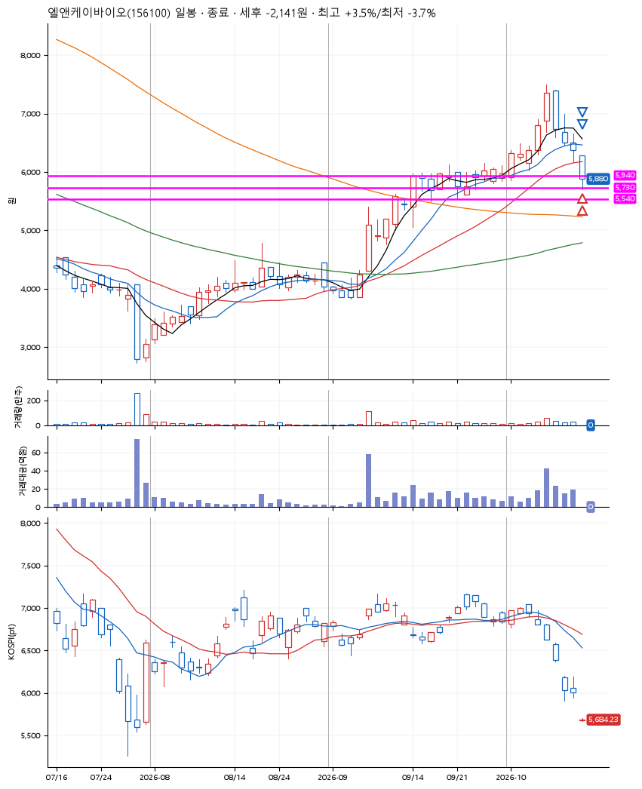
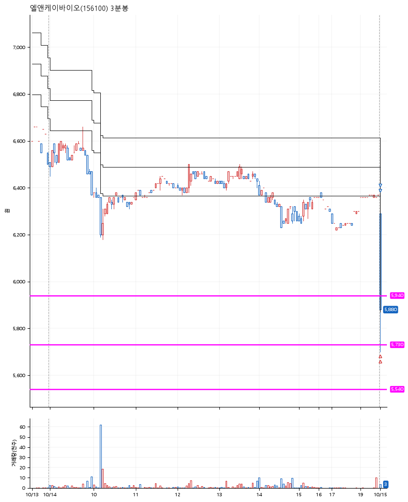

# 엘앤케이바이오(156100) · 2026-10-15

**2차 매수 → 3% 익절 → 본절 이탈**

진입 2026-10-15 09:01 (D+4) · 청산 2026-10-15 09:01 (D+4) · 보유 0분

| | |
|---|---|
| 결과 | 손절 |
| 평단 / 수량 | 5,920원 · 46주 |
| 투입 | 272,320원 |
| 세후 손익 | -2,141원 (-0.79%) |
| 최고 / 최저 | +3.5% / -3.7% |
| 당일 등락 | -11.76% |
| 보유기간 | 0분 |

## 3선

| | |
|---|---|
| 1선 | 5,940원 |
| 2선 | 5,730원 |
| 3선 | 5,540원 |

기준봉 2026-10-08 (D+4)

`#KOSPI하락횡보장` `#시장을이기는종목`

## 차트

**일봉**

**3분봉**

## 체결

| 시각 | 구분 | 수량 | 판정가 | 체결가 | 오차 |
|---|---|---|---|---|---|
| 09:01 | 매수 | 23주 | 5,830 | 5,960 | +2.23% |
| 09:01 | 매수 | 23주 | 5,720 | 5,880 | +2.80% |
| 09:01 | 매도 | 18주 | 6,130 | 5,890 | -3.92% |
| 09:01 | 매도 | 28주 | 5,890 | 5,885 | -0.08% |

## 잘한 점

_(미작성)_

## 아쉬운 점

_(미작성)_
