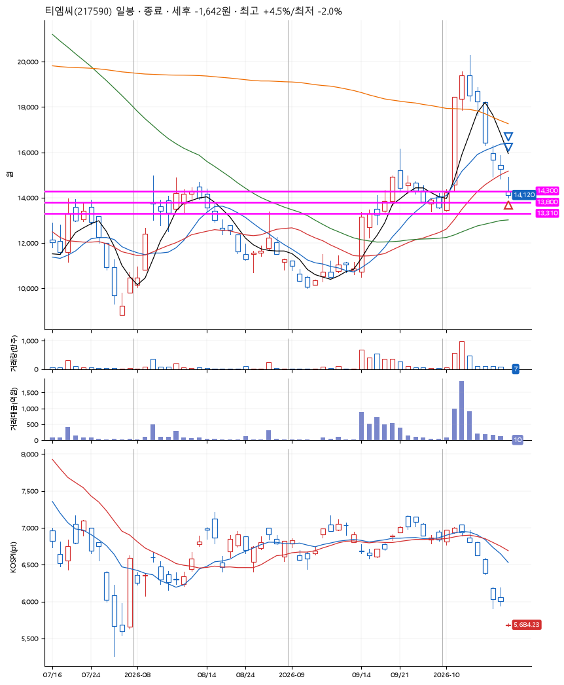
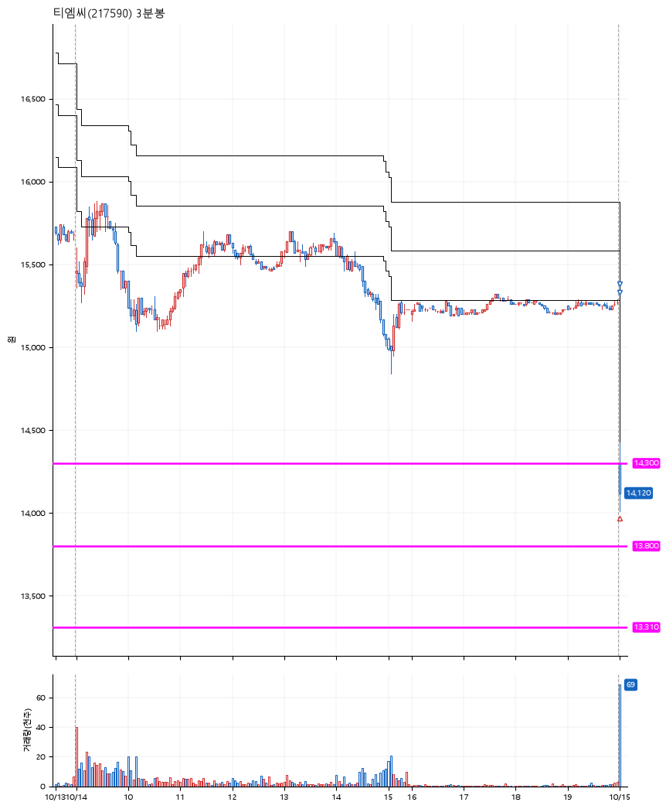

# 티엠씨(217590) · 2026-10-15

**1차 매수 → 3% 익절 → 본절 이탈**

진입 2026-10-15 09:00 (D+7) · 청산 2026-10-15 09:01 (D+7) · 보유 1분

| | |
|---|---|
| 결과 | 손절 |
| 평단 / 수량 | 14,290원 · 9주 |
| 투입 | 128,610원 |
| 세후 손익 | -1,642원 (-1.28%) |
| 최고 / 최저 | +4.5% / -2.0% |
| 당일 등락 | -5.94% |
| 보유기간 | 1분 |

## 3선

| | |
|---|---|
| 1선 | 14,300원 |
| 2선 | 13,800원 |
| 3선 | 13,310원 |

기준봉 2026-10-02 (D+7)

`#KOSPI하락횡보장` `#시장을이기는종목` `#상한가` `#테마주`

> 광통신 통신장비

## 차트

**일봉**

**3분봉**

## 체결

| 시각 | 구분 | 수량 | 판정가 | 체결가 | 오차 |
|---|---|---|---|---|---|
| 09:00 | 매수 | 9주 | 14,300 | 14,290 | -0.07% |
| 09:01 | 매도 | 3주 | 14,720 | 14,140 | -3.94% |
| 09:01 | 매도 | 6주 | 14,140 | 14,140 | +0.00% |

## 잘한 점

_(미작성)_

## 아쉬운 점

_(미작성)_
