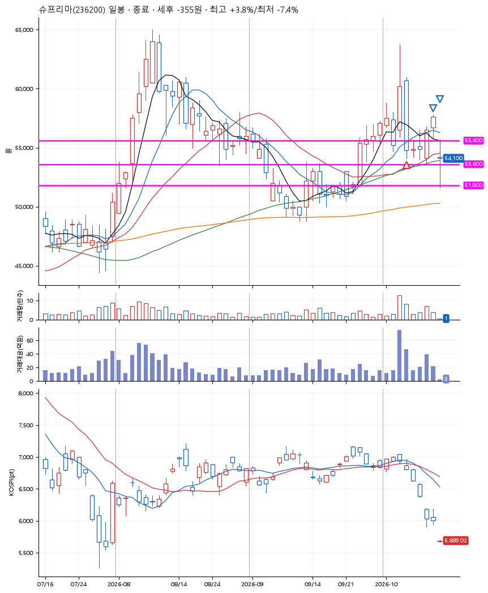
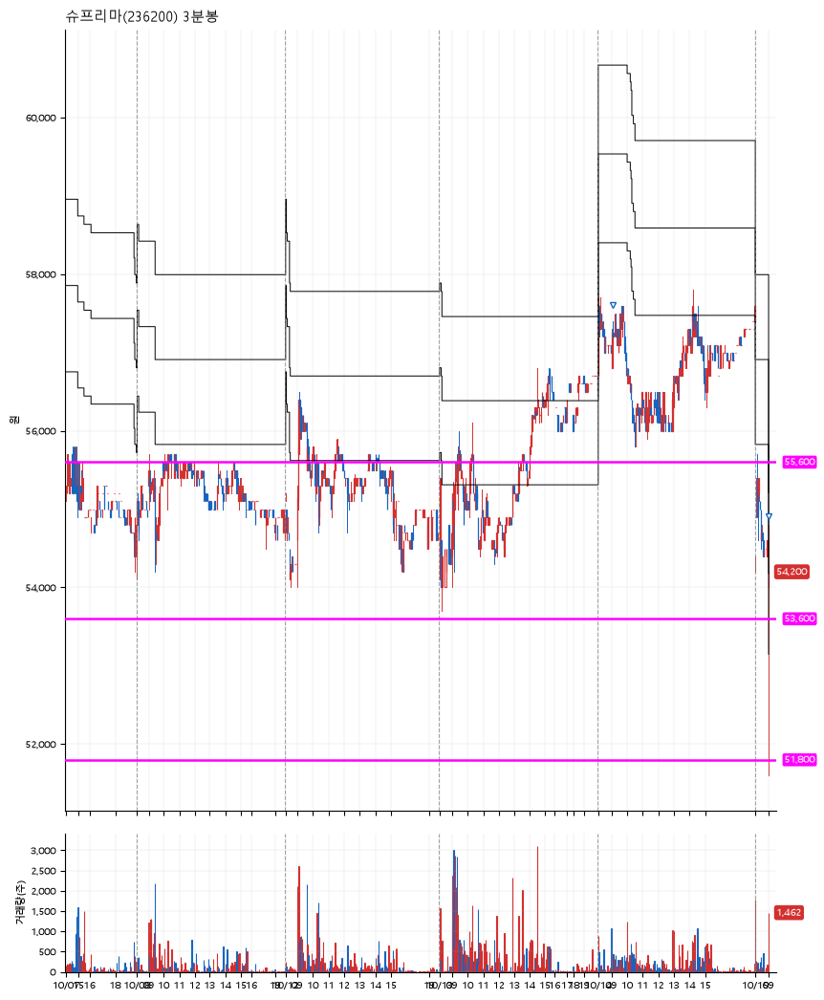

# 슈프리마(236200) · 2026-10-15

**1차 매수 → 3% 익절 → 본절 이탈**

진입 2026-10-07 09:25 (D+1) · 청산 2026-10-15 09:02 (D+6) · 보유 6일차

| | |
|---|---|
| 결과 | 손절 |
| 평단 / 수량 | 55,700원 · 2주 |
| 투입 | 111,400원 |
| 세후 손익 | -355원 (-0.32%) |
| 최고 / 최저 | +3.8% / -7.4% |
| 당일 등락 | -0.74% |
| 보유기간 | 9일차 |

## 3선

| | |
|---|---|
| 1선 | 55,600원 |
| 2선 | 53,600원 |
| 3선 | 51,800원 |

기준봉 2026-10-06 (D+6)

`#KOSPI하락횡보장` `#시장을이기는종목`

## 차트

**일봉**

**3분봉**

## 체결

| 시각 | 구분 | 수량 | 판정가 | 체결가 | 오차 |
|---|---|---|---|---|---|
| 09:25 | 매수 | 2주 | 55,600 | 55,700 | +0.18% |
| 09:06 | 매도 | 1주 | 57,400 | 57,300 | -0.17% |
| 09:02 | 매도 | 1주 | 54,000 | 54,000 | +0.00% |

## 잘한 점

_(미작성)_

## 아쉬운 점

_(미작성)_
