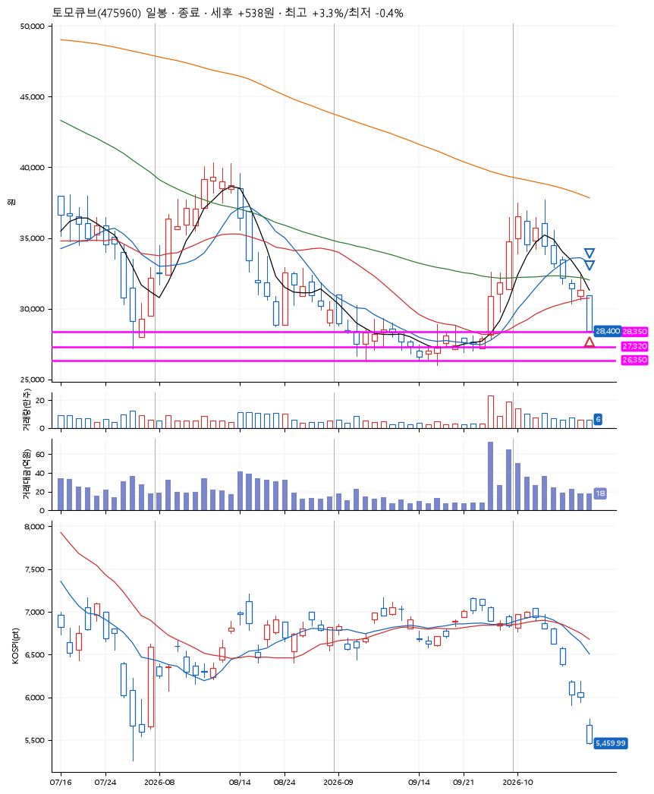
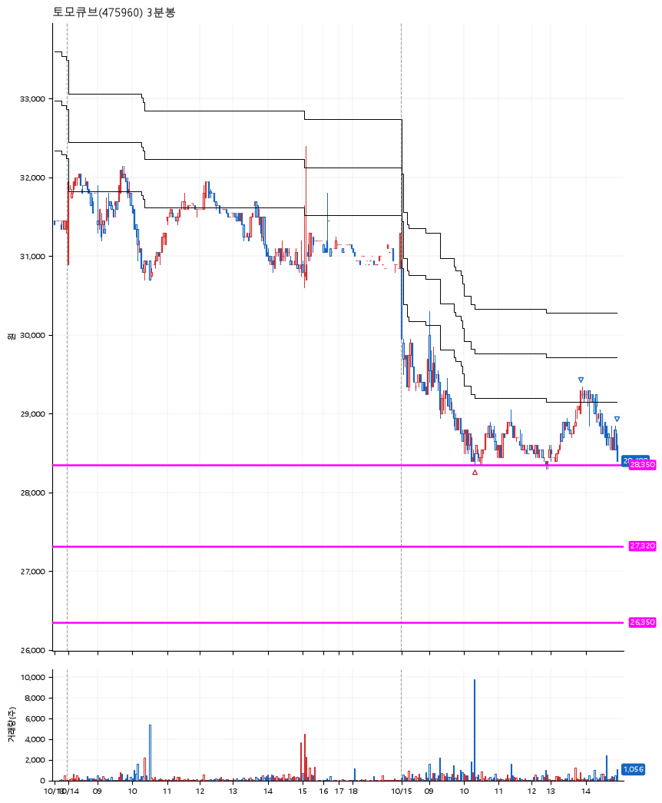

# 토모큐브(475960) · 2026-10-15

**1차 매수 → 3% 익절 → 본절 이탈**

진입 2026-10-15 10:19 (D+9) · 청산 2026-10-15 14:56 (D+9) · 보유 4시간 36분

| | |
|---|---|
| 결과 | 익절 |
| 평단 / 수량 | 28,400원 · 4주 |
| 투입 | 113,600원 |
| 세후 손익 | +538원 (+0.47%) |
| 최고 / 최저 | +3.3% / -0.4% |
| 당일 등락 | -3.33% |
| 보유기간 | 4시간 36분 |

## 3선

| | |
|---|---|
| 1선 | 28,350원 |
| 2선 | 27,320원 |
| 3선 | 26,350원 |

기준봉 2026-09-30 (D+9)

`#KOSPI하락횡보장` `#시장을이기는종목` `#테마주`

> 제약 바이오

## 차트

**일봉**

**3분봉**

## 체결

| 시각 | 구분 | 수량 | 판정가 | 체결가 | 오차 |
|---|---|---|---|---|---|
| 10:19 | 매수 | 4주 | 28,350 | 28,400 | +0.18% |
| 13:53 | 매도 | 1주 | 29,300 | 29,200 | -0.34% |
| 14:56 | 매도 | 3주 | 28,400 | 28,400 | +0.00% |

## 잘한 점

_(미작성)_

## 아쉬운 점

_(미작성)_
