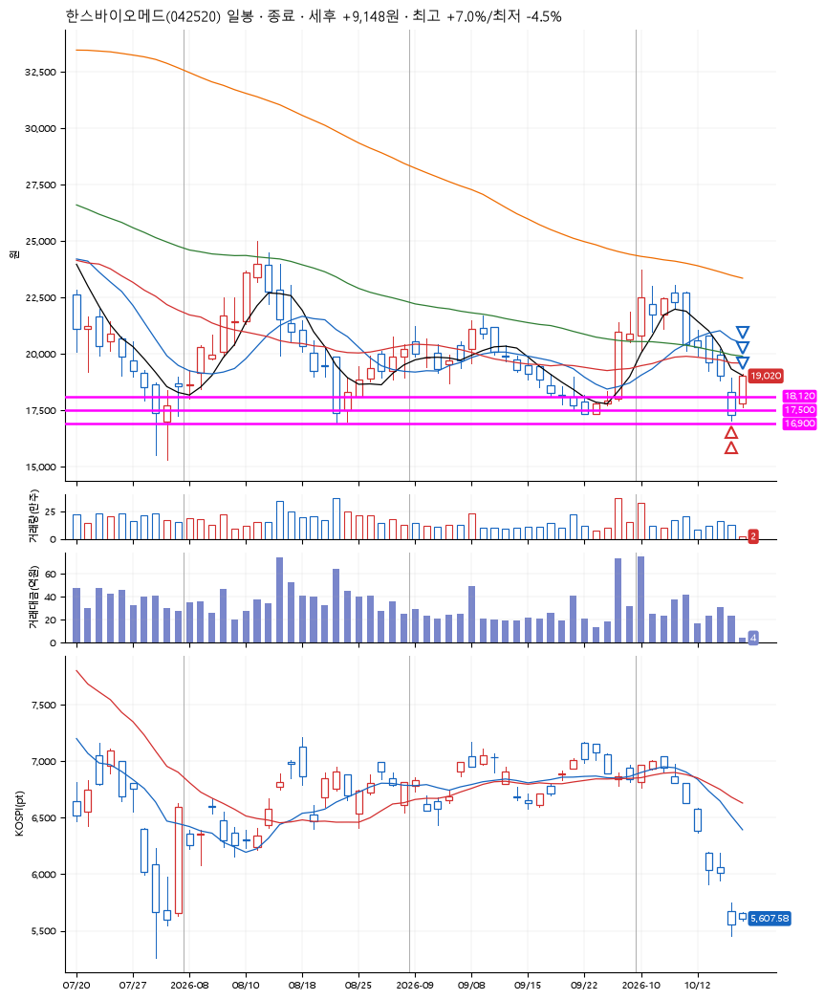
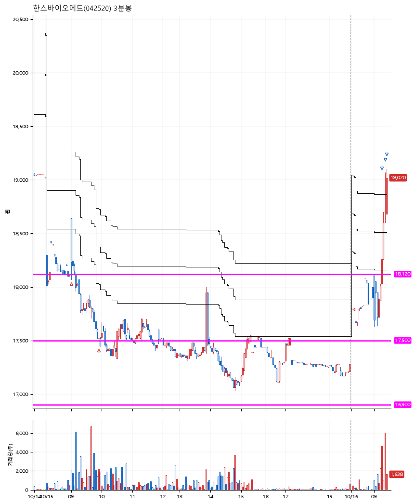

# 한스바이오메드(042520) · 2026-10-16

**2차 매수 → 3% 익절 → 5% 익절 → 7% 익절**

진입 2026-10-15 09:01 (D+10) · 청산 2026-10-16 09:25 (D+11) · 보유 2일차

| | |
|---|---|
| 결과 | 익절 |
| 평단 / 수량 | 17,825원 · 14주 |
| 투입 | 249,550원 |
| 세후 손익 | +9,148원 (+3.67%) |
| 최고 / 최저 | +7.0% / -4.5% |
| 당일 등락 | +20.31% |
| 보유기간 | 2일차 |

## 3선

| | |
|---|---|
| 1선 | 18,120원 |
| 2선 | 17,500원 |
| 3선 | 16,900원 |

기준봉 2026-09-29 (D+11)

`#KOSPI하락횡보장` `#시장을이기는종목`

## 차트

**일봉**

**3분봉**

## 체결

| 시각 | 구분 | 수량 | 판정가 | 체결가 | 오차 |
|---|---|---|---|---|---|
| 09:01 | 매수 | 7주 | 18,120 | 18,140 | +0.11% |
| 09:55 | 매수 | 7주 | 17,500 | 17,510 | +0.06% |
| 09:17 | 매도 | 5주 | 18,360 | 18,210 | -0.82% |
| 09:21 | 매도 | 7주 | 18,720 | 18,600 | -0.64% |
| 09:25 | 매도 | 2주 | 19,080 | 19,020 | -0.31% |

## 잘한 점

_(미작성)_

## 아쉬운 점

_(미작성)_
