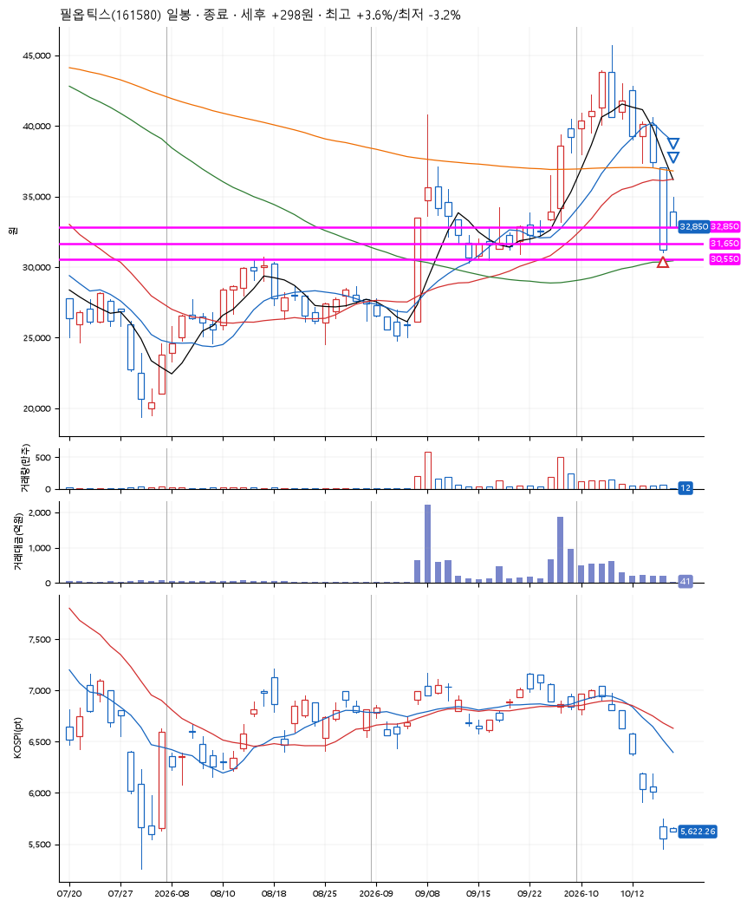
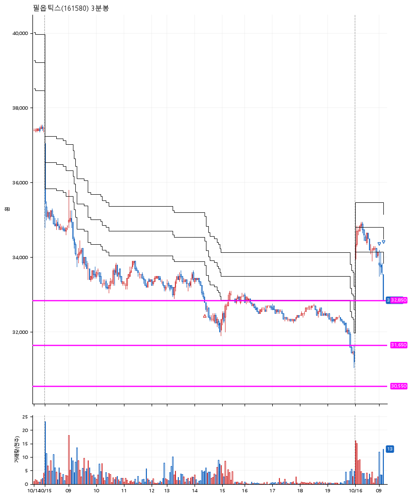

# 필옵틱스(161580) · 2026-10-16

**1차 매수 → 3% 익절 → 본절 이탈**

진입 2026-10-15 14:21 (D+10) · 청산 2026-10-16 09:11 (D+11) · 보유 2일차

| | |
|---|---|
| 결과 | 익절 |
| 평단 / 수량 | 32,950원 · 4주 |
| 투입 | 131,800원 |
| 세후 손익 | +298원 (+0.23%) |
| 최고 / 최저 | +3.6% / -3.2% |
| 당일 등락 | -0.89% |
| 보유기간 | 2일차 |

## 3선

| | |
|---|---|
| 1선 | 32,850원 |
| 2선 | 31,650원 |
| 3선 | 30,550원 |

기준봉 2026-09-29 (D+11)

`#KOSPI하락횡보장` `#시장을이기는종목` `#테마주`

> TGV 유리기판

## 차트

**일봉**

**3분봉**

## 체결

| 시각 | 구분 | 수량 | 판정가 | 체결가 | 오차 |
|---|---|---|---|---|---|
| 14:21 | 매수 | 4주 | 32,850 | 32,950 | +0.30% |
| 09:00 | 매도 | 1주 | 34,100 | 33,850 | -0.73% |
| 09:11 | 매도 | 3주 | 32,950 | 32,850 | -0.30% |

## 잘한 점

_(미작성)_

## 아쉬운 점

_(미작성)_
