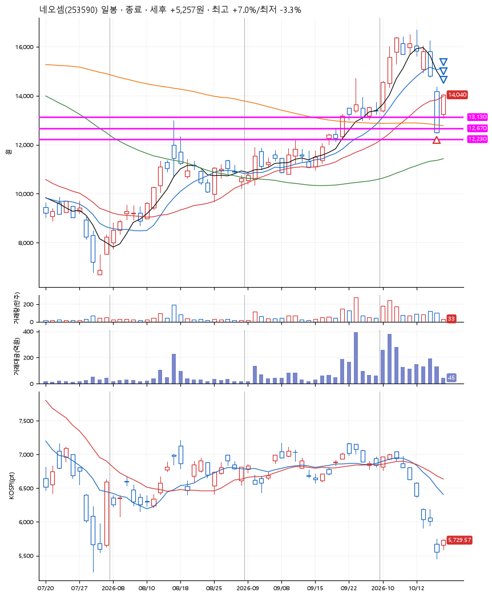
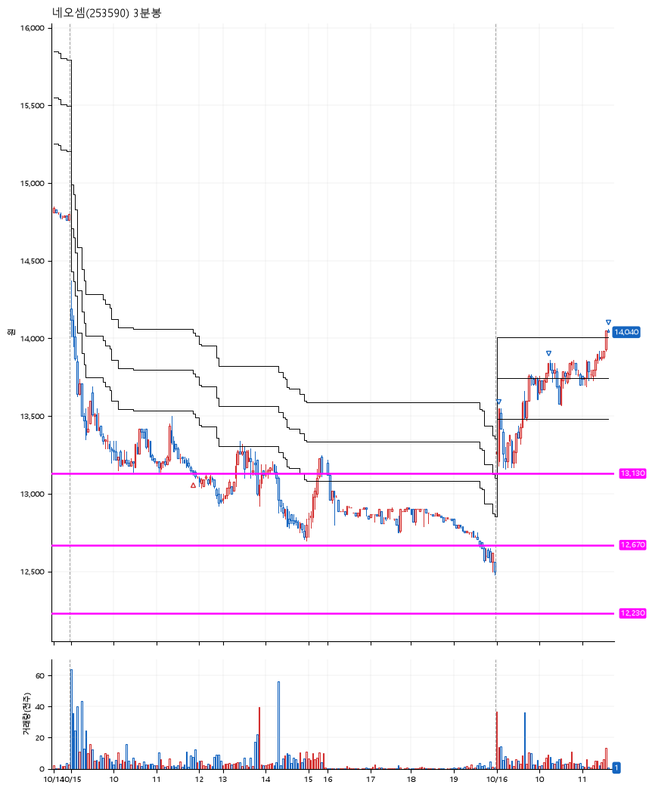

# 네오셈(253590) · 2026-10-16

**1차 매수 → 3% 익절 → 5% 익절 → 7% 익절**

진입 2026-10-15 11:51 (D+8) · 청산 2026-10-16 11:37 (D+9) · 보유 2일차

| | |
|---|---|
| 결과 | 익절 |
| 평단 / 수량 | 13,140원 · 10주 |
| 투입 | 131,400원 |
| 세후 손익 | +5,257원 (+4.00%) |
| 최고 / 최저 | +7.0% / -3.3% |
| 당일 등락 | +12.82% |
| 보유기간 | 2일차 |

## 3선

| | |
|---|---|
| 1선 | 13,130원 |
| 2선 | 12,670원 |
| 3선 | 12,230원 |

기준봉 2026-10-01 (D+9)

`#KOSPI하락횡보장` `#시장을이기는종목`

## 차트

**일봉**

**3분봉**

## 체결

| 시각 | 구분 | 수량 | 판정가 | 체결가 | 오차 |
|---|---|---|---|---|---|
| 11:51 | 매수 | 10주 | 13,130 | 13,140 | +0.08% |
| 09:05 | 매도 | 4주 | 13,540 | 13,520 | -0.15% |
| 10:12 | 매도 | 5주 | 13,800 | 13,770 | -0.22% |
| 11:37 | 매도 | 1주 | 14,060 | 14,040 | -0.14% |

## 잘한 점

_(미작성)_

## 아쉬운 점

_(미작성)_
