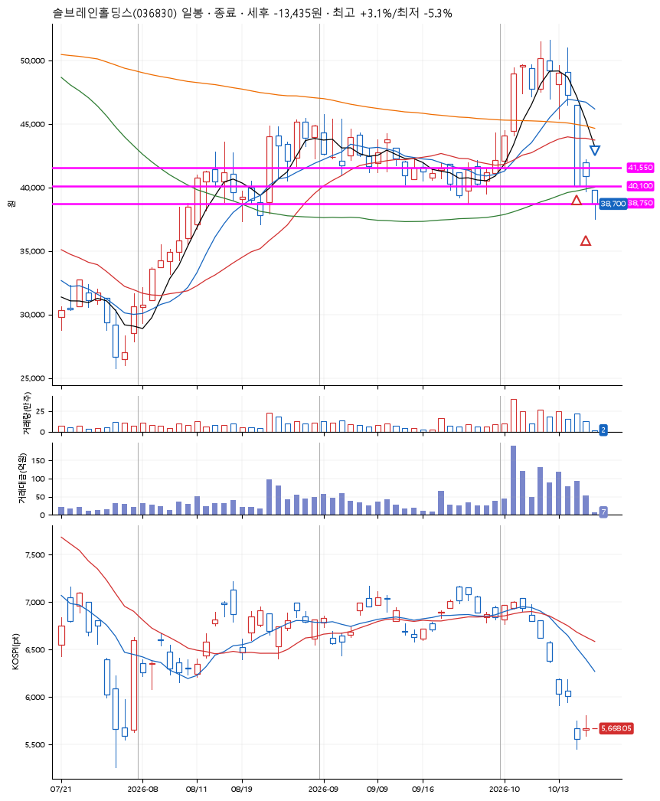
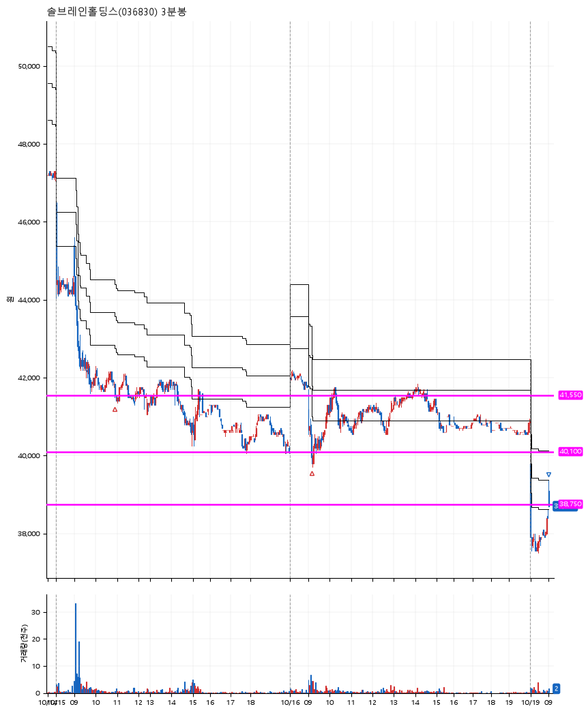

# 솔브레인홀딩스(036830) · 2026-10-19

**2차 매수 → 손절**

진입 2026-10-15 10:56 (D+7) · 청산 2026-10-19 09:00 (D+9) · 보유 3일차

| | |
|---|---|
| 결과 | 손절 |
| 평단 / 수량 | 40,850원 · 6주 |
| 투입 | 245,100원 |
| 세후 손익 | -13,435원 (-5.48%) |
| 최고 / 최저 | +3.1% / -5.3% |
| 당일 등락 | +11.38% |
| 보유기간 | 5일차 |

## 3선

| | |
|---|---|
| 1선 | 41,550원 |
| 2선 | 40,100원 |
| 3선 | 38,750원 |

기준봉 2026-10-02 (D+9)

`#KOSPI하락횡보장` `#시장을이기는종목` `#테마주`

> 2차전지

## 차트

**일봉**

**3분봉**

## 체결

| 시각 | 구분 | 수량 | 판정가 | 체결가 | 오차 |
|---|---|---|---|---|---|
| 10:56 | 매수 | 3주 | 41,550 | 41,550 | +0.00% |
| 09:09 | 매수 | 3주 | 40,100 | 40,150 | +0.12% |
| 09:00 | 매도 | 6주 | 38,750 | 38,700 | -0.13% |

## 잘한 점

_(미작성)_

## 아쉬운 점

_(미작성)_
