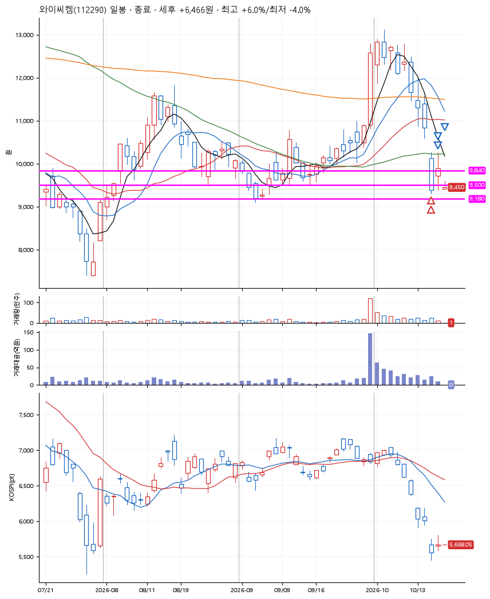
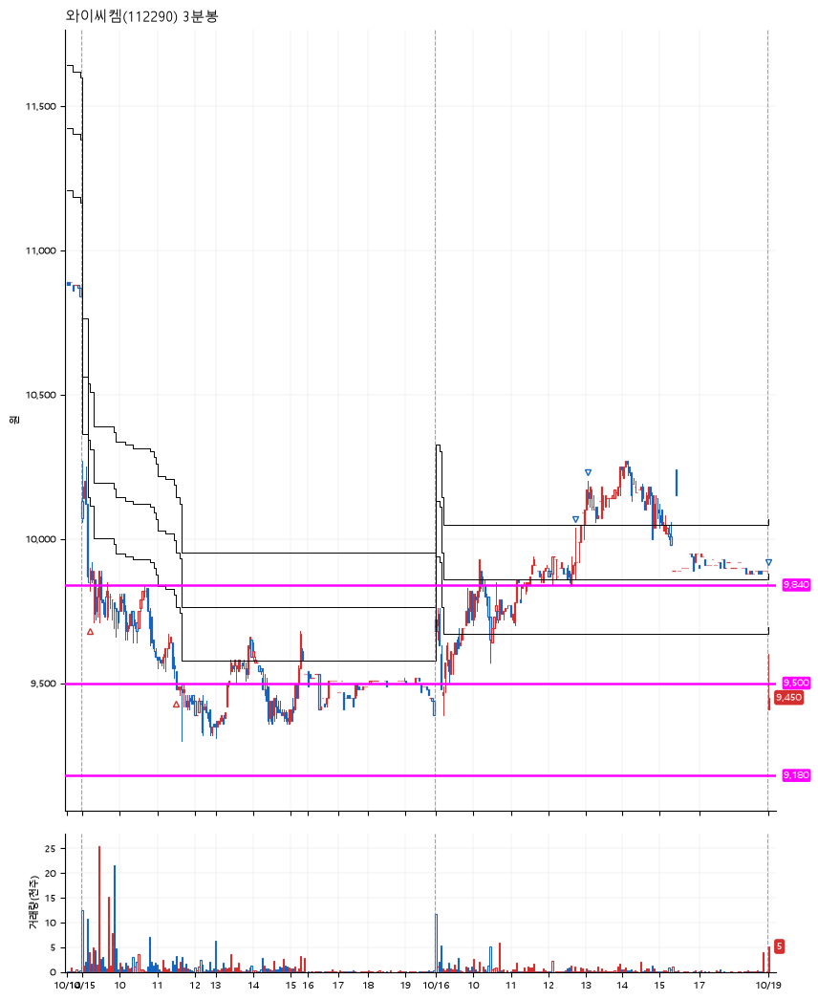

# 와이씨켐(112290) · 2026-10-19

**2차 매수 → 3% 익절 → 5% 익절 → 본절 이탈**

진입 2026-10-15 09:14 (D+9) · 청산 2026-10-19 09:00 (D+11) · 보유 3일차

| | |
|---|---|
| 결과 | 익절 |
| 평단 / 수량 | 9,687원 · 27주 |
| 투입 | 261,560원 |
| 세후 손익 | +6,466원 (+2.47%) |
| 최고 / 최저 | +6.0% / -4.0% |
| 당일 등락 | +6.27% |
| 보유기간 | 5일차 |

## 3선

| | |
|---|---|
| 1선 | 9,840원 |
| 2선 | 9,500원 |
| 3선 | 9,180원 |

기준봉 2026-09-30 (D+11)

`#KOSPI하락횡보장` `#시장을이기는종목` `#테마주`

> 반도체

## 차트

**일봉**

**3분봉**

## 체결

| 시각 | 구분 | 수량 | 판정가 | 체결가 | 오차 |
|---|---|---|---|---|---|
| 09:14 | 매수 | 13주 | 9,840 | 9,900 | +0.61% |
| 11:31 | 매수 | 14주 | 9,500 | 9,490 | -0.11% |
| 12:42 | 매도 | 10주 | 9,980 | 9,860 | -1.20% |
| 13:04 | 매도 | 14주 | 10,190 | 10,120 | -0.69% |
| 09:00 | 매도 | 3주 | 9,410 | 9,453 | +0.46% |

## 잘한 점

_(미작성)_

## 아쉬운 점

_(미작성)_
