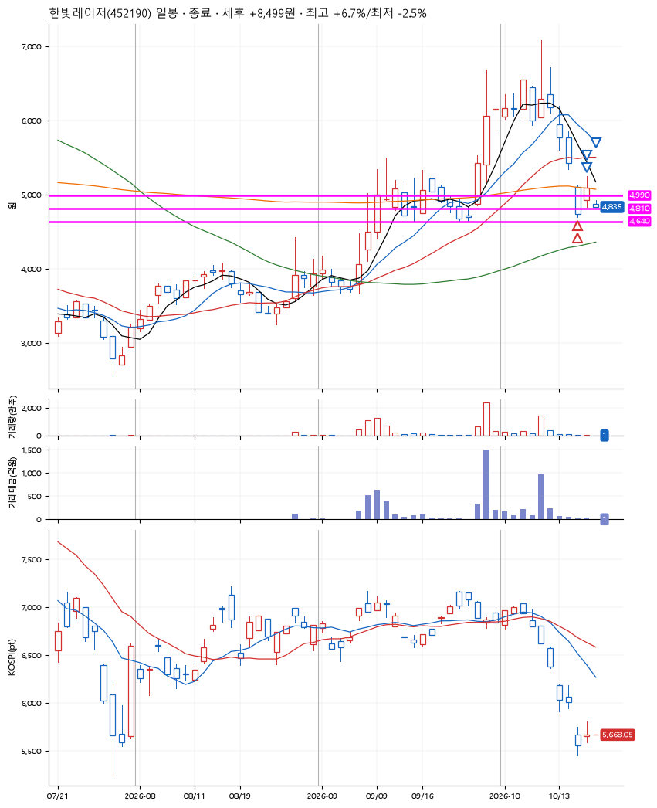
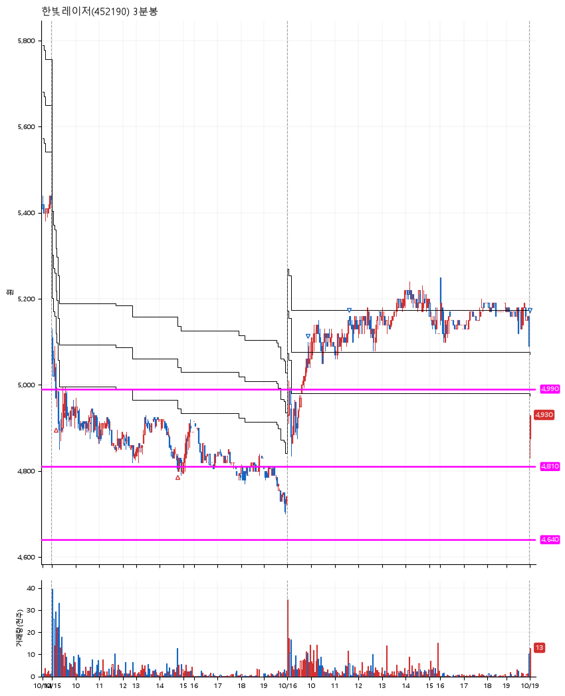

# 한빛레이저(452190) · 2026-10-19

**2차 매수 → 3% 익절 → 5% 익절 → 본절 이탈**

진입 2026-10-15 09:11 (D+10) · 청산 2026-10-19 09:00 (D+12) · 보유 3일차

| | |
|---|---|
| 결과 | 익절 |
| 평단 / 수량 | 4,913원 · 55주 |
| 투입 | 270,212원 |
| 세후 손익 | +8,499원 (+3.15%) |
| 최고 / 최저 | +6.7% / -2.5% |
| 당일 등락 | +6.46% |
| 보유기간 | 5일차 |

## 3선

| | |
|---|---|
| 1선 | 4,990원 |
| 2선 | 4,810원 |
| 3선 | 4,640원 |

기준봉 2026-09-29 (D+12)

`#KOSPI하락횡보장` `#시장을이기는종목` `#테마주`

> 2차전지 유리기판

## 차트

**일봉**

**3분봉**

## 체결

| 시각 | 구분 | 수량 | 판정가 | 체결가 | 오차 |
|---|---|---|---|---|---|
| 09:11 | 매수 | 27주 | 4,990 | 5,000 | +0.20% |
| 14:47 | 매수 | 28주 | 4,810 | 4,829 | +0.40% |
| 09:51 | 매도 | 22주 | 5,070 | 5,060 | -0.20% |
| 11:37 | 매도 | 27주 | 5,160 | 5,140 | -0.39% |
| 09:00 | 매도 | 6주 | 4,875 | 4,875 | +0.00% |

## 잘한 점

_(미작성)_

## 아쉬운 점

_(미작성)_
