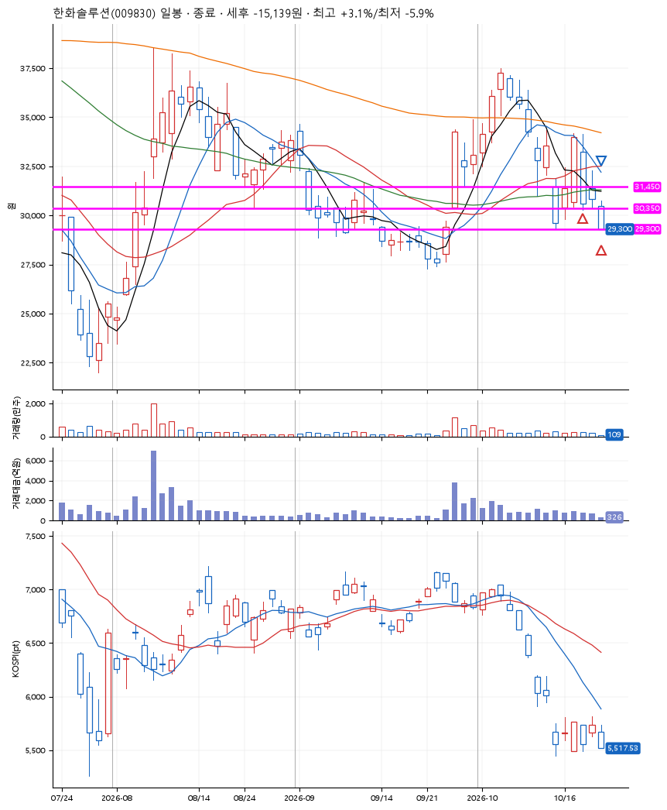
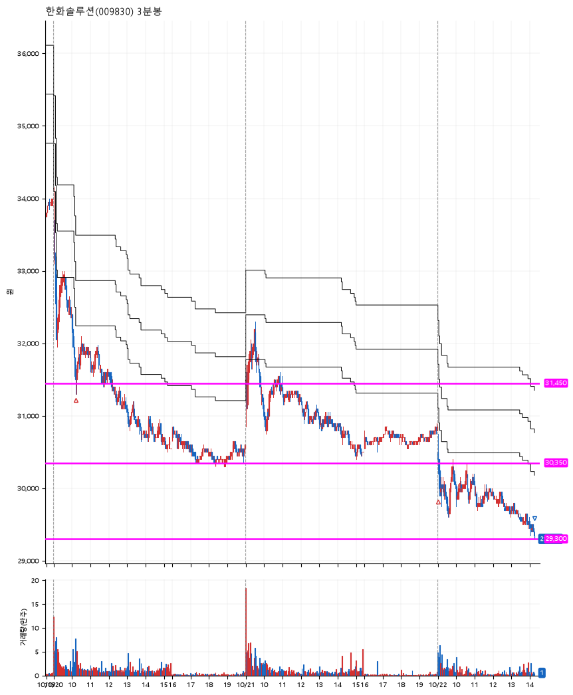

# 한화솔루션(009830) · 2026-10-22

**2차 매수 → 손절**

진입 2026-10-20 10:13 (D+1) · 청산 2026-10-22 14:15 (D+3) · 보유 3일차

| | |
|---|---|
| 결과 | 손절 |
| 평단 / 수량 | 31,125원 · 8주 |
| 투입 | 249,000원 |
| 세후 손익 | -15,139원 (-6.08%) |
| 최고 / 최저 | +3.1% / -5.9% |
| 당일 등락 | -4.59% |
| 보유기간 | 3일차 |

## 3선

| | |
|---|---|
| 1선 | 31,450원 |
| 2선 | 30,350원 |
| 3선 | 29,300원 |

기준봉 2026-10-19 (D+3)

`#KOSPI하락횡보장` `#시장을이기는종목` `#테마주`

> 태양광에너지

## 차트

**일봉**

**3분봉**

## 체결

| 시각 | 구분 | 수량 | 판정가 | 체결가 | 오차 |
|---|---|---|---|---|---|
| 10:13 | 매수 | 4주 | 31,450 | 31,550 | +0.32% |
| 09:00 | 매수 | 4주 | 30,350 | 30,700 | +1.15% |
| 14:15 | 매도 | 8주 | 29,300 | 29,300 | +0.00% |

## 잘한 점

_(미작성)_

## 아쉬운 점

_(미작성)_
