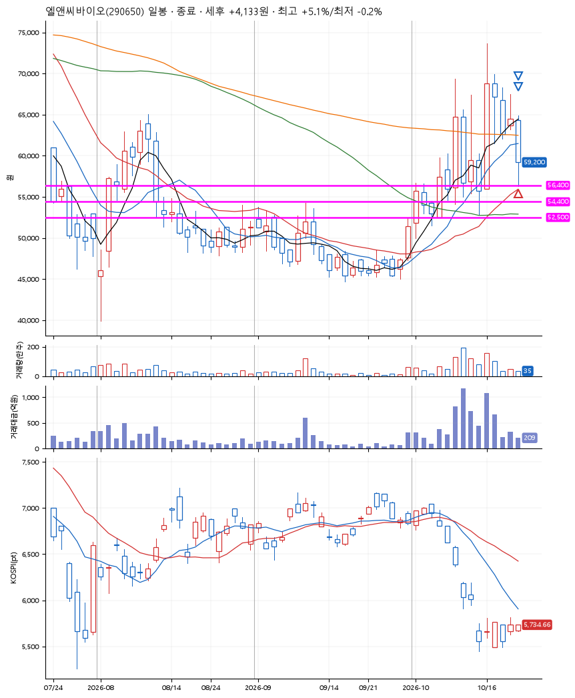
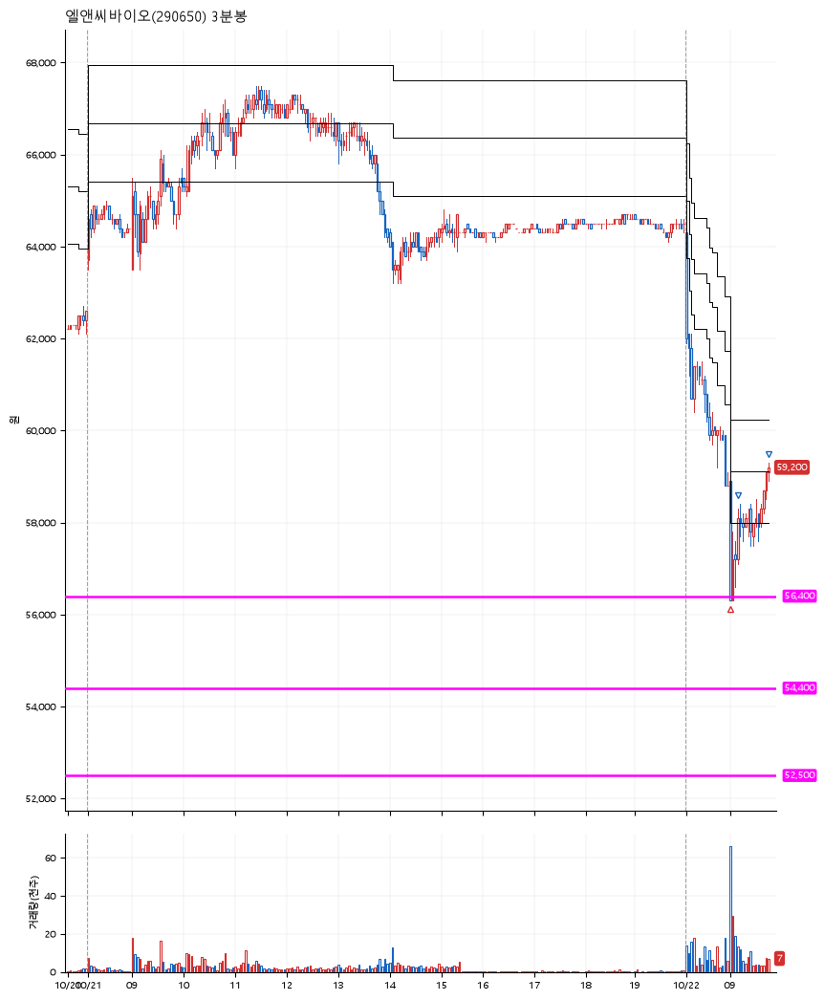

# 엘앤씨바이오(290650) · 2026-10-22

**1차 매수 → 3% 익절 → 5% 익절**

진입 2026-10-22 09:02 (D+4) · 청산 2026-10-22 09:47 (D+4) · 보유 44분

| | |
|---|---|
| 결과 | 익절 |
| 평단 / 수량 | 56,400원 · 2주 |
| 투입 | 112,800원 |
| 세후 손익 | +4,133원 (+3.66%) |
| 최고 / 최저 | +5.1% / -0.2% |
| 당일 등락 | +1.36% |
| 보유기간 | 44분 |

## 3선

| | |
|---|---|
| 1선 | 56,400원 |
| 2선 | 54,400원 |
| 3선 | 52,500원 |

기준봉 2026-10-16 (D+4)

`#KOSPI하락횡보장` `#시장을이기는종목` `#테마주`

> 화장품

## 차트

**일봉**

**3분봉**

## 체결

| 시각 | 구분 | 수량 | 판정가 | 체결가 | 오차 |
|---|---|---|---|---|---|
| 09:02 | 매수 | 2주 | 56,400 | 56,400 | +0.00% |
| 09:11 | 매도 | 1주 | 58,100 | 58,000 | -0.17% |
| 09:47 | 매도 | 1주 | 59,300 | 59,200 | -0.17% |

## 잘한 점

_(미작성)_

## 아쉬운 점

_(미작성)_
