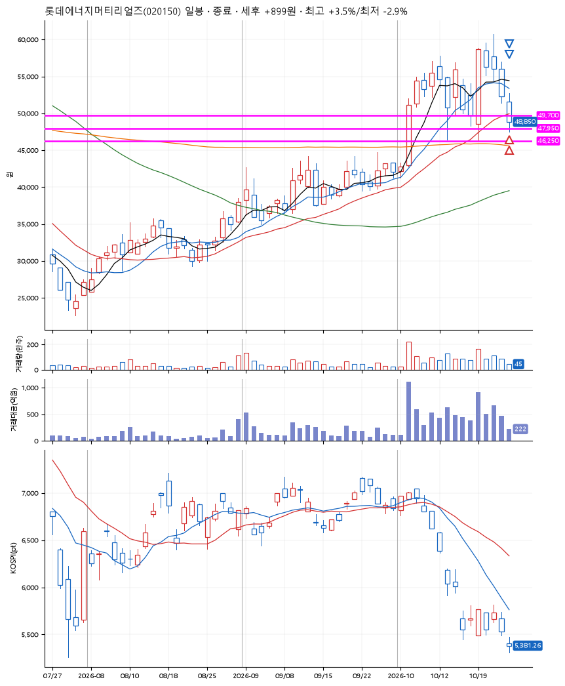
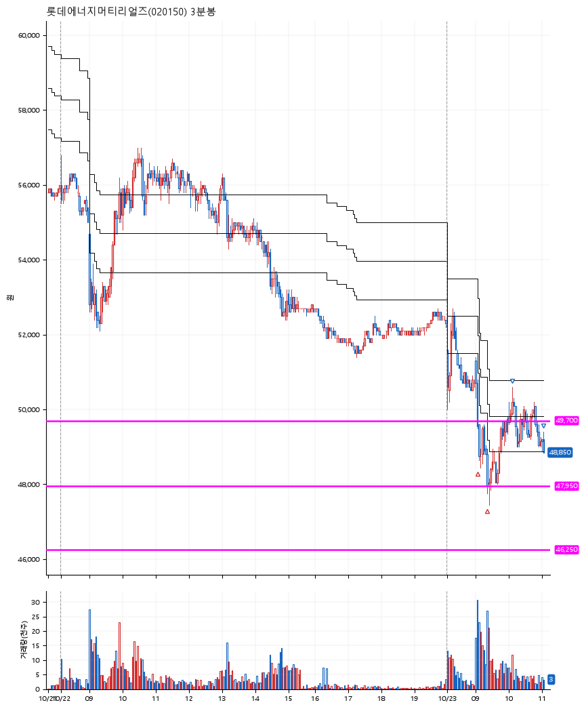

# 롯데에너지머티리얼즈(020150) · 2026-10-23

**2차 매수 → 3% 익절 → 본절 이탈**

진입 2026-10-23 09:05 (D+4) · 청산 2026-10-23 11:05 (D+4) · 보유 2시간 0분

| | |
|---|---|
| 결과 | 익절 |
| 평단 / 수량 | 48,875원 · 4주 |
| 투입 | 195,500원 |
| 세후 손익 | +899원 (+0.46%) |
| 최고 / 최저 | +3.5% / -2.9% |
| 당일 등락 | -5.12% |
| 보유기간 | 2시간 0분 |

## 3선

| | |
|---|---|
| 1선 | 49,700원 |
| 2선 | 47,950원 |
| 3선 | 46,250원 |

기준봉 2026-10-19 (D+4)

`#KOSPI하락횡보장` `#시장을이기는종목` `#테마주`

> 반도체 2차전지

## 차트

**일봉**

**3분봉**

## 체결

| 시각 | 구분 | 수량 | 판정가 | 체결가 | 오차 |
|---|---|---|---|---|---|
| 09:05 | 매수 | 2주 | 49,700 | 49,750 | +0.10% |
| 09:23 | 매수 | 2주 | 47,950 | 48,000 | +0.10% |
| 10:07 | 매도 | 1주 | 50,400 | 50,300 | -0.20% |
| 11:05 | 매도 | 3주 | 48,850 | 48,850 | +0.00% |

## 잘한 점

_(미작성)_

## 아쉬운 점

_(미작성)_
