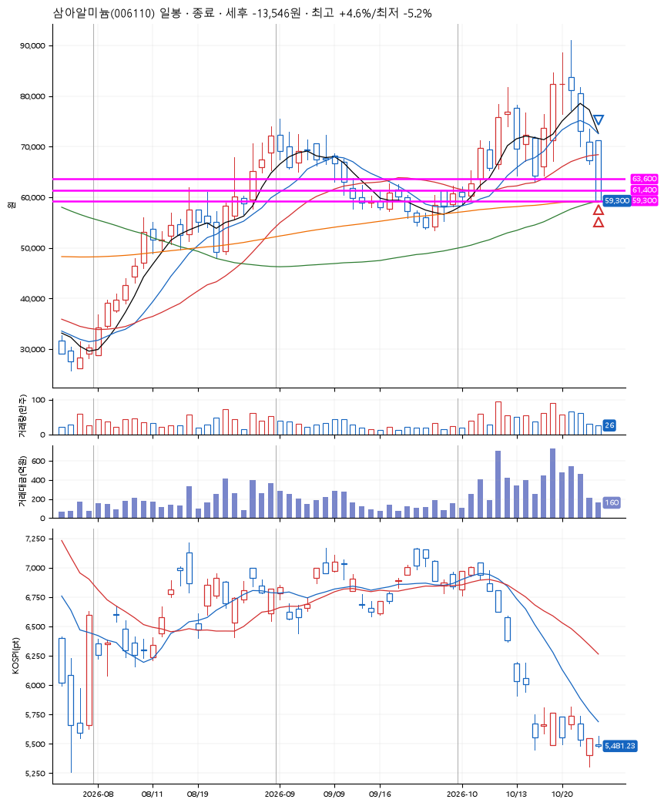
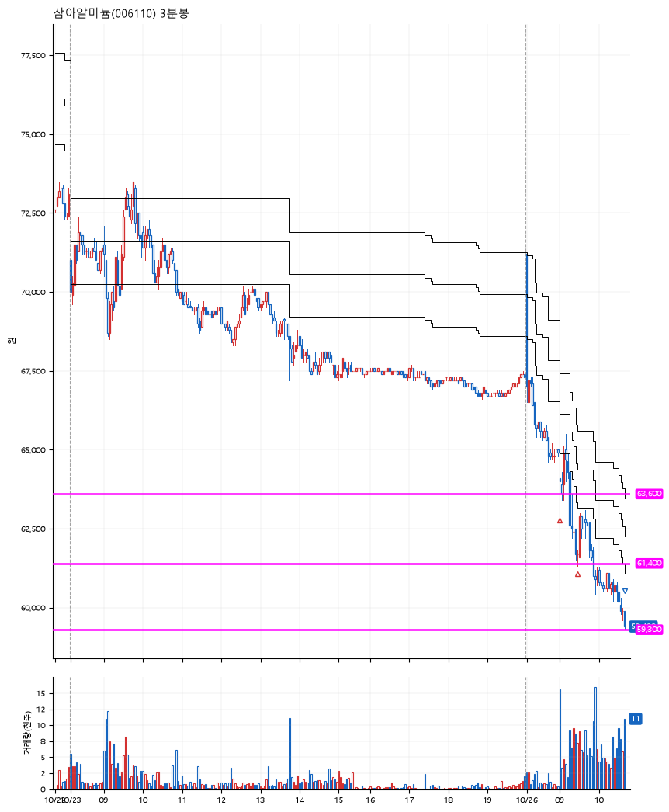

# 삼아알미늄(006110) · 2026-10-26

**2차 매수 → 손절**

진입 2026-10-26 09:01 (D+5) · 청산 2026-10-26 10:41 (D+5) · 보유 1시간 40분

| | |
|---|---|
| 결과 | 손절 |
| 평단 / 수량 | 62,550원 · 4주 |
| 투입 | 250,200원 |
| 세후 손익 | -13,546원 (-5.41%) |
| 최고 / 최저 | +4.6% / -5.2% |
| 당일 등락 | -10.92% |
| 보유기간 | 1시간 40분 |

## 3선

| | |
|---|---|
| 1선 | 63,600원 |
| 2선 | 61,400원 |
| 3선 | 59,300원 |

기준봉 2026-10-19 (D+5)

`#KOSPI하락횡보장` `#시장을이기는종목` `#테마주`

> 2차전지

## 차트

**일봉**

**3분봉**

## 체결

| 시각 | 구분 | 수량 | 판정가 | 체결가 | 오차 |
|---|---|---|---|---|---|
| 09:01 | 매수 | 2주 | 63,600 | 63,600 | +0.00% |
| 09:27 | 매수 | 2주 | 61,400 | 61,500 | +0.16% |
| 10:41 | 매도 | 4주 | 59,300 | 59,300 | +0.00% |

## 잘한 점

_(미작성)_

## 아쉬운 점

_(미작성)_
