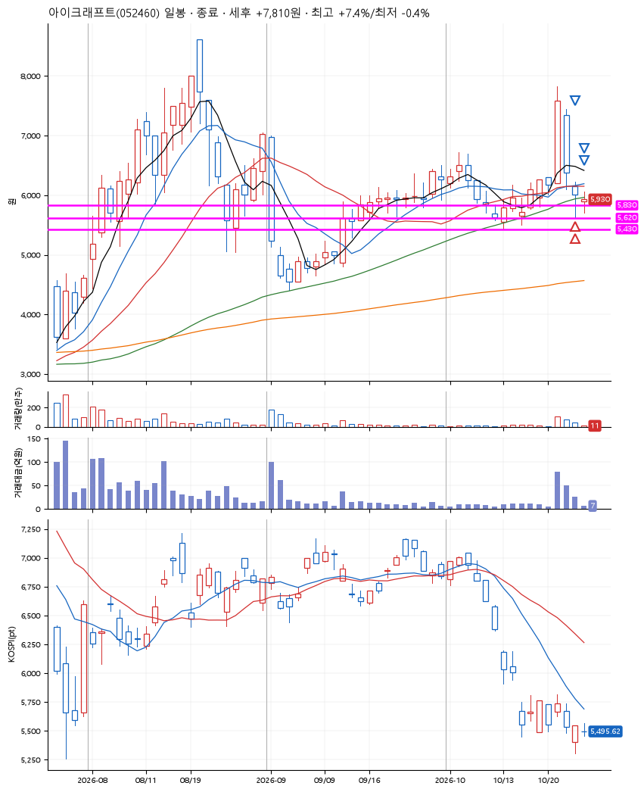
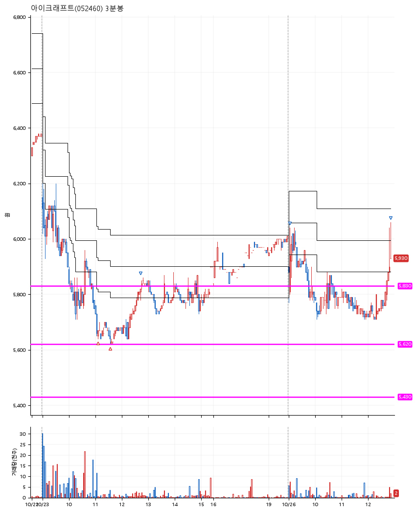

# 아이크래프트(052460) · 2026-10-26

**2차 매수 → 3% 익절 → 5% 익절 → 7% 익절**

진입 2026-10-23 11:06 (D+2) · 청산 2026-10-26 12:54 (D+3) · 보유 2일차

| | |
|---|---|
| 결과 | 익절 |
| 평단 / 수량 | 5,645원 · 48주 |
| 투입 | 270,960원 |
| 세후 손익 | +7,810원 (+2.88%) |
| 최고 / 최저 | +7.4% / -0.4% |
| 당일 등락 | +0.17% |
| 보유기간 | 4일차 |

## 3선

| | |
|---|---|
| 1선 | 5,830원 |
| 2선 | 5,620원 |
| 3선 | 5,430원 |

기준봉 2026-10-21 (D+3)

`#KOSPI하락횡보장` `#시장을이기는종목` `#테마주`

> 5G

## 차트

**일봉**

**3분봉**

## 체결

| 시각 | 구분 | 수량 | 판정가 | 체결가 | 오차 |
|---|---|---|---|---|---|
| 11:06 | 매수 | 24주 | 5,650 | 5,660 | +0.18% |
| 11:34 | 매수 | 24주 | 5,620 | 5,630 | +0.18% |
| 12:43 | 매도 | 19주 | 5,820 | 5,781 | -0.67% |
| 09:03 | 매도 | 24주 | 5,930 | 5,830 | -1.69% |
| 12:54 | 매도 | 5주 | 6,050 | 5,930 | -1.98% |

## 잘한 점

_(미작성)_

## 아쉬운 점

_(미작성)_
