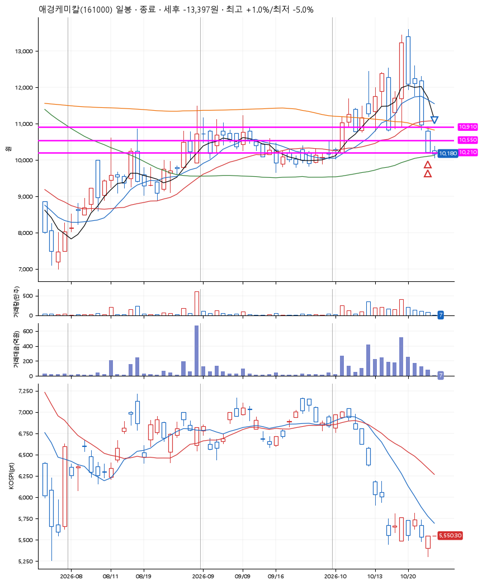
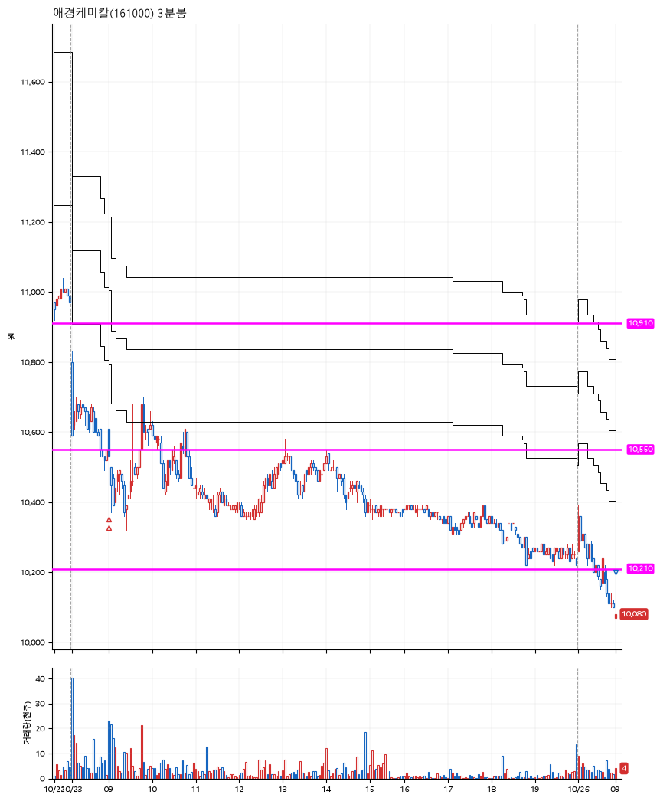

# 애경케미칼(161000) · 2026-10-26

**2차 매수 → 손절**

진입 2026-10-23 09:00 (D+4) · 청산 2026-10-26 09:00 (D+5) · 보유 2일차

| | |
|---|---|
| 결과 | 손절 |
| 평단 / 수량 | 10,595원 · 24주 |
| 투입 | 254,280원 |
| 세후 손익 | -13,397원 (-5.27%) |
| 최고 / 최저 | +1.0% / -5.0% |
| 당일 등락 | -0.60% |
| 보유기간 | 4일차 |

## 3선

| | |
|---|---|
| 1선 | 10,910원 |
| 2선 | 10,550원 |
| 3선 | 10,210원 |

기준봉 2026-10-19 (D+5)

`#KOSPI하락횡보장` `#시장을이기는종목` `#테마주`

> 2차전지

## 차트

**일봉**

**3분봉**

## 체결

| 시각 | 구분 | 수량 | 판정가 | 체결가 | 오차 |
|---|---|---|---|---|---|
| 09:00 | 매수 | 12주 | 10,610 | 10,630 | +0.19% |
| 09:02 | 매수 | 12주 | 10,550 | 10,560 | +0.09% |
| 09:00 | 매도 | 24주 | 10,070 | 10,060 | -0.10% |

## 잘한 점

_(미작성)_

## 아쉬운 점

_(미작성)_
