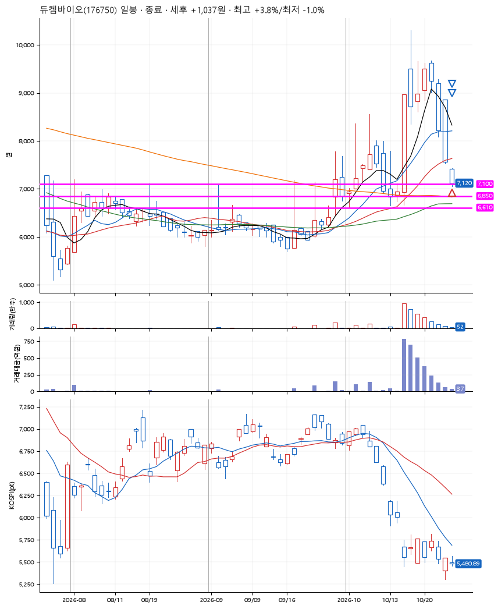
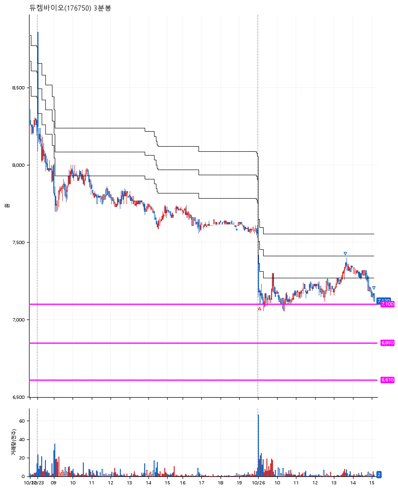

# 듀켐바이오(176750) · 2026-10-26

**1차 매수 → 3% 익절 → 본절 이탈**

진입 2026-10-26 09:03 (D+7) · 청산 2026-10-26 15:08 (D+7) · 보유 6시간 4분

| | |
|---|---|
| 결과 | 익절 |
| 평단 / 수량 | 7,130원 · 19주 |
| 투입 | 135,470원 |
| 세후 손익 | +1,037원 (+0.77%) |
| 최고 / 최저 | +3.8% / -1.0% |
| 당일 등락 | -4.85% |
| 보유기간 | 6시간 4분 |

## 3선

| | |
|---|---|
| 1선 | 7,100원 |
| 2선 | 6,850원 |
| 3선 | 6,610원 |

기준봉 2026-10-15 (D+7)

`#KOSPI하락횡보장` `#시장을이기는종목` `#상한가`

> 치매 진단제

## 차트

**일봉**

**3분봉**

## 체결

| 시각 | 구분 | 수량 | 판정가 | 체결가 | 오차 |
|---|---|---|---|---|---|
| 09:03 | 매수 | 19주 | 7,100 | 7,130 | +0.42% |
| 13:38 | 매도 | 7주 | 7,350 | 7,340 | -0.14% |
| 15:08 | 매도 | 12주 | 7,130 | 7,120 | -0.14% |

## 잘한 점

_(미작성)_

## 아쉬운 점

_(미작성)_
