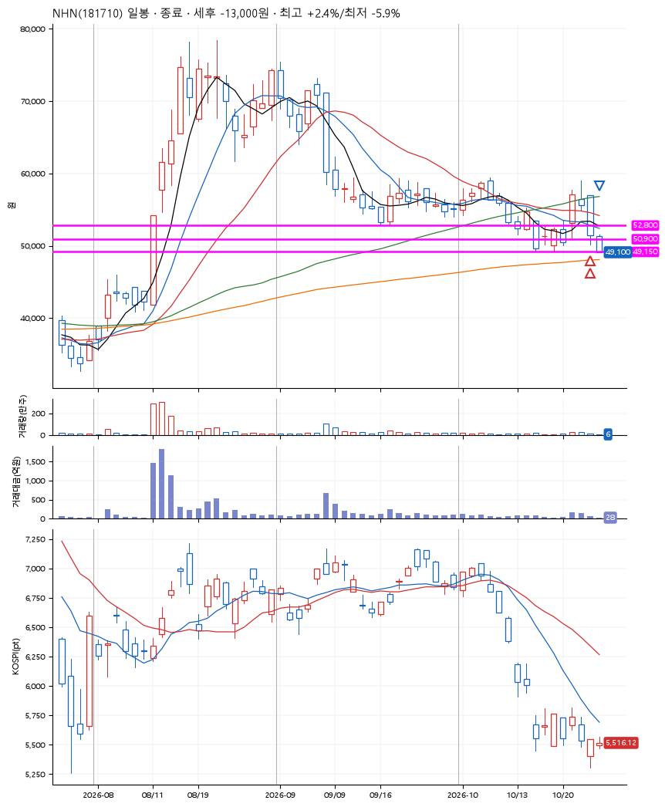
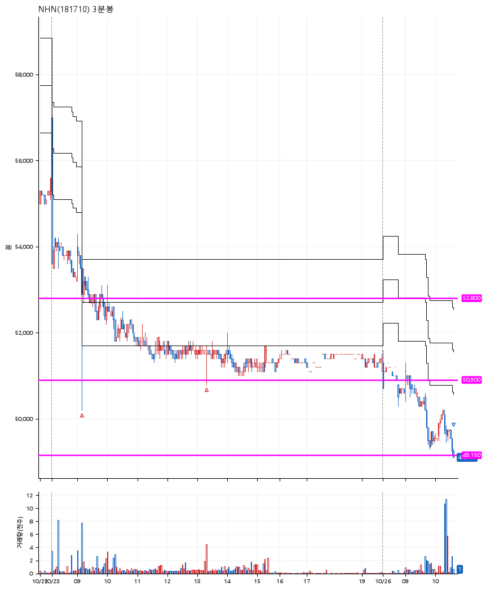

# NHN(181710) · 2026-10-26

**2차 매수 → 손절**

진입 2026-10-23 09:10 (D+2) · 청산 2026-10-26 10:36 (D+3) · 보유 2일차

| | |
|---|---|
| 결과 | 손절 |
| 평단 / 수량 | 52,250원 · 4주 |
| 투입 | 209,000원 |
| 세후 손익 | -13,000원 (-6.22%) |
| 최고 / 최저 | +2.4% / -5.9% |
| 당일 등락 | -3.91% |
| 보유기간 | 4일차 |

## 3선

| | |
|---|---|
| 1선 | 52,800원 |
| 2선 | 50,900원 |
| 3선 | 49,150원 |

기준봉 2026-10-21 (D+3)

`#KOSPI하락횡보장` `#시장을이기는종목` `#테마주`

> 실적호조

## 차트

**일봉**

**3분봉**

## 체결

| 시각 | 구분 | 수량 | 판정가 | 체결가 | 오차 |
|---|---|---|---|---|---|
| 09:10 | 매수 | 2주 | 52,800 | 53,200 | +0.76% |
| 13:19 | 매수 | 2주 | 50,900 | 51,300 | +0.79% |
| 10:36 | 매도 | 4주 | 49,150 | 49,113 | -0.08% |

## 잘한 점

_(미작성)_

## 아쉬운 점

_(미작성)_
