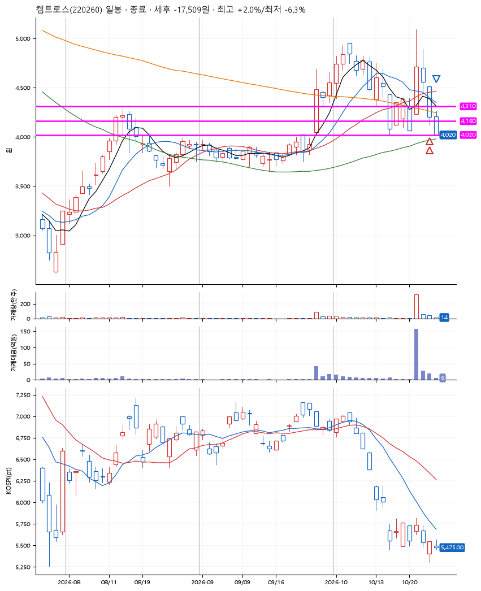
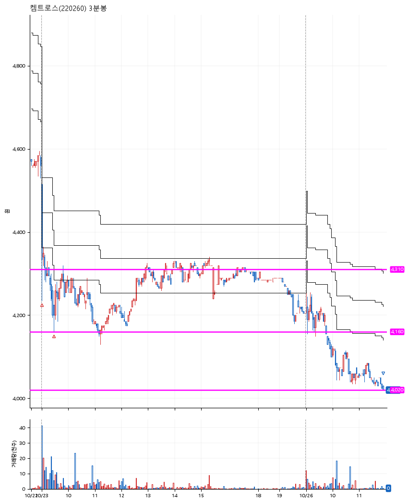

# 켐트로스(220260) · 2026-10-26

**2차 매수 → 손절**

진입 2026-10-23 09:02 (D+2) · 청산 2026-10-26 11:55 (D+3) · 보유 2일차

| | |
|---|---|
| 결과 | 손절 |
| 평단 / 수량 | 4,289원 · 63주 |
| 투입 | 270,185원 |
| 세후 손익 | -17,509원 (-6.48%) |
| 최고 / 최저 | +2.0% / -6.3% |
| 당일 등락 | -4.87% |
| 보유기간 | 4일차 |

## 3선

| | |
|---|---|
| 1선 | 4,310원 |
| 2선 | 4,160원 |
| 3선 | 4,020원 |

기준봉 2026-10-21 (D+3)

`#KOSPI하락횡보장` `#시장을이기는종목` `#테마주`

> 반도체

## 차트

**일봉**

**3분봉**

## 체결

| 시각 | 구분 | 수량 | 판정가 | 체결가 | 오차 |
|---|---|---|---|---|---|
| 09:02 | 매수 | 31주 | 4,310 | 4,375 | +1.51% |
| 09:28 | 매수 | 32주 | 4,160 | 4,205 | +1.08% |
| 11:55 | 매도 | 63주 | 4,020 | 4,020 | +0.00% |

## 잘한 점

_(미작성)_

## 아쉬운 점

_(미작성)_
