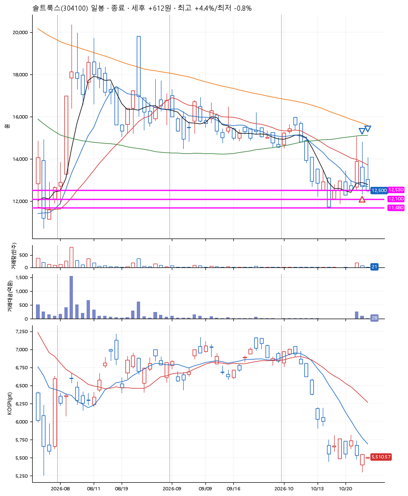
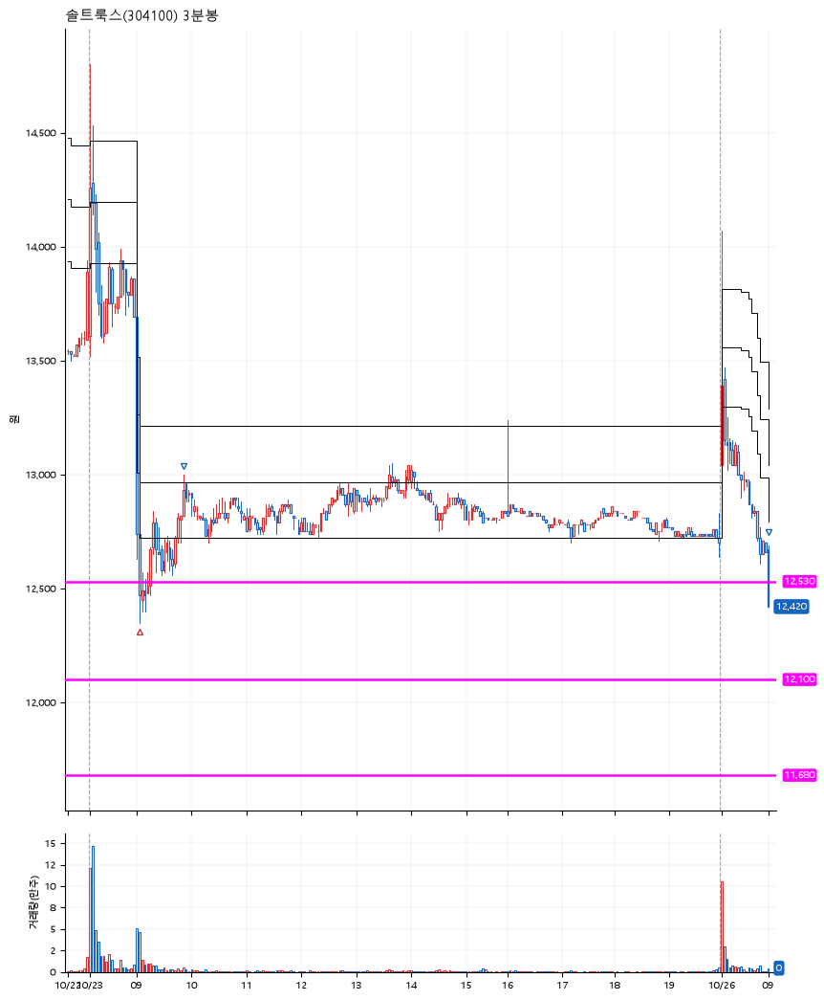

# 솔트룩스(304100) · 2026-10-26

**1차 매수 → 3% 익절 → 본절 이탈**

진입 2026-10-23 09:05 (D+1) · 청산 2026-10-26 09:00 (D+2) · 보유 2일차

| | |
|---|---|
| 결과 | 익절 |
| 평단 / 수량 | 12,500원 · 10주 |
| 투입 | 125,000원 |
| 세후 손익 | +612원 (+0.49%) |
| 최고 / 최저 | +4.4% / -0.8% |
| 당일 등락 | -2.05% |
| 보유기간 | 4일차 |

## 3선

| | |
|---|---|
| 1선 | 12,530원 |
| 2선 | 12,100원 |
| 3선 | 11,680원 |

기준봉 2026-10-22 (D+2)

`#KOSPI하락횡보장` `#시장을이기는종목`

## 차트

**일봉**

**3분봉**

## 체결

| 시각 | 구분 | 수량 | 판정가 | 체결가 | 오차 |
|---|---|---|---|---|---|
| 09:05 | 매수 | 10주 | 12,530 | 12,500 | -0.24% |
| 09:52 | 매도 | 4주 | 12,880 | 12,830 | -0.39% |
| 09:00 | 매도 | 6주 | 12,500 | 12,430 | -0.56% |

## 잘한 점

_(미작성)_

## 아쉬운 점

_(미작성)_
